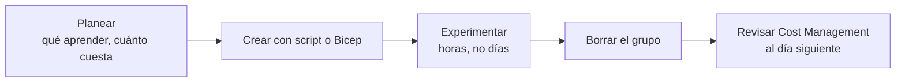

# Probar servicios de pago con el crédito de la cuenta gratuita

Parte de: [[07-Azure/02 Dónde probar Azure sin pagar/_Índice Dónde probar Azure sin pagar|Dónde probar Azure sin pagar]]

> [!info] Cómo avanzar
> `progreso`: **pendiente** → **viendo** (estudiando) → **visto** (contestaste la autoevaluación sin abrir las respuestas) → **dominado** (hiciste el laboratorio o lo aplicaste de verdad).

## Contenido

### Qué es
El crédito de la cuenta gratuita (USD 200 por 30 días, verificado en la página oficial en noviembre de 2026) es tu oportunidad de usar **servicios que normalmente cuestan** y que no tienen cuota gratuita: clústeres de AKS con varios nodos, Application Gateway con WAF, Front Door Premium, Azure SQL de niveles altos, VMs grandes o con GPU, Service Bus Premium, API Management Developer. Mientras tengas crédito y límite de gasto, el peor caso es quedarte sin crédito, no recibir una factura.

### Cómo funciona
Todo consumo fuera de las cuotas gratuitas se **descuenta del crédito**. Con la protección del límite de gasto, al agotarse se deshabilita la suscripción. Por eso la estrategia es **gastarlo con intención**: experimentos cortos, planificados y borrados al terminar.



**Cómo planear una prueba para no agotarlo**
1. **Objetivo concreto**: "configurar Application Gateway con WAF delante de App Service y ver los logs de bloqueos", no "jugar con redes".
2. **Estimar** en la [calculadora de precios](https://azure.microsoft.com/pricing/calculator/) el costo por **hora** de cada recurso y multiplicar por las horas que planeas tenerlo.
3. **Todo en un grupo de recursos** propio, con etiqueta `expira`.
4. **Infraestructura en script o [[Bicep]]**: así puedes borrar cada noche y recrear en minutos al día siguiente; recrear es casi gratis, dejar encendido no.
5. **Presupuesto con alerta** al 25%, 50% y 75% del crédito (ver [[Cómo evitar cobros inesperados en la nube (presupuestos y alertas)]]).
6. **Tamaños mínimos**: el nodo más pequeño, una sola instancia, la región más barata que tenga el servicio.

### Ejemplo
Prueba de una tarde con AKS:
```bash
RG=rg-lab-aks
az group create -n $RG -l eastus --tags ambiente=lab expira=2026-11-10
az aks create -g $RG -n aks-lab --tier free --node-count 1 \
  --node-vm-size Standard_B2s --generate-ssh-keys
az aks get-credentials -g $RG -n aks-lab
kubectl create deployment hola --image=mcr.microsoft.com/dotnet/samples:aspnetapp
kubectl expose deployment hola --type=LoadBalancer --port=80 --target-port=8080
kubectl get svc hola --watch     # espera la IP pública y prueba en el navegador
#- Al terminar (el mismo día):
az group delete -n $RG --yes --no-wait
```
El tier Free de AKS no cobra la administración del clúster, pero el nodo, su disco, el balanceador y la IP pública sí consumen crédito. Además AKS crea un grupo `MC_...` con esos recursos; al borrar el grupo del clúster se borra también.

**Ideas que valen el crédito** para tu camino a senior y AZ-305: AKS básico, Application Gateway + WAF, Front Door, Private Endpoints con DNS privado, Azure SQL con replicación geográfica, Service Bus con sesiones, API Management.

### Cuándo usarlo y cuándo no
Úsalo para lo que **no puedes** probar con cuotas gratuitas. No lo gastes en lo que ya es gratis (App Service F1, Functions de consumo, Static Web Apps). Tampoco lo uses para "tener algo encendido" un mes: eso consume el crédito sin aprender más.

### Errores comunes
1. **Dejar corriendo un servicio caro "para seguir mañana"**: un clúster, un gateway o una VM grande cobran cada hora aunque nadie los use; una noche puede costar lo mismo que la tarde de práctica. Borra y recrea con el script.
2. **No estimar** y descubrir que un servicio cuesta mucho por hora (algunos gateways y SKUs Premium).
3. **Experimentos sin grupo propio**: luego no sabes qué borrar.
4. **Ignorar recursos creados indirectamente** (grupos `MC_`, discos, IPs, Log Analytics).
5. **Esperar al día 29** para usar el crédito: se pierde lo no usado.

### Para profundizar
- [Preguntas frecuentes de la cuenta gratuita](https://azure.microsoft.com/free/free-account-faq/)
- [Calculadora de precios de Azure](https://azure.microsoft.com/pricing/calculator/)
- [Evitar cargos con la cuenta gratuita](https://learn.microsoft.com/es-mx/azure/cost-management-billing/manage/avoid-charges-free-account)

## Autoevaluación

Contesta primero en voz alta o en papel; luego despliega la respuesta.

> [!question]- ¿Para qué conviene usar el crédito inicial?
> Para probar servicios que **no** tienen nivel gratuito (Application Gateway, Front Door, AKS con nodos, SQL de mayor tamaño) durante poco tiempo, como un laboratorio concreto.

> [!question]- ¿Cómo planeas una prueba con crédito para no agotarlo?
> Estima en la calculadora de precios, crea todo en **un grupo de recursos** del lab, pon un presupuesto con alertas, y borra el grupo al terminar el mismo día.

> [!question]- Error común: dejar corriendo un servicio caro «para seguir mañana».
> Un servicio cobrado por hora (gateways, nodos, VMs) consume crédito toda la noche. Mejor guarda la definición en Bicep y vuelve a crearlo.

