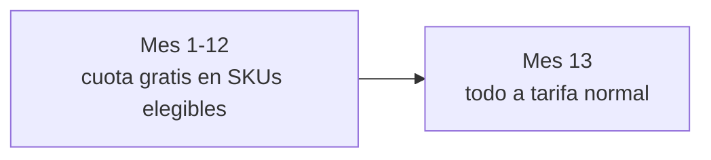

# Servicios de Azure gratuitos durante 12 meses

Parte de: [[07-Azure/02 Dónde probar Azure sin pagar/_Índice Dónde probar Azure sin pagar|Dónde probar Azure sin pagar]]

> [!info] Cómo avanzar
> `progreso`: **pendiente** → **viendo** (estudiando) → **visto** (contestaste la autoevaluación sin abrir las respuestas) → **dominado** (hiciste el laboratorio o lo aplicaste de verdad).

## Contenido

### Qué es
Son cantidades mensuales gratuitas de **más de 20 servicios populares** durante los **primeros 12 meses**, solo para **clientes nuevos**. Vienen con la cuenta gratuita y se conservan si actualizas a pago por uso dentro de ese año. Datos verificados en las páginas oficiales de Azure y Microsoft Learn en noviembre de 2026; las ofertas cambian, revísalas antes de crear algo.

### Cómo funciona
- Cada servicio tiene una cuota **mensual** atada a **SKUs o tamaños específicos**.
- La cuota cuenta desde que creaste la cuenta, no desde que creaste el recurso.
- Se requiere tener la suscripción **activa**: si no actualizas a pago por uso al terminar los 30 días del crédito, la suscripción se deshabilita y no puedes usar estos servicios (ver [[Cuenta gratuita de Azure (crédito de 30 días, servicios gratuitos y límite de gasto)]]). Microsoft Learn confirma que tras actualizar sigues teniendo los servicios gratuitos durante los 12 meses y solo pagas lo que exceda.

**Ejemplos de la página oficial (noviembre 2026)**

| Servicio | Cuota mensual por 12 meses |
|---|---|
| Máquinas virtuales Linux o Windows | 750 horas **de cada uno** de los tamaños B1s, B2pts v2 (Arm) y B2ats v2 (AMD) |
| Container Registry | 1 registro Standard, 100 GB, 10 webhooks |
| Azure Database for PostgreSQL | 750 horas de Flexible Server B1MS, 32 GB de almacenamiento y 32 GB de respaldo |
| Azure Database for MySQL | 750 horas de Flexible Server B1MS, 32 GB y 32 GB de respaldo |
| Azure SQL Managed Instance | 720 vCore-horas de General Purpose de 4 u 8 vCores, 64 GB de datos y 64 GB de respaldo |

La página resumida no detalla en esta revisión cuotas de discos administrados ni Blob Storage; consulta la lista completa ("See all free services") antes de contar con ellas (Pendiente de confirmar).

Un mes tiene como máximo 744 horas, así que **750 horas alcanzan para una VM del tamaño elegible encendida todo el mes**, no para dos del mismo tamaño.



### Ejemplo
Quieres un servidor Linux para practicar ([[Máquinas virtuales]]):
```bash
az vm create -g rg-lab -n vm-lab --image Ubuntu2404 --size Standard_B1s \
  --admin-username azureuser --generate-ssh-keys --public-ip-sku Standard
```
- `Standard_B1s` entra en la cuota; `Standard_B2s` **no**, aunque se parezca.
- El disco del sistema operativo y la IP pública se facturan por separado según sus propias reglas; revisa en Cost Management qué aparece tras el primer día.
- PostgreSQL para Pochteca.Nomisma: Flexible Server **B1MS** entra en la cuota; otro tamaño o más almacenamiento del indicado, no.

### Qué pasa al mes 13
La cuota termina y **todo se cobra a tarifa normal**: la VM B1s, el PostgreSQL B1MS y el registro Standard empiezan a cobrar por hora o por día. Microsoft avisa por correo, pero si no actúas, el cargo llega a tu tarjeta. Antes de cumplir el año decide: borrar, migrar a un servicio siempre gratuito (por ejemplo, de PostgreSQL B1MS a Azure SQL con oferta gratuita, o de VM a Container Apps) o asumir el costo.

### Cuándo usarlo y cuándo no
Úsalo para aprender servicios IaaS y bases administradas durante tu primer año. No construyas algo que deba vivir indefinidamente sobre estas cuotas (ver [[Crédito promocional vs proyectos con costo cero permanente]]).

### Errores comunes
1. **Tamaño "parecido" pero no elegible**: se cobra completo desde la primera hora.
2. **Dos VMs B1s todo el mes**: 1,488 horas contra 750 gratis.
3. **Olvidar recursos asociados** (discos, IPs, snapshots, egress).
4. **No marcar en el calendario el mes 12**.
5. **Región no disponible** para el tamaño gratuito: revisa disponibilidad antes.

### Para profundizar
- [Servicios gratuitos de Azure](https://azure.microsoft.com/pricing/free-services/)
- [Evitar cargos con la cuenta gratuita](https://learn.microsoft.com/es-mx/azure/cost-management-billing/manage/avoid-charges-free-account)
- [Supervisar el uso de servicios gratuitos](https://learn.microsoft.com/es-mx/azure/cost-management-billing/manage/check-free-service-usage)

## Autoevaluación

Contesta primero en voz alta o en papel; luego despliega la respuesta.

> [!question]- ¿Qué son los servicios gratuitos de 12 meses?
> Cantidades limitadas de servicios populares (VMs pequeñas, almacenamiento, bases de datos) sin costo durante los primeros 12 meses de la cuenta, **una vez que la actualizas** a pago por uso (verificar en la página oficial).

> [!question]- Creaste una VM «gratis de 12 meses» pero de otro tamaño. ¿Se cobra?
> Sí. La gratuidad aplica solo a los tamaños/SKU y cantidades indicados; cualquier otro se cobra (o consume crédito).

> [!question]- ¿Qué pasa al mes 13?
> Los recursos siguen corriendo y empiezan a cobrar a precio normal. Hay que borrarlos o bajar de nivel antes.

