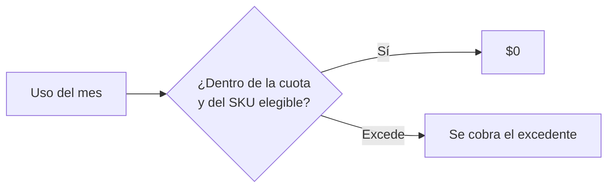

# Servicios de Azure siempre gratuitos

Parte de: [[07-Azure/02 Dónde probar Azure sin pagar/_Índice Dónde probar Azure sin pagar|Dónde probar Azure sin pagar]]

> [!info] Cómo avanzar
> `progreso`: **pendiente** → **viendo** (estudiando) → **visto** (contestaste la autoevaluación sin abrir las respuestas) → **dominado** (hiciste el laboratorio o lo aplicaste de verdad).

## Contenido

### Qué es
Los servicios **siempre gratuitos** (*always free*) son cantidades mensuales de ciertos servicios que no cuestan nada **sin fecha de vencimiento**, mientras estén dentro de la cuota. Según la página oficial son **más de 65 servicios**, y las cuotas aplican tanto a la cuenta gratuita como a suscripciones de pago por uso. Datos verificados en las páginas oficiales de Azure y Microsoft Learn en noviembre de 2026; las ofertas cambian, revísalas antes de crear algo.

"Siempre gratuito" **no** significa "ilimitado": significa que **cada mes** tienes una cuota que no se cobra; lo que la exceda se cobra a tarifa normal (o se descuenta del crédito si lo tienes).

### Cómo funciona
- La cuota se mide **por mes** y casi siempre **por suscripción** (no por recurso), salvo que la oferta diga otra cosa.
- Aplica solo a un **SKU, plan o modalidad concretos**: por ejemplo, el plan de consumo de Functions o el tier Free de App Service.
- Se reinicia al inicio de cada periodo; no se acumula lo no usado.

**Ejemplos de la página oficial (noviembre 2026)**

| Servicio | Cuota mensual gratuita |
|---|---|
| Azure Functions | 1 millón de solicitudes |
| App Service | Hasta 10 apps web o API, 1 GB de almacenamiento, 1 hora de cómputo al día (tier Free) |
| Static Web Apps | 100 GB de ancho de banda por suscripción, 2 dominios propios, 0.5 GB por app |
| Container Apps | 180,000 vCPU-segundos, 360,000 GiB-segundos y 2 millones de solicitudes |
| Azure SQL Database | 100,000 vCore-segundos de uso serverless y 32 GB de almacenamiento |
| Cosmos DB | 1,000 RU/s aprovisionadas y 25 GB |
| Azure DevOps | 5 usuarios con repositorios Git privados ilimitados |
| AKS | Administración del clúster gratis; los nodos se cobran |
| API Management | 1 millón de llamadas (tier Consumption) |
| Logic Apps | 4,000 acciones integradas (plan Consumption) |
| AI Search | 50 MB, 10,000 documentos, 3 índices |
| Cost Management, Advisor, Resource Manager | Gratis |

Patrón común: los servicios con cuota siempre gratuita suelen ser **serverless o de consumo** (pagas por ejecución o segundo de uso), **niveles de entrada** de servicios de aplicación, o **herramientas de gestión** de la plataforma.

### Ejemplo
Arquitectura de [[Itzamna.Dionisio]] + front que puede quedar en cuota gratuita para un portafolio con poco tráfico:
- Front React en [[Azure Static Web Apps]] (tier Free).
- API en App Service F1 (o en Container Apps con mínimo de réplicas en 0).
- Base en [[Azure SQL Database]] con la oferta gratuita serverless (autopausa al agotar la cuota mensual).
- Pipeline en Azure DevOps (5 usuarios gratis).

Verificación: a fin de mes revisa *Cost Management > Análisis de costos* agrupado por recurso y busca cualquier línea con costo > 0.

### Cuándo usarlo y cuándo no
Ideal para proyectos personales, demos, portafolio y aprendizaje continuo. No lo uses para producción con usuarios reales: los tiers gratuitos tienen límites de CPU, sin SLA o con SLA menor, y la cuota puede cambiar.

### Errores comunes
1. **Leer "siempre gratis" como ilimitado**: el excedente se cobra. Un bucle que llama a una Function millones de veces sale de la cuota.
2. **SKU equivocado**: Functions en plan Premium o App Service en B1 **no** están en la cuota gratuita.
3. **Recursos asociados que sí cobran**: la cuenta de almacenamiento de Functions, el Log Analytics que crea Container Apps, IPs públicas, tráfico de salida.
4. **Varias instancias del mismo servicio** creyendo que cada una tiene su cuota: muchas cuotas son por suscripción.
5. **No revisar cambios**: Microsoft ajusta servicios y cantidades.

### Para profundizar
- [Servicios gratuitos de Azure](https://azure.microsoft.com/pricing/free-services/)
- [Nivel gratuito de Azure SQL Database](https://learn.microsoft.com/es-mx/azure/azure-sql/database/free-tier)
- [Evitar cargos con la cuenta gratuita](https://learn.microsoft.com/es-mx/azure/cost-management-billing/manage/avoid-charges-free-account)

## Autoevaluación

Contesta primero en voz alta o en papel; luego despliega la respuesta.

> [!question]- ¿Qué significa que un servicio sea «siempre gratuito»?
> Que tiene una **cantidad mensual** gratuita (ejecuciones, GB, usuarios…) disponible incluso en pago por uso. Pasando esa cantidad, se cobra normal. La lista y los montos cambian (verificar en la página oficial).

> [!question]- Da ejemplos del tipo de servicio que suele tener cuota siempre gratis.
> Ejecuciones de Azure Functions en plan de consumo, Static Web Apps en plan Free, App Service F1, cierta cantidad de Cosmos DB con *free tier*, Azure DevOps para equipos pequeños (verificar en la página oficial).

> [!question]- Error común con la cuota siempre gratuita.
> Suponer que cubre servicios auxiliares (logs, almacenamiento, egreso) o varias instancias: la cuota suele ser **por cuenta o por mes**, no por recurso.

