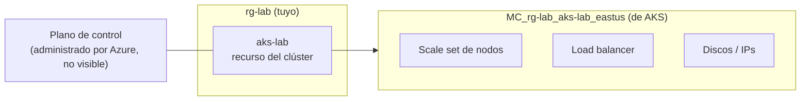

# AKS (conceptos)

Parte de: [[07-Azure/03 Cómputo/_Índice Cómputo|Cómputo]]

> [!info] Cómo avanzar
> `progreso`: **pendiente** → **viendo** (estudiando) → **visto** (contestaste la autoevaluación sin abrir las respuestas) → **dominado** (hiciste el laboratorio o lo aplicaste de verdad).

## Contenido

### Qué es
**Azure Kubernetes Service (AKS)** es el servicio de **Kubernetes administrado** de Azure. Kubernetes orquesta contenedores: decide en qué nodo corre cada *pod*, los reinicia si fallan, los escala, los expone con servicios y actualiza versiones de forma progresiva (ver [[Kubernetes - conceptos básicos]]). AKS te da un clúster listo sin instalar ni operar el **plano de control** tú mismo.

### Cómo funciona
**Qué administra Azure y qué administras tú**

| Azure administra | Tú administras |
|---|---|
| Plano de control: API server, etcd, scheduler, controladores | Tus cargas: deployments, services, ingress, configuración |
| Disponibilidad del plano de control (con SLA en tiers Standard y Premium) | **Node pools**: tamaño de VM, número de nodos, autoescalado |
| Imágenes de nodo y actualizaciones disponibles | **Cuándo** actualizar la versión de Kubernetes y las imágenes de nodo |
| Integración con Entra ID, redes, discos, balanceadores | Seguridad de las cargas: RBAC de Kubernetes, políticas de red, secretos, imágenes |
| | Observabilidad, ingress controller, cert-manager, backups de estado |

**Tiers de precio** (Microsoft Learn, noviembre 2026):
- **Free**: sin cargo por administración del clúster, sin SLA del API server (*best effort*); recomendado para dev, pruebas y aprendizaje, con menos de 10 nodos.
- **Standard**: hasta 5,000 nodos, SLA de 99.95% con zonas de disponibilidad (99.9% sin ellas); para producción.
- **Premium**: lo de Standard más soporte de largo plazo (LTS) de versiones de Kubernetes por 24 meses.
- En todos, **los nodos se cobran** como VMs (más discos, balanceadores e IPs).
- **AKS Automatic** es una variante más administrada y preconfigurada (usa el tier Standard) que decide muchos de esos detalles por ti.

**El grupo de recursos `MC_...`**: al crear el clúster `aks-lab` en `rg-lab`, AKS crea un **grupo de recursos de nodos** llamado por defecto `MC_rg-lab_aks-lab_<región>`. Ahí pone la infraestructura que usa el clúster: VMs o *scale sets* de los nodos, discos, NICs, balanceador, IPs públicas, a veces la red. Lo administra AKS: **no modifiques ni borres** recursos ahí a mano (puedes romper el clúster). Se elimina automáticamente al borrar el clúster. Puedes darle otro nombre con `--node-resource-group` al crearlo.



### Ejemplo
```bash
az aks create -g rg-lab -n aks-lab --tier free --node-count 2 \
  --node-vm-size Standard_B2s --enable-managed-identity --generate-ssh-keys \
  --attach-acr acrdionisio      # da AcrPull a la identidad de los nodos
az aks get-credentials -g rg-lab -n aks-lab
kubectl get nodes
az aks show -g rg-lab -n aks-lab --query nodeResourceGroup -o tsv   # el grupo MC_
```
Un deployment mínimo de la API:
```yaml
apiVersion: apps/v1
kind: Deployment
metadata: { name: dionisio-api }
spec:
  replicas: 2
  selector: { matchLabels: { app: dionisio-api } }
  template:
    metadata: { labels: { app: dionisio-api } }
    spec:
      containers:
        - name: api
          image: acrdionisio.azurecr.io/dionisio-api:1.5.0
          ports: [{ containerPort: 8080 }]
          readinessProbe: { httpGet: { path: /health, port: 8080 } }
```

### Cuándo usarlo y cuándo no
AKS tiene sentido con **muchos servicios**, equipo con experiencia en Kubernetes, necesidad del ecosistema (operadores, Helm, service mesh, GitOps con Flux/Argo), cargas mixtas o portabilidad entre nubes.

**Es demasiado** cuando tienes una o pocas APIs, un equipo pequeño sin experiencia en Kubernetes, o no quieres asumir actualizaciones de versión (cada versión menor tiene soporte limitado), parches de nodos, ingress, certificados y observabilidad del clúster. Para la mayoría de tus proyectos (Dionisio, Hermes, Clio), [[App Service]] o [[Container Apps]] dan lo mismo con mucho menos trabajo y costo. Practica AKS con crédito y bórralo al terminar.

### Errores comunes
1. **Tocar el grupo `MC_`** a mano o aplicarle locks/políticas que bloquean a AKS.
2. **No planear actualizaciones**: el clúster queda en una versión sin soporte.
3. **Dejar un clúster de práctica encendido**: los nodos cobran 24/7.
4. **Sin requests/limits ni probes** en los pods: programación y reinicios erráticos.
5. **Tier Free en producción**: sin SLA del plano de control.

### Para profundizar
- [¿Qué es Azure Kubernetes Service?](https://learn.microsoft.com/es-mx/azure/aks/what-is-aks)
- [Conceptos básicos de AKS](https://learn.microsoft.com/es-mx/azure/aks/core-aks-concepts)
- [Niveles de precios Free, Standard y Premium de AKS](https://learn.microsoft.com/es-mx/azure/aks/free-standard-pricing-tiers)
- [Preguntas frecuentes de AKS (grupo de recursos de nodos)](https://learn.microsoft.com/es-mx/azure/aks/faq)

## Autoevaluación

Contesta primero en voz alta o en papel; luego despliega la respuesta.

> [!question]- ¿Qué administra Azure y qué administras tú en AKS?
> Azure administra el **plano de control** de Kubernetes. Tú administras los **node pools** (VMs que pagas), versiones/actualizaciones, despliegues, redes y seguridad de las cargas.

> [!question]- ¿Cuándo AKS es demasiado para un proyecto?
> Con pocas APIs y un equipo pequeño: el costo operativo (actualizaciones, redes, observabilidad, seguridad) supera el beneficio. App Service o Container Apps cubren la mayoría de los casos.

> [!question]- ¿Qué es el grupo de recursos `MC_...` que aparece al crear un clúster?
> El *node resource group*: contiene las VMs, discos, balanceadores y redes que AKS crea. No lo edites a mano; se borra al borrar el clúster.

