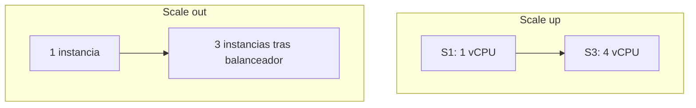

# App Service - planes y escalado

Parte de: [[07-Azure/03 Cómputo/_Índice Cómputo|Cómputo]]

> [!info] Cómo avanzar
> `progreso`: **pendiente** → **viendo** (estudiando) → **visto** (contestaste la autoevaluación sin abrir las respuestas) → **dominado** (hiciste el laboratorio o lo aplicaste de verdad).

## Contenido

### Qué es
Un **plan de App Service** es el **conjunto de cómputo** (VMs administradas) donde corren tus apps de [[App Service]]. Define la **región**, el **sistema operativo** (Windows o Linux), el **nivel de precio** (Free, Basic, Standard, Premium, Isolated) con su tamaño (B1, S1, P0v3…) y el **número de instancias**. Pagas por el plan, no por la app: varias apps pueden compartir un plan y sus recursos.

### Cómo funciona
**Niveles** (Microsoft Learn):
- **Free y Shared**: corren en VMs compartidas con apps de otros clientes y reciben una cuota de CPU; no escalan horizontalmente.
- **Basic, Standard, Premium (v2/v3/v4)**: VMs **dedicadas** a tu plan.
- **IsolatedV2**: VMs dedicadas dentro de una red virtual dedicada (App Service Environment).

**Límites por nivel** (tabla de límites de App Service en Microsoft Learn, noviembre 2026):

| Nivel | Instancias máx. | CPU | Almacenamiento | Dominios propios | Autoescalado | Slots | Always On |
|---|---|---|---|---|---|---|---|
| Free (F1) | 1 compartida | 60 min/día | 1 GB | No (solo `*.azurewebsites.net`) | No | No | No |
| Basic | 3 | Sin cuota | 10 GB | Sí, con SSL SNI | No | No | Sí |
| Standard | 10 | Sin cuota | 50 GB | Sí | Sí | 5 | Sí |
| Premium | 20 (v1) / 30 (v2-v4) | Sin cuota | 250 GB | Sí | Sí | 20 | Sí |

**F1 en la práctica**: 60 minutos de CPU al día (y 3 por cada 5 minutos); al agotarlos la app se detiene hasta el siguiente periodo. Sin dominio propio ni certificado propio, sin Always On (la app se descarga por inactividad y la primera petición tarda), sin slots, sin autoescalado y una sola instancia sin SLA. Ideal para practicar, no para usuarios reales.

**Scale up vs scale out**
- **Scale up (vertical)**: cambiar el plan a un nivel o tamaño mayor (B1 → S1 → P1v3): más CPU/RAM y más funciones. Puede reiniciar la app.
- **Scale out (horizontal)**: aumentar el número de instancias del plan. Manual, por **reglas de autoescalado** (CPU, memoria, longitud de cola, horario; Standard o superior) o con **escalado automático** de la plataforma en Premium v2+.
- **Todas las apps del plan escalan juntas** porque comparten las instancias; un slot activo también compite por los recursos del plan.



**Stateless para escalar horizontalmente**: el balanceador reparte peticiones entre instancias; si guardas sesión, caché o archivos subidos **en memoria o disco local** de una instancia, la siguiente petición puede caer en otra que no los tiene. Además las instancias se agregan, quitan o reciclan en cualquier momento. Saca el estado a servicios compartidos: sesión o caché en Redis, archivos en [[Azure Blob Storage]], datos en la base, y claves de Data Protection persistidas fuera de la instancia. La afinidad de sesión (*ARR affinity*) existe, pero es un parche que reparte mal la carga y falla cuando la instancia se recicla.

### Ejemplo
```bash
#- Subir de nivel (scale up) para tener slots y autoescalado
az appservice plan update -g rg-dionisio-prod -n plan-dionisio-prod --sku S1

#- Escalar a 2 instancias (scale out manual)
az appservice plan update -g rg-dionisio-prod -n plan-dionisio-prod --number-of-workers 2

#- Autoescalado por CPU: entre 2 y 5 instancias
az monitor autoscale create -g rg-dionisio-prod -n as-dionisio \
  --resource plan-dionisio-prod --resource-type Microsoft.Web/serverfarms \
  --min-count 2 --max-count 5 --count 2
az monitor autoscale rule create -g rg-dionisio-prod --autoscale-name as-dionisio \
  --condition "CpuPercentage > 70 avg 10m" --scale out 1
az monitor autoscale rule create -g rg-dionisio-prod --autoscale-name as-dionisio \
  --condition "CpuPercentage < 30 avg 15m" --scale in 1
```
Define siempre reglas de **entrada y salida** y un **máximo**, para no crecer sin control.

### Cuándo usarlo y cuándo no
- **F1**: aprender y demos. **B1**: dev/test o apps pequeñas con dominio propio. **S1/P0v3+**: producción con slots y autoescalado. Premium v3/v4 suele dar mejor relación precio/rendimiento y más memoria.
- Agrupa en un plan apps del mismo ambiente con carga moderada; separa en planes distintos las que tienen picos que afectarían a las demás o requisitos distintos.

### Errores comunes
1. **Escalar el plan "un rato"** y olvidar bajarlo: pagas por hora mientras exista.
2. **Estado en memoria** al escalar horizontalmente.
3. **Mezclar prod y dev en el mismo plan**: dev consume recursos de prod.
4. **Autoescalado solo de salida** y nunca de entrada.
5. **Esperar Always On o slots en F1/Basic**.

### Para profundizar
- [Planes de Azure App Service](https://learn.microsoft.com/es-mx/azure/app-service/overview-hosting-plans)
- [Escalar verticalmente una aplicación en App Service](https://learn.microsoft.com/es-mx/azure/app-service/manage-scale-up)
- [Límites de App Service](https://learn.microsoft.com/es-mx/azure/azure-resource-manager/management/azure-subscription-service-limits#azure-app-service-limits)
- [Introducción al escalado automático en Azure](https://learn.microsoft.com/es-mx/azure/azure-monitor/autoscale/autoscale-get-started)

## Autoevaluación

Contesta primero en voz alta o en papel; luego despliega la respuesta.

> [!question]- ¿Qué es un plan de App Service?
> El conjunto de **máquinas** (región, SO, tamaño, número de instancias) donde corren una o varias apps. Se paga el plan, no cada app: varias apps en un plan comparten CPU y memoria.

> [!question]- Diferencia entre *scale up* y *scale out*.
> **Scale up**: cambiar a un nivel/tamaño mayor (más CPU, RAM, funciones como slots). **Scale out**: más instancias del mismo tamaño, manual o con **autoescalado** por métricas u horario.

> [!question]- ¿Qué limitaciones típicas tiene el nivel gratuito F1?
> Infraestructura compartida, cuota diaria de CPU, sin *Always On* (la app se duerme y el primer request es lento), sin slots ni autoescalado, sin dominio propio con TLS. Detalle exacto (verificar en la página oficial).

> [!question]- ¿Por qué tu app debe ser *stateless* para escalar horizontalmente?
> Cada request puede caer en otra instancia; sesión en memoria o archivos locales se pierden. Usa Redis, la base o tokens. *ARR affinity* (sticky sessions) existe, pero es un parche.

## Práctica

- [[Lab 2 - Desplegar una API .NET a App Service]]

