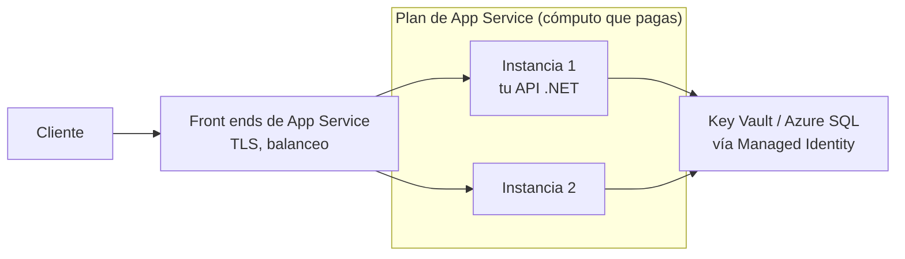

# App Service

Parte de: [[07-Azure/03 Cómputo/_Índice Cómputo|Cómputo]]

> [!info] Cómo avanzar
> `progreso`: **pendiente** → **viendo** (estudiando) → **visto** (contestaste la autoevaluación sin abrir las respuestas) → **dominado** (hiciste el laboratorio o lo aplicaste de verdad).

## Contenido

### Qué es
**Azure App Service** es la plataforma administrada (PaaS) de Azure para hospedar **aplicaciones web y APIs** en .NET, Java, Node.js, Python o PHP, sobre Windows o Linux, ya sea con código o con contenedores. Tú subes la aplicación; Azure se encarga del sistema operativo, los parches, el servidor web, el balanceo entre instancias, los certificados del dominio `*.azurewebsites.net`, el escalado y el monitoreo básico.

Te ahorra administrar VMs e IIS: no hay servidor que parchar, no configuras el sitio en IIS, no abres puertos ni renuevas certificados del dominio por defecto, y escalar es mover un control.

### Cómo funciona

- La app (*Web App*) corre dentro de un **plan de App Service**, que define región, sistema operativo, tamaño y número de instancias (ver [[App Service - planes y escalado]]).
- La configuración se maneja con **App Settings** y **Connection Strings**, que llegan a tu app como **variables de entorno** y sobrescriben `appsettings.json`.
- Herramientas incluidas: *Log stream*, *Diagnose and solve problems*, consola Kudu (`https://<app>.scm.azurewebsites.net`), health check, autenticación integrada (Easy Auth), [[App Service - deployment slots|deployment slots]], integración con VNet y [[Private Endpoints]].

**Formas de desplegar**
- **Zip deploy** (`az webapp deploy --type zip`): subes el resultado de `dotnet publish` empaquetado.
- **Azure Pipelines** con la tarea `AzureWebApp@1` (usa zip deploy por debajo) o **GitHub Actions**.
- **Contenedor** desde [[Container Registry]].
- **Run from package** (`WEBSITE_RUN_FROM_PACKAGE=1`): monta el zip como sistema de archivos de solo lectura; despliegue atómico.
- FTP/FTPS y Web Deploy existen, pero usan credenciales de publicación (autenticación básica), que conviene mantener desactivada.

**Recomendación para una API .NET**: pipeline de [[Azure Pipelines]] que hace `dotnet publish`, publica el zip como artefacto y lo despliega con `AzureWebApp@1` a un slot de staging, usando una *service connection* con federación de identidad. Repetible, auditable y sin credenciales FTP.

**Si vienes de IIS por FTP**: ya no copias archivos sueltos sobre un sitio vivo; despliegas un paquete completo (atómico). No editas `web.config` ni `appsettings.json` en el servidor: la configuración por ambiente va en App Settings o Key Vault. El sistema de archivos local no es persistente entre reinicios (salvo `/home`, compartido y lento) ni compartido de forma segura entre instancias para estado de la app. El TLS, el balanceo y los reinicios los maneja la plataforma; los logs se ven en Log stream y [[Application Insights]], no en el visor de eventos.

### Ejemplo
```bash
RG=rg-dionisio-dev; APP=app-dionisio-dev
az appservice plan create -g $RG -n plan-dionisio-dev --sku B1 --is-linux
az webapp create -g $RG -p plan-dionisio-dev -n $APP --runtime "DOTNETCORE:10.0"

#- Configuración: las secciones anidadas se separan con doble guion bajo
az webapp config appsettings set -g $RG -n $APP --settings \
  ASPNETCORE_ENVIRONMENT=Development \
  Logging__LogLevel__Default=Information \
  ConnectionStrings__Dionisio="@Microsoft.KeyVault(SecretUri=https://kv-dionisio-dev.vault.azure.net/secrets/sql-dionisio)"

#- Publicar y desplegar
dotnet publish src/Dionisio.Api -c Release -o publish
(cd publish && zip -r ../api.zip .)
az webapp deploy -g $RG -n $APP --src-path api.zip --type zip
```
`Logging__LogLevel__Default` equivale a `{"Logging":{"LogLevel":{"Default":...}}}`. El doble guion bajo funciona en Windows y Linux (en Linux los dos puntos `:` no son válidos en nombres de variables). La referencia `@Microsoft.KeyVault(...)` hace que App Service resuelva el secreto con la [[Managed Identity]] de la app.

### Cuándo usarlo y cuándo no
Úsalo para APIs y sitios web HTTP con tráfico continuo: es el camino más corto para [[Itzamna.Dionisio]] o los backends de Hermes/Iris. Considera [[Azure Functions]] para trabajo por eventos o esporádico, [[Container Apps]] si ya empaquetas en contenedores o quieres escalar a cero, [[Azure Static Web Apps]] para front estático, y [[Máquinas virtuales]] solo si necesitas control del sistema operativo.

### Errores comunes
1. **Error 500.30 o la app no arranca tras desplegar**: ASP.NET Core falló al iniciar. Revisa primero **Log stream** o *Diagnose and solve problems* para ver la excepción de arranque. Causas típicas: el **stack o versión de .NET** del sitio no coincide con la de tu publicación, falta una **configuración o secreto** que el `Program.cs` exige al iniciar (cadena de conexión, opción validada al arranque), referencia de Key Vault sin permiso, o el paquete desplegado está incompleto.
2. **Secretos en `appsettings.json`** del repo: usa Key Vault y Managed Identity.
3. **Escribir archivos en disco local** como si fuera un servidor propio.
4. **Usar `:` en nombres de App Settings en Linux**.
5. **No configurar health check** con varias instancias: el balanceador no sabe sacar las enfermas.

### Para profundizar
- [Información general de App Service](https://learn.microsoft.com/es-mx/azure/app-service/overview)
- [Configurar una aplicación de App Service](https://learn.microsoft.com/es-mx/azure/app-service/configure-common)
- [Implementar archivos en App Service (zip deploy)](https://learn.microsoft.com/es-mx/azure/app-service/deploy-zip)
- [Solución de problemas de ASP.NET Core en Azure App Service e IIS](https://learn.microsoft.com/es-mx/aspnet/core/test/troubleshoot-azure-iis)

## Autoevaluación

Contesta primero en voz alta o en papel; luego despliega la respuesta.

> [!question]- ¿Qué es App Service y qué te ahorra?
> PaaS para hospedar apps web y APIs (.NET, Node, Python, Java, PHP o contenedores) en Windows o Linux. Azure administra SO, parches, balanceo y certificados; tú despliegas código.

> [!question]- ¿Qué formas de desplegar a App Service conoces y cuál recomiendas para una API .NET?
> Zip deploy (`az webapp deploy --type zip`), tarea `AzureWebApp@1` en Azure Pipelines o la action `azure/webapps-deploy`, contenedor desde ACR, Git local y FTP/FTPS. Recomendado: **pipeline con zip deploy** (repetible, con historial). FTP solo como respaldo; en apps nuevas la autenticación básica (FTP/WebDeploy) viene deshabilitada (verificar en la página oficial).

> [!question]- Vienes de publicar en IIS por FTP. ¿Qué cambia en App Service?
> No administras el servidor ni el sitio de IIS (en Windows sí corre sobre IIS por debajo). La configuración va en **App Settings** y **Connection strings** (sobrescriben `appsettings.json` como variables de entorno) y el disco local no es persistente para tus archivos: usa Blob Storage.

> [!question]- ¿Cómo pasas un valor de `appsettings.json` anidado como App Setting?
> Con doble guion bajo: `Storage__Provider=AzureBlob` equivale a `Storage:Provider`. En Linux `:` no es válido en nombres de variables.

> [!question]- Error común: la app responde 500.30 o no arranca tras desplegar. ¿Qué revisas primero?
> El **Log stream** y los logs de diagnóstico, el *runtime stack* configurado vs la versión de .NET compilada, y App Settings faltantes (cadena de conexión). En Linux, también el comando de inicio.

## Práctica

- [[Lab 2 - Desplegar una API .NET a App Service]]

