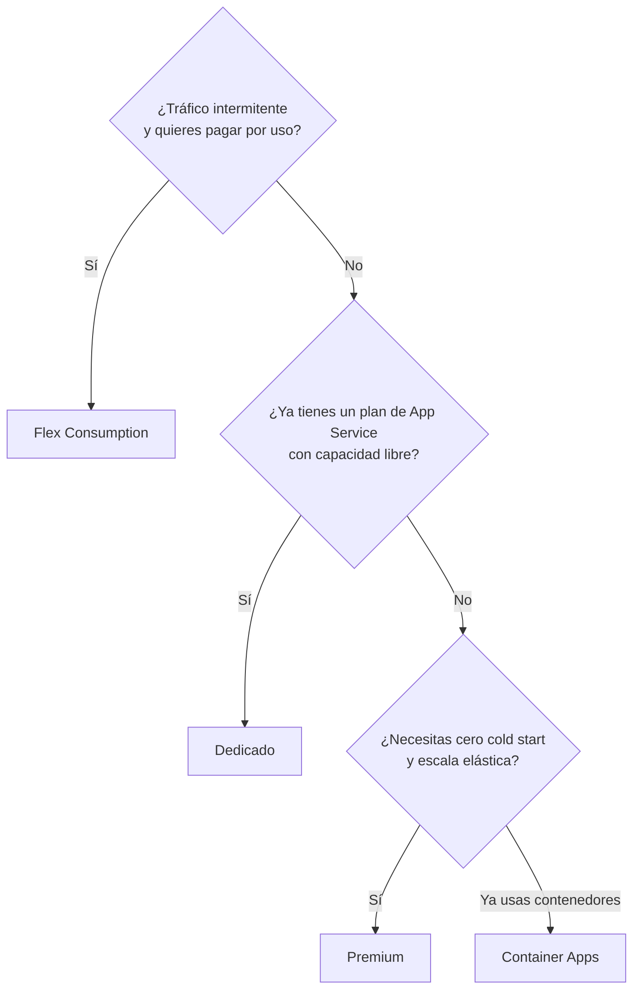

# Azure Functions - planes de hospedaje

Parte de: [[Azure Functions]]

> [!info] Cómo avanzar
> `progreso`: **pendiente** → **viendo** (estudiando) → **visto** (contestaste la autoevaluación sin abrir las respuestas) → **dominado** (hiciste el laboratorio o lo aplicaste de verdad).

## Contenido

### Qué es
El **plan de hospedaje** de una Function App define **cómo escala**, **cuánto puede durar una ejecución**, **si puede escalar a cero**, **qué opciones de red** tiene y **cómo se cobra**. Es una decisión de arquitectura: cambiar después puede requerir recrear la app.

### Cómo funciona
Datos de la tabla oficial de Microsoft Learn (noviembre 2026):

| Plan | Timeout por defecto / máximo | Escala a cero | Cold start | Red (VNet) | Instancias máx. |
|---|---|---|---|---|---|
| **Flex Consumption** | 30 min / sin límite | Sí | Mejorado; admite instancias *always ready* | Sí (integración y private endpoints) | 1,000 por grupo de funciones |
| **Premium** | 30 min / sin límite | No: siempre al menos 1 caliente | Mínimo | Sí | Windows 100, Linux 20-100 |
| **Dedicado** (plan de App Service) | 30 min / sin límite (con Always On) | No | Prácticamente no aplica | Sí | 10-30 (100 con ASE) |
| **Container Apps** | 30 min / sin límite | Sí, con mínimo de réplicas 0 | Según réplicas mínimas | Integración saliente sí; private endpoints de entrada no | 300-1,000 |
| **Consumption** (heredado) | 5 min / 10 min | Sí | Sí | No | Windows 200, Linux 100 |

Notas importantes:
- El plan **Consumption en Linux** se retira el **30 de septiembre de 2028** y no recibe nuevas funciones; Microsoft recomienda migrar a **Flex Consumption**. Windows Consumption no está afectado por ahora.
- **Flex Consumption** es la opción serverless recomendada: cobra por ejecución y memoria, escala rápido, soporta VNet y permite instancias siempre listas para evitar cold start.
- La cuota siempre gratuita de Functions (1 millón de solicitudes al mes, según la página oficial) aplica a los planes de consumo, no a Premium ni Dedicado.



**La cuenta de almacenamiento**: toda Function App necesita una cuenta de Azure Storage, indicada en la configuración `AzureWebJobsStorage`. El runtime la usa para coordinar (leases y bloqueos entre instancias), guardar el estado de triggers como Timer y Blob, las claves de función y, en Durable Functions, el historial de orquestaciones; en algunos planes también para el contenido de la app. Sin ella, la app no arranca o los triggers no funcionan.

### Ejemplo
**Tu función tarda 20 minutos por ejecución.** En el Consumption heredado es imposible (máximo 10 minutos). Opciones:
1. **Flex Consumption, Premium o Dedicado**, cuyo timeout por defecto es 30 minutos y se puede ampliar en `host.json` (`"functionTimeout": "00:45:00"`, o `-1` para ilimitado donde se permite).
2. Mejor aún, **rediseñar**: dividir en pasos con **Durable Functions** (fan-out de actividades cortas) o con mensajes en cola; así cada pieza es corta, reintentable y paralela.
3. Si una petición **HTTP** dispara el proceso, responde `202 Accepted` y procesa en segundo plano: las peticiones HTTP tienen además un límite de respuesta del balanceador (alrededor de 230 segundos según la documentación de Functions).

Crear una Function App en Flex Consumption con su almacenamiento:
```bash
RG=rg-reporteria-dev
az storage account create -n streporteriadev01 -g $RG -l eastus --sku Standard_LRS
az functionapp create -g $RG -n func-reporteria-dev --storage-account streporteriadev01 \
  --flexconsumption-location eastus --runtime dotnet-isolated --runtime-version 10.0
```
(Revisa las versiones admitidas con `az functionapp list-flexconsumption-runtimes`.)

### Cuándo usarlo y cuándo no
- **Flex Consumption**: la opción por defecto para cargas por eventos nuevas.
- **Premium**: latencia baja constante, ejecuciones largas frecuentes, mucha memoria.
- **Dedicado**: ya pagas un plan de App Service con capacidad ociosa, o necesitas costo predecible.
- **Container Apps**: tu plataforma ya son contenedores y quieres funciones junto a otros microservicios.

### Errores comunes
1. **Crear la Function App y olvidar (o borrar) la cuenta de almacenamiento**: la app no arranca, los timers no se disparan, o pierdes el estado de Durable. Al limpiar un laboratorio, el almacenamiento también cobra; bórralo junto con la app.
2. **Elegir Consumption heredado en Linux** para algo nuevo.
3. **Procesos largos en una petición HTTP**.
4. **Compartir una cuenta de almacenamiento** entre muchas Function Apps con mucha carga: contención y límites.
5. **Premium "por si acaso"**: paga instancias calientes 24/7.

### Para profundizar
- [Opciones de hospedaje de Azure Functions](https://learn.microsoft.com/es-mx/azure/azure-functions/functions-scale)
- [Plan Flex Consumption](https://learn.microsoft.com/es-mx/azure/azure-functions/flex-consumption-plan)
- [Consideraciones de almacenamiento para Azure Functions](https://learn.microsoft.com/es-mx/azure/azure-functions/storage-considerations)

## Autoevaluación

Contesta primero en voz alta o en papel; luego despliega la respuesta.

> [!question]- ¿Qué planes de hospedaje existen para Functions?
> **Consumo** (y su evolución **Flex Consumption**): escala a cero, pago por uso. **Premium**: instancias precalentadas, integración con VNet, sin cold start. **Dedicado** (plan de App Service): capacidad fija. También en Container Apps (verificar en la página oficial).

> [!question]- Tu función tarda 20 minutos por ejecución. ¿Qué consideras?
> Los planes de consumo tienen un **tiempo máximo de ejecución**; para tareas largas usa Premium/Dedicado, Durable Functions (partir en pasos) o un Container Apps Job (verificar en la página oficial).

> [!question]- Error común: crear la Function App y olvidar la cuenta de almacenamiento.
> Functions **requiere** una cuenta de almacenamiento (estado de triggers, leases, archivos). Si la borras o rotas su llave sin actualizar la configuración, la app deja de funcionar.

