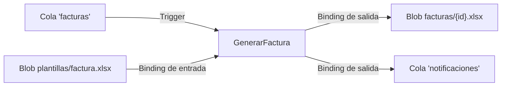

# Azure Functions - triggers y bindings

Parte de: [[Azure Functions]]

> [!info] Cómo avanzar
> `progreso`: **pendiente** → **viendo** (estudiando) → **visto** (contestaste la autoevaluación sin abrir las respuestas) → **dominado** (hiciste el laboratorio o lo aplicaste de verdad).

## Contenido

### Qué es
En [[Azure Functions]]:
- Un **trigger** es **lo que hace que la función se ejecute** y entrega los datos del evento. Cada función tiene **exactamente un** trigger: HTTP, Timer, Queue Storage, Service Bus, Blob, Event Grid, Event Hubs, Cosmos DB, etc.
- Un **binding** es una **conexión declarativa** a otro servicio para **leer** (entrada) o **escribir** (salida) datos sin escribir el código cliente. Una función puede tener cero o varios bindings.

El trigger es en sí un tipo especial de binding de entrada; la diferencia es que **solo el trigger inicia** la ejecución.

### Cómo funciona

- En el modelo aislado de .NET se declaran con atributos: `[QueueTrigger]`, `[TimerTrigger]`, `[BlobInput]`, `[BlobOutput]`, `[ServiceBusOutput]`…
- El parámetro `Connection` apunta al **nombre de una configuración** (App Setting), no a la cadena en sí. Con identidad administrada se usa el prefijo, por ejemplo `ColaPedidos__queueServiceUri`, y la [[Managed Identity]] de la Function App con el rol de datos correspondiente.
- Las extensiones de cada servicio se instalan como paquetes NuGet (`Microsoft.Azure.Functions.Worker.Extensions.Storage.Queues`, `...ServiceBus`).
- Los **bindings ahorran código repetitivo**, pero si necesitas control fino (transacciones, reintentos propios, consultas complejas) usa el SDK del servicio inyectado por DI.

**Reintentos y mensajes venenosos**
- **Queue Storage**: si la función lanza excepción, el mensaje vuelve a ser visible y se reintenta; tras `maxDequeueCount` intentos (5 por defecto) el runtime lo mueve a la cola `<nombre>-poison`.
- **Service Bus**: el mensaje se reintenta hasta el `MaxDeliveryCount` de la entidad (10 por defecto) y luego va a la **dead-letter queue**.
- En ambos casos debes **monitorear** la cola poison/dead-letter: ahí terminan los mensajes que nunca se procesarán solos.

**Idempotencia**: los triggers de mensajería garantizan entrega **al menos una vez**, no exactamente una. Un mensaje puede procesarse dos veces si la función hace su trabajo pero falla (o se reinicia la instancia) antes de confirmar; también hay reintentos por errores transitorios. Si tu función cobra, envía correos o inserta registros, procesar dos veces duplica el efecto. Diseña para que repetir no cambie el resultado: claves de idempotencia, `MERGE`/`IF NOT EXISTS` en el procedimiento, o registrar ids ya procesados (ver [[Idempotencia]]).

### Ejemplo
Generación de reportes de Wee.Reporteria con trigger de cola y bindings de blob:
```csharp
using Microsoft.Azure.Functions.Worker;
using Microsoft.Extensions.Logging;

public record SolicitudReporte(string Id, string Tipo);

public class GenerarReporte(IRepositorioReportes repo, ILogger<GenerarReporte> log)
{
    [Function("GenerarReporte")]
    [BlobOutput("reportes/{Id}.xlsx", Connection = "Almacen")]
    public async Task<byte[]> Run(
        [QueueTrigger("solicitudes-reporte", Connection = "Almacen")] SolicitudReporte solicitud,
        FunctionContext ctx)
    {
        // Idempotente: si ya existe el reporte, el blob se sobrescribe con el mismo contenido
        log.LogInformation("Generando reporte {Id} intento {Intento}",
            solicitud.Id, ctx.BindingContext.BindingData["DequeueCount"]);
        return await repo.GenerarExcelAsync(solicitud.Tipo);  // lógica con Dapper y .sql
    }
}
```
Configuración del número de intentos en `host.json`:
```json
{
  "version": "2.0",
  "extensions": { "queues": { "maxDequeueCount": 3, "visibilityTimeout": "00:00:30" } }
}
```

### Cuándo usarlo y cuándo no
Usa triggers y bindings para conectar servicios sin código de plomería. Para operaciones que requieren lógica de negocio rica, transacciones o manejo de errores propio, deja el trigger y usa el SDK o tu capa de datos (en tu caso, Dapper con SQL en archivos).

### Errores comunes
1. **No monitorear la cola poison o dead-letter**: los mensajes fallidos se acumulan en silencio.
2. **Funciones no idempotentes** con triggers de mensajería.
3. **Poner la cadena en `Connection`** en lugar del nombre de la configuración.
4. **Tragar excepciones**: si capturas y no relanzas, el mensaje se da por procesado aunque falló.
5. **Mensajes grandes** en la cola: guarda el contenido en un blob y encola la referencia.

### Para profundizar
- [Conceptos de desencadenadores y enlaces](https://learn.microsoft.com/es-mx/azure/azure-functions/functions-triggers-bindings)
- [Desencadenador de Queue Storage para Functions](https://learn.microsoft.com/es-mx/azure/azure-functions/functions-bindings-storage-queue-trigger)
- [Control de errores y reintentos en Functions](https://learn.microsoft.com/es-mx/azure/azure-functions/functions-bindings-error-pages)

## Autoevaluación

Contesta primero en voz alta o en papel; luego despliega la respuesta.

> [!question]- Diferencia entre trigger y binding.
> El **trigger** dispara la función (exactamente uno). Los **bindings** de entrada/salida conectan datos sin escribir SDK (p. ej. leer un blob, escribir en una cola).

> [!question]- ¿Qué pasa si una función con trigger de cola falla varias veces con el mismo mensaje?
> Tras el número máximo de intentos, el mensaje va a la cola *poison* (`<cola>-poison`) en Queue Storage, o a la *dead-letter queue* en Service Bus. Monitoréala.

> [!question]- ¿Por qué tu función debe ser idempotente?
> La entrega es *al menos una vez*: un mensaje o evento puede procesarse más de una vez. Procesarlo dos veces no debe duplicar efectos (usa ids de operación).

