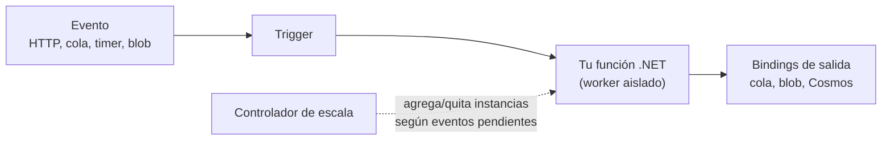

# Azure Functions

Parte de: [[07-Azure/03 Cómputo/_Índice Cómputo|Cómputo]]

> [!info] Cómo avanzar
> `progreso`: **pendiente** → **viendo** (estudiando) → **visto** (contestaste la autoevaluación sin abrir las respuestas) → **dominado** (hiciste el laboratorio o lo aplicaste de verdad).

## Contenido

### Qué es
**Azure Functions** es el servicio **serverless** de Azure para ejecutar código **en respuesta a eventos**: una petición HTTP, un mensaje en una cola, un archivo nuevo en Blob Storage, un temporizador, un evento de Event Grid. Escribes funciones pequeñas; la plataforma las escala según la carga y, en los planes de consumo, cobras por ejecución y puedes escalar a cero cuando no hay trabajo.

Las funciones viven en una **Function App**, que es la unidad de despliegue, configuración y escalado. Para .NET el modelo vigente es el **worker aislado** (*isolated worker*): tu código corre en un proceso propio con la versión de .NET que elijas, con inyección de dependencias y middleware como en ASP.NET Core. El modelo *in-process* llega a fin de soporte el **10 de noviembre de 2026** según Microsoft Learn; los proyectos nuevos deben usar el aislado.

### Cómo funciona
Las dos piezas clave tienen su propia nota:
- [[Azure Functions - triggers y bindings]]: **qué** inicia la función (trigger, exactamente uno) y **con qué** se conecta de forma declarativa (bindings de entrada y salida).
- [[Azure Functions - planes de hospedaje]]: **dónde** corre (Flex Consumption, Premium, Dedicado, Container Apps), y con ello el escalado, el tiempo máximo y la red.



**Cold start**: cuando no hay instancias calientes (porque escaló a cero o porque llega un pico), la plataforma debe asignar una instancia, cargar el runtime y tu código antes de atender: la primera petición tarda segundos. Mitigaciones:
- **Instancias "always ready"** en Flex Consumption, o instancias precalentadas en **Premium** (siempre hay al menos una caliente).
- Plan **Dedicado** (App Service) con **Always On**.
- Arranque ligero: pocas dependencias, sin trabajo pesado en el constructor ni en `Program.cs`, y cliente HTTP o de base reutilizados.
- Aceptarlo cuando la función no atiende usuarios en tiempo real (procesamiento de colas, tareas nocturnas).

**Durable Functions** es una extensión para **flujos con estado** escritos como código: un **orquestador** llama a **actividades**, espera eventos externos o temporizadores y guarda su progreso automáticamente (event sourcing en el almacenamiento), de modo que el flujo sobrevive reinicios y puede durar días. Patrones típicos: encadenamiento, *fan-out/fan-in* (procesar 1,000 archivos en paralelo y juntar resultados), aprobaciones humanas con tiempo límite, monitoreo periódico.

### Ejemplo
Función HTTP en modelo aislado (.NET) que recibe un pedido y lo encola para procesarlo después:
```csharp
using Microsoft.Azure.Functions.Worker;
using Microsoft.Azure.Functions.Worker.Http;
using Microsoft.Extensions.Logging;
using System.Net;

public record PedidoNuevo(string ClienteId, decimal Total);

public class RecibirPedido(ILogger<RecibirPedido> log)
{
    [Function("RecibirPedido")]
    public async Task<SalidaPedido> Run(
        [HttpTrigger(AuthorizationLevel.Function, "post", Route = "pedidos")] HttpRequestData req)
    {
        var pedido = await req.ReadFromJsonAsync<PedidoNuevo>();
        log.LogInformation("Pedido de {Cliente} por {Total}", pedido!.ClienteId, pedido.Total);

        var resp = req.CreateResponse(HttpStatusCode.Accepted);
        return new SalidaPedido { Mensaje = pedido, Http = resp };
    }
}

public class SalidaPedido
{
    [QueueOutput("pedidos-pendientes", Connection = "ColaPedidos")]
    public PedidoNuevo? Mensaje { get; set; }   // se escribe en la cola automáticamente
    public required HttpResponseData Http { get; set; }
}
```

### Cuándo usarlo y cuándo no
**Functions en vez de App Service** cuando el trabajo es **por eventos o intermitente** (procesar colas, archivos, webhooks, tareas programadas), cuando quieres pagar por ejecución y escalar a cero, o como "pegamento" entre servicios. **App Service** es mejor para una API REST completa con muchos endpoints, controllers, middleware y tráfico constante, como [[Itzamna.Dionisio]]; ahí el modelo de Functions no aporta y el cold start estorba. Para flujos largos con estado usa Durable Functions o [[Service Bus]] con workers.

### Errores comunes
1. **Funciones largas y monolíticas** en planes con tiempo máximo: divídelas o usa Durable.
2. **Crear `HttpClient` o conexiones por ejecución**: agota sockets; usa DI.
3. **No ser idempotente** con triggers que reintentan (ver [[Idempotencia]]).
4. **Seguir creando proyectos in-process**: ya en fin de soporte.
5. **Ignorar el cold start** en endpoints de cara al usuario.

### Para profundizar
- [Introducción a Azure Functions](https://learn.microsoft.com/es-mx/azure/azure-functions/functions-overview)
- [Guía del modelo de worker aislado de .NET](https://learn.microsoft.com/es-mx/azure/azure-functions/dotnet-isolated-process-guide)
- [¿Qué es Durable Functions?](https://learn.microsoft.com/es-mx/azure/azure-functions/durable/durable-functions-overview)

## Subtemas

- [[Azure Functions - triggers y bindings]]
- [[Azure Functions - planes de hospedaje]]

## Autoevaluación

Contesta primero en voz alta o en papel; luego despliega la respuesta.

> [!question]- ¿Qué es Azure Functions?
> Cómputo **serverless** basado en eventos: escribes funciones que se disparan por HTTP, timer, colas, blobs, eventos, etc., y Azure escala las instancias. Paga por ejecución en planes de consumo.

> [!question]- ¿Qué es el *cold start* y cómo se mitiga?
> La latencia del primer request cuando no hay instancias calientes (escala desde cero). Se mitiga con planes que mantienen instancias listas (Premium, o instancias *always ready* en Flex Consumption) o un plan dedicado.

> [!question]- ¿Cuándo usarías Functions en vez de App Service?
> Trabajo **por eventos o intermitente** (procesar un blob, un mensaje, una tarea nocturna). Para una API con tráfico constante y dependencias pesadas, App Service suele ser más simple y predecible.

> [!question]- ¿Para qué sirve Durable Functions?
> Orquestar flujos con estado (encadenar pasos, *fan-out/fan-in*, esperar aprobación humana) escritos como código; el estado se guarda en almacenamiento.

## Progreso de los subtemas

```base
filters:
  and:
    - file.inFolder("07-Azure/03 Cómputo/Azure Functions")
    - file.name != "Azure Functions"
views:
  - type: table
    name: Progreso
    order:
      - file.name
      - progreso
      - nivel
```
