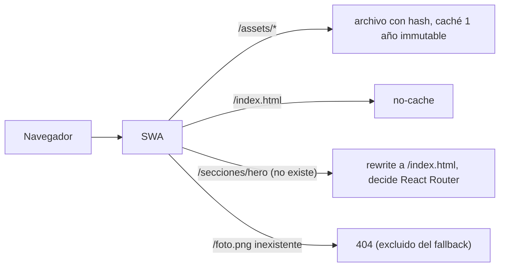

# Azure Static Web Apps

> Hosting de Azure para sitios estáticos y SPA (HTML/JS/CSS) con CDN global, HTTPS y reglas de rutas y headers en `staticwebapp.config.json`; [[Itzamna.Clio]] despliega ahí sus dos apps: el Studio y el portfolio público.

## Qué es y qué problema resuelve
Una SPA de [[Vite]] compila a archivos estáticos; no necesita un servidor de aplicación. Static Web Apps (SWA) los sirve desde una red global, con certificado, y resuelve dos problemas típicos de una SPA:
- **Rutas del cliente**: `/secciones/hero` no existe como archivo; hay que devolver `index.html` (*navigation fallback*) para que el router del front decida.
- **Headers**: caché y seguridad (CSP, `X-Frame-Options`) sin servidor propio.

## Cómo funciona por dentro
- `staticwebapp.config.json` en la raíz del sitio publicado:
  - `navigationFallback.rewrite`: archivo para rutas inexistentes; `exclude`: patrones que **no** caen al fallback (assets, imágenes) y por tanto dan 404 real.
  - `routes[]`: headers (o redirecciones, roles) por ruta.
  - `globalHeaders`: headers en todas las respuestas.
- Despliegue con un **token de despliegue** por sitio (tarea `AzureStaticWebApp@0` o GitHub Action). Con `skip_app_build: true` solo sube lo ya compilado.
- Cada sitio tiene un dominio `*.azurestaticapps.net` (dominios propios opcionales).



## Cuándo usarla y cuándo no
### Ventajas
- Barato (plan gratuito) y sin servidor que mantener.
- CDN, HTTPS y headers declarativos.
- Integración directa con Azure Pipelines / GitHub Actions.
### Desventajas
- Sin SSR propio (solo estático + Functions opcionales); el SEO depende del cliente.
- Headers estáticos: la CSP no puede variar por petición.
- Configuración específica de Azure.

## Alternativas
| Alternativa | En qué se diferencia |
|---|---|
| Blob Storage static website + CDN | Más piezas; sin fallback ni headers tan sencillos. |
| App Service | Servidor completo; más caro para solo estáticos. |
| Netlify / Vercel / Cloudflare Pages | Equivalentes; Vercel/Netlify con SSR integrado. |

## Cómo se usó en Itzamna
Dos sitios, cada uno con su config en `public/` (Vite la copia a `dist/`: "Cada dist ya incluye su staticwebapp.config.json"):

| Sitio | Recurso (pipeline) | Config |
|---|---|---|
| Studio (editor) | `swa-itzamna-clio-studio-prod` | `Itzamna.Clio/apps/studio/public/staticwebapp.config.json` |
| Web (portfolio público + `/preview`) | `swa-itzamna-clio-web-prod` | `Itzamna.Clio/apps/web/public/staticwebapp.config.json` |

Común a ambos: fallback a `/index.html` excluyendo `/assets/*` e imágenes/íconos; `/assets/*` con `public, max-age=31536000, immutable` (nombres con hash de Vite); `/index.html` con `no-cache` (para tomar el build nuevo); `X-Content-Type-Options: nosniff`, `Referrer-Policy: strict-origin-when-cross-origin`.

Diferencias:
- **Studio**: `X-Frame-Options: DENY` y `X-Robots-Tag: noindex, nofollow` (no se embebe ni se indexa).
- **Web**: excluye además `/demo/*` del fallback, `/preview` con `noindex`, y CSP que solo deja embeber el sitio al Studio ([[Vista previa en vivo]], [[Content Security Policy]]):

`Itzamna.Clio/apps/web/public/staticwebapp.config.json`:
```json
"routes": [
  { "route": "/assets/*", "headers": { "Cache-Control": "public, max-age=31536000, immutable" } },
  { "route": "/index.html", "headers": { "Cache-Control": "no-cache" } },
  { "route": "/preview", "headers": { "X-Robots-Tag": "noindex, nofollow" } }
],
"globalHeaders": {
  "X-Content-Type-Options": "nosniff",
  "Referrer-Policy": "strict-origin-when-cross-origin",
  "Content-Security-Policy": "frame-ancestors 'self' https://wonderful-cliff-018ec1310.6.azurestaticapps.net"  }
```
Despliegue en `Itzamna.Clio/azure-pipelines.yml` ([[Azure Pipelines]]): dos `AzureStaticWebApp@0` con `skip_app_build: true` y tokens `SwaStudioToken`/`SwaWebToken` del grupo secreto; luego una prueba de humo verifica 200 en ambos y que la CSP del portfolio contenga la URL del Studio.

Funcionalidades: [[Portfolio público]], [[Vista previa en vivo]], [[Autenticación y acceso]] (Studio).

> [!note] Pendiente de confirmar
> La URL del Studio está escrita a mano en la CSP del sitio web: si cambia el dominio (p. ej. dominio propio), hay que editar el JSON y la variable `studioUrl` del pipeline. Sin SSR, el SEO y Open Graph del portfolio dependen del JavaScript ([[Secciones pendientes]]). No hay dominio propio configurado en el repo.

> [!tip] Reutilizable
> El par "`/assets/*` immutable + `/index.html` no-cache + fallback con exclusiones" es la config base correcta para cualquier SPA de Vite en SWA.

## Errores comunes y buenas prácticas
- Fallback sin `exclude`: una imagen faltante devuelve `index.html` con 200 y se rompe en silencio.
- Cachear `index.html`: los usuarios se quedan con un build viejo que pide assets que ya no existen.
- Olvidar que el config debe ir en la **salida** (`dist/`), no solo en el repo: aquí está en `public/`.
- Poner secretos en variables `VITE_*`: terminan en el JS público.

## Qué estudiar después
- [[Azure Pipelines]], [[Content Security Policy]], [[Vite]], [[React Router]]
- Dominios propios, autenticación integrada de SWA, Azure Functions como API.

## Documentación oficial
- https://learn.microsoft.com/azure/static-web-apps/overview
- https://learn.microsoft.com/azure/static-web-apps/configuration

## Autoevaluación

Contesta primero en voz alta o en papel; luego despliega la respuesta.

> [!question]- ¿Para qué tipo de apps es Static Web Apps y qué resuelve `navigationFallback`?
> Para SPAs y sitios estáticos. `navigationFallback` devuelve `index.html` en rutas del cliente que no existen como archivo, para que el router del front decida.

> [!question]- ¿Por qué `/assets/*` puede tener `immutable` y `index.html` no debe cachearse?
> Los assets llevan **hash** en el nombre: un contenido nuevo es un archivo nuevo. `index.html` siempre tiene el mismo nombre; si se cachea, el usuario se queda con el build viejo que apunta a assets que ya no existen.

> [!question]- Pones un secreto en una variable `VITE_*` del pipeline. ¿Qué pasa?
> Queda incrustado en el JavaScript público y cualquiera lo puede leer. Los secretos van en una API (Functions) o en el backend.

