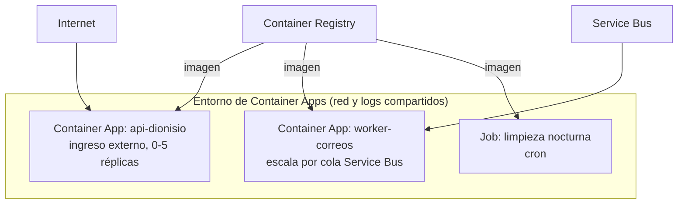

# Container Apps

Parte de: [[07-Azure/03 Cómputo/_Índice Cómputo|Cómputo]]

> [!info] Cómo avanzar
> `progreso`: **pendiente** → **viendo** (estudiando) → **visto** (contestaste la autoevaluación sin abrir las respuestas) → **dominado** (hiciste el laboratorio o lo aplicaste de verdad).

## Contenido

### Qué es
**Azure Container Apps (ACA)** es un servicio administrado para ejecutar **contenedores** (APIs, workers, trabajos programados, microservicios) **sin administrar Kubernetes**. Por debajo usa Kubernetes, **KEDA** (escalado por eventos) y **Envoy** (ingreso y tráfico), pero tú no ves ni configuras el clúster: defines la imagen, CPU/memoria, réplicas mínimas y máximas, reglas de escala e ingreso. Puede **escalar a cero** y tiene una cuota mensual gratuita en el plan de consumo (180,000 vCPU-segundos, 360,000 GiB-segundos y 2 millones de solicitudes, según la página oficial en noviembre de 2026).

### Cómo funciona

- **Entorno (environment)**: frontera compartida para varias apps: red virtual, Log Analytics, y comunicación interna por nombre.
- **Container App**: una o varias imágenes con su configuración, secretos e ingreso (externo o solo interno).
- **Escalado**: reglas por HTTP concurrente, CPU, memoria o cualquier escalador de KEDA (longitud de cola de Service Bus o Storage, Event Hubs, cron). Con mínimo 0, sin tráfico no pagas cómputo (pero hay cold start).
- **Jobs**: contenedores que se ejecutan y terminan (manual, por cron o por evento).
- **Perfiles de carga de trabajo**: *Consumption* (serverless) o *Dedicated* (cómputo reservado y GPU).
- **Dapr** opcional para invocación de servicios, pub/sub y estado.

**Revisiones**: cada cambio de la plantilla (imagen, variables, recursos) crea una **revisión** inmutable. En modo de **revisiones múltiples** puedes tener varias activas y **repartir el tráfico por porcentaje** entre ellas. Así se hace un **canary**: la revisión nueva recibe 10%, observas errores y latencia en [[Application Insights]], subes a 50% y luego 100%; si falla, regresas el tráfico a la anterior al instante. Cada revisión puede tener una **etiqueta** con URL propia para probarla directamente.

### Ejemplo
```bash
RG=rg-dionisio-dev
az containerapp env create -g $RG -n cae-dionisio-dev -l eastus

az containerapp create -g $RG -n api-dionisio --environment cae-dionisio-dev \
  --image acrdionisio.azurecr.io/dionisio-api:1.4.0 \
  --registry-server acrdionisio.azurecr.io --registry-identity system \
  --target-port 8080 --ingress external \
  --min-replicas 0 --max-replicas 5 --cpu 0.5 --memory 1Gi \
  --revisions-mode multiple --revision-suffix v140

#- Desplegar versión nueva y hacer canary 90/10
az containerapp update -g $RG -n api-dionisio \
  --image acrdionisio.azurecr.io/dionisio-api:1.5.0 --revision-suffix v150
az containerapp ingress traffic set -g $RG -n api-dionisio \
  --revision-weight api-dionisio--v140=90 api-dionisio--v150=10
```
La imagen se construye con un [[Dockerfile para .NET]]; las imágenes oficiales de ASP.NET Core escuchan en el puerto 8080 por defecto desde .NET 8.

### Cuándo usarlo y cuándo no
| Si… | Elige |
|---|---|
| Una API web .NET sin contenedores, tráfico constante | [[App Service]] |
| Ya empaquetas en contenedores, varios microservicios, workers por cola, escalar a cero | **Container Apps** |
| Necesitas el API completo de Kubernetes, operadores, control de nodos, mallas de servicio propias | [[AKS (conceptos)]] |
| Funciones por eventos sin pensar en contenedores | [[Azure Functions]] |

Container Apps es el punto medio: más flexible que App Service para arquitecturas de varios servicios, mucho más simple que AKS.

### Errores comunes
1. **Mínimo de réplicas 0 en una API sensible a latencia**: cold start; usa 1 si importa.
2. **Usar `latest`** como etiqueta: no puedes saber qué revisión corre qué código (ver [[Container Registry]]).
3. **Credenciales de administrador del registro** en lugar de identidad administrada con `AcrPull`.
4. **Olvidar el costo del Log Analytics** del entorno: la ingesta de logs se cobra aparte.
5. **Estado en el sistema de archivos** del contenedor: es efímero.

### Para profundizar
- [Información general de Azure Container Apps](https://learn.microsoft.com/es-mx/azure/container-apps/overview)
- [Revisiones en Azure Container Apps](https://learn.microsoft.com/es-mx/azure/container-apps/revisions)
- [Reglas de escalado en Container Apps](https://learn.microsoft.com/es-mx/azure/container-apps/scale-app)
- [Comparación de opciones de contenedores en Azure](https://learn.microsoft.com/es-mx/azure/container-apps/compare-options)

## Autoevaluación

Contesta primero en voz alta o en papel; luego despliega la respuesta.

> [!question]- ¿Qué es Azure Container Apps?
> Plataforma serverless para contenedores construida sobre Kubernetes, KEDA y Dapr, sin administrar el clúster: ingress HTTP, escalado por eventos (incluso a cero), revisiones y división de tráfico.

> [!question]- ¿Cuándo eliges Container Apps sobre App Service y sobre AKS?
> Sobre App Service: varios microservicios en contenedor, escalado por eventos/colas, escalar a cero. Sobre AKS: cuando no necesitas acceso a la API de Kubernetes ni control del clúster.

> [!question]- ¿Qué es una revisión y cómo sirve para canary?
> Una versión inmutable de la configuración de la app. En modo *multiple revisions* repartes tráfico (p. ej. 90/10) entre revisiones y luego mueves todo a la nueva.

