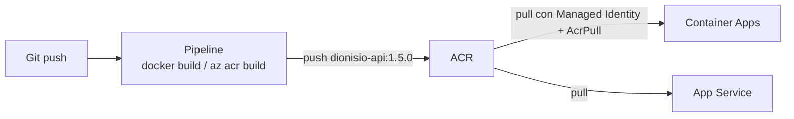

# Container Registry

Parte de: [[07-Azure/03 Cómputo/_Índice Cómputo|Cómputo]]

> [!info] Cómo avanzar
> `progreso`: **pendiente** → **viendo** (estudiando) → **visto** (contestaste la autoevaluación sin abrir las respuestas) → **dominado** (hiciste el laboratorio o lo aplicaste de verdad).

## Contenido

### Qué es
**Azure Container Registry (ACR)** es un registro **privado** y administrado de imágenes de contenedor (compatible con Docker y OCI) y otros artefactos como charts de Helm. Ahí publicas las imágenes que construyes en tu pipeline, y de ahí las descargan [[App Service]], [[Container Apps]], [[AKS (conceptos)|AKS]] o Functions. Tenerlo en Azure significa autenticación con Entra ID, tráfico cercano a tus servicios y opciones de red privada.

### Cómo funciona

- **Niveles**: **Basic**, **Standard** y **Premium**; cambian almacenamiento incluido, rendimiento y funciones. Premium añade replicación geográfica, private endpoints, zonas de redundancia y otras capacidades empresariales. La cuenta gratuita incluye 1 registro Standard durante 12 meses, según la página oficial (noviembre 2026).
- **Nombre**: `<nombre>.azurecr.io`; la imagen completa se escribe `acrdionisio.azurecr.io/dionisio-api:1.5.0`.
- **ACR Tasks**: `az acr build` construye la imagen **en Azure**, sin Docker local.
- **Autenticación**, de mejor a peor:
  1. **[[Managed Identity]]** del servicio que descarga, con rol **AcrPull** sobre el registro (y **AcrPush** solo para el pipeline que publica).
  2. Service principal o federación de identidad para el pipeline (service connection de Azure DevOps).
  3. **Usuario administrador** (usuario y contraseña compartidos): viene desactivado y conviene dejarlo así.

**Cómo debe autenticarse App Service o Container Apps**: con su identidad administrada (de sistema o de usuario) con **AcrPull** sobre el registro. En Container Apps: `--registry-identity system`; en App Service: activar `acrUseManagedIdentityCreds`. Sin contraseñas en la configuración, revocable con RBAC.

### Ejemplo
```bash
RG=rg-compartido
az acr create -g $RG -n acrdionisio --sku Basic

#- Construir en la nube con una etiqueta inmutable (versión + commit)
TAG="1.5.0-$(git rev-parse --short HEAD)"
az acr build -r acrdionisio -t dionisio-api:$TAG -f src/Dionisio.Api/Dockerfile .

#- Dar AcrPull a la identidad de la Container App
PRINCIPAL=$(az containerapp show -g rg-dionisio-dev -n api-dionisio --query identity.principalId -o tsv)
az role assignment create --assignee-object-id $PRINCIPAL --assignee-principal-type ServicePrincipal \
  --role AcrPull --scope $(az acr show -n acrdionisio --query id -o tsv)

#- Limpiar imágenes viejas: conservar las 10 más recientes por repositorio (con ACR Tasks y 'acr purge')
az acr run -r acrdionisio --cmd "acr purge --filter 'dionisio-api:.*' --ago 30d --keep 10 --untagged" /dev/null
```
En [[Azure Pipelines]] la tarea `Docker@2` con una service connection de tipo *Docker Registry* hace `buildAndPush`; usa `$(Build.BuildNumber)` o el commit como etiqueta.

### Cuándo usarlo y cuándo no
Úsalo cuando despliegas contenedores a servicios de Azure y quieres imágenes privadas con autenticación de Entra. Un registro compartido por varios proyectos suele bastar (separa por repositorio). Para imágenes públicas de código abierto sin secretos puede bastar un registro público gratuito; para proyectos sin contenedores no lo necesitas.

### Errores comunes
1. **Desplegar con la etiqueta `latest`**: es mutable. No sabes qué código corre, dos instancias pueden descargar versiones distintas, el servicio puede no detectar el cambio (la "misma" etiqueta no dispara una revisión nueva) y el rollback a "la anterior" es imposible porque `latest` ya se sobrescribió. Usa etiquetas **inmutables** (versión semántica + commit) o el digest `@sha256:...`.
2. **Usuario administrador habilitado** y su contraseña en variables del pipeline.
3. **Dar AcrPush o Owner** a quien solo necesita descargar.
4. **Nunca limpiar**: el almacenamiento crece y se cobra.
5. **Registro en otra región** lejos de tus servicios: descargas lentas y egress.

### Para profundizar
- [Introducción a Azure Container Registry](https://learn.microsoft.com/es-mx/azure/container-registry/container-registry-intro)
- [Niveles de servicio de Container Registry](https://learn.microsoft.com/es-mx/azure/container-registry/container-registry-skus)
- [Recomendaciones para etiquetar imágenes](https://learn.microsoft.com/es-mx/azure/container-registry/container-registry-image-tag-version)
- [Opciones de autenticación de ACR](https://learn.microsoft.com/es-mx/azure/container-registry/container-registry-authentication)

## Autoevaluación

Contesta primero en voz alta o en papel; luego despliega la respuesta.

> [!question]- ¿Para qué sirve Azure Container Registry (ACR)?
> Registro privado de imágenes de contenedores (y artefactos OCI) cerca de tus servicios de Azure. Se publica con `docker push` o se construye en la nube con `az acr build`.

> [!question]- ¿Cómo debe autenticarse App Service o Container Apps contra ACR?
> Con **Managed Identity** y el rol **AcrPull** sobre el registro. El *admin user* (usuario y contraseña compartidos) es para pruebas; mejor deshabilitado.

> [!question]- Error común con la etiqueta `latest`.
> No dice qué versión corre y puede cambiar sin que te enteres; dificulta el rollback. Etiqueta con versión o el id del build/commit.

