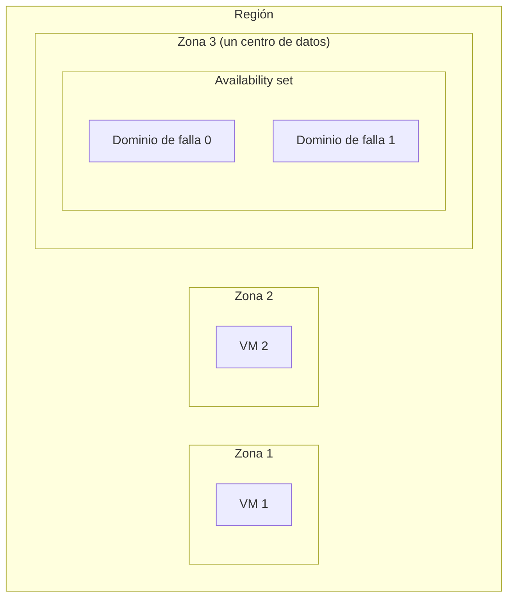

# Máquinas virtuales

Parte de: [[07-Azure/03 Cómputo/_Índice Cómputo|Cómputo]]

> [!info] Cómo avanzar
> `progreso`: **pendiente** → **viendo** (estudiando) → **visto** (contestaste la autoevaluación sin abrir las respuestas) → **dominado** (hiciste el laboratorio o lo aplicaste de verdad).

## Contenido

### Qué es
Una **máquina virtual (VM)** de Azure es un servidor Windows o Linux virtualizado en la infraestructura de Microsoft: **IaaS**. Tú eliges tamaño (CPU, RAM), imagen y discos, y administras **todo desde el sistema operativo hacia arriba**: parches, antivirus, configuración, runtime, respaldos de la aplicación. A cambio tienes control total.

### Cómo funciona
Una VM no es un solo recurso; al crearla aparecen varios:
- **VM** (cómputo), **disco del SO** y discos de datos (administrados), **NIC** (interfaz de red), **red virtual/subred**, **NSG** (reglas de firewall) y opcionalmente **IP pública**.
- **Tamaños** por familia: B (burstable, económicas para cargas ligeras), D (propósito general), E (memoria), F (cómputo), N (GPU).

**Estados y cobro**
| Estado | Cómo llegas | Cobra cómputo | Cobra discos/IP |
|---|---|---|---|
| Running | Iniciada | Sí | Sí |
| Stopped | Apagada desde el SO | **Sí** | Sí |
| Stopped (deallocated) | *Detener* en portal o `az vm deallocate` | No | **Sí** |

**Qué sigue cobrando tras desasignar**: los **discos administrados** (SO y datos, según tamaño y tipo), las **IPs públicas** (las de SKU Standard son estáticas y cobran mientras existan), **snapshots** e imágenes, y respaldos en Recovery Services. Para dejar de pagar todo, borra el grupo de recursos.

**Alta disponibilidad**
- **Conjunto de disponibilidad (availability set)**: reparte las VMs dentro de **un mismo centro de datos** en distintos **dominios de falla** (rack, energía, red) y **dominios de actualización** (mantenimiento planeado). Protege contra la falla de un rack o un reinicio por mantenimiento, no contra la caída del centro de datos. SLA de 99.95%.
- **Zonas de disponibilidad**: reparte las VMs en **centros de datos físicamente separados** dentro de la región, con energía, refrigeración y red independientes. Protege contra la pérdida de un centro de datos completo. SLA de 99.99% con dos o más VMs en zonas distintas.
- **Virtual Machine Scale Sets** (modo flexible) agrupan VMs idénticas con autoescalado y pueden usar zonas o dominios de falla; Microsoft ofrece una ruta para migrar de conjuntos de disponibilidad a scale sets.



**Conectarte sin exponer RDP/SSH a Internet**
- **Azure Bastion**: RDP/SSH desde el portal (o cliente nativo) por TLS; la VM no necesita IP pública. Tiene costo por hora según el SKU.
- **Just-in-time (JIT) de Defender for Cloud**: abre el puerto solo a tu IP y por tiempo limitado.
- **VPN** (punto a sitio o sitio a sitio) o ExpressRoute hacia la [[Virtual Network]].
- **Inicio de sesión con Entra ID** en Linux/Windows, y **Run Command** para ejecutar scripts sin conexión interactiva.

### Ejemplo
```bash
RG=rg-lab-vm
az group create -n $RG -l eastus --tags ambiente=lab
#- VM Linux sin IP pública; administración por Run Command o Bastion
az vm create -g $RG -n vm-lab --image Ubuntu2404 --size Standard_B1s \
  --admin-username azureuser --generate-ssh-keys --public-ip-address "" --nsg-rule NONE

az vm run-command invoke -g $RG -n vm-lab --command-id RunShellScript \
  --scripts "sudo apt-get update && sudo apt-get install -y nginx"

az vm deallocate -g $RG -n vm-lab        # deja de cobrar cómputo
az group delete -n $RG --yes --no-wait    # deja de cobrar todo
```
`Standard_B1s` está entre los tamaños con 750 horas gratuitas al mes durante 12 meses (ver [[Servicios de Azure gratuitos durante 12 meses]]).

### Cuándo usarlo y cuándo no
Una VM tiene sentido cuando **necesitas el sistema operativo**: software que no corre en PaaS (un servicio Windows heredado, un SQL Server con características que Azure SQL no tiene), migración *lift and shift* rápida, agentes de compilación propios para Azure DevOps, herramientas que requieren drivers o acceso administrativo, laboratorios de redes o seguridad. Para una API .NET o un sitio web, [[App Service]] o [[Container Apps]] te quitan parches, escalado y alta disponibilidad de encima.

### Errores comunes
1. **Apagar desde el SO** y seguir pagando cómputo.
2. **RDP 3389 o SSH 22 abiertos a Internet**: escaneos y fuerza bruta en minutos.
3. **Borrar la VM y dejar discos, NIC e IP** huérfanos cobrando.
4. **Una sola VM para producción** sin zonas ni conjunto de disponibilidad.
5. **No parchear**: en IaaS es tu responsabilidad (usa Azure Update Manager).

### Para profundizar
- [Información general de máquinas virtuales Linux en Azure](https://learn.microsoft.com/es-mx/azure/virtual-machines/linux/overview)
- [Opciones de disponibilidad para máquinas virtuales](https://learn.microsoft.com/es-mx/azure/virtual-machines/availability)
- [Estados y estado de facturación de las VMs](https://learn.microsoft.com/es-mx/azure/virtual-machines/states-billing)
- [¿Qué es Azure Bastion?](https://learn.microsoft.com/es-mx/azure/bastion/bastion-overview)

## Autoevaluación

Contesta primero en voz alta o en papel; luego despliega la respuesta.

> [!question]- ¿Cuándo tiene sentido una VM en vez de PaaS?
> Software que exige control del SO (instalaciones especiales, versiones viejas de IIS o .NET Framework con dependencias del servidor), migraciones *lift-and-shift* o licencias atadas al servidor. A cambio, tú parcheas y respaldas.

> [!question]- Diferencia entre conjunto de disponibilidad y zonas de disponibilidad.
> **Availability set**: reparte VMs en dominios de falla y de actualización dentro de un centro de datos. **Availability zones**: VMs en centros de datos físicamente separados de la región; protege contra la caída de uno completo.

> [!question]- ¿Qué sigue cobrando tras desasignar una VM?
> Los **discos administrados**, las IP públicas estáticas y los snapshots/respaldos. El cómputo deja de cobrarse solo en *Stopped (deallocated)*.

> [!question]- ¿Cómo te conectas a una VM sin exponer RDP/SSH a Internet?
> Con **Azure Bastion** o acceso *just-in-time* de Defender for Cloud; evita reglas NSG que abran 3389/22 a `*`.

