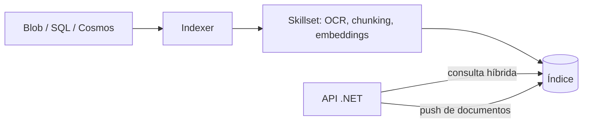

# Azure AI Search

Parte de: [[07-Azure/04 Datos/_Índice Datos|Datos]]

> [!info] Cómo avanzar
> `progreso`: **pendiente** → **viendo** (estudiando) → **visto** (contestaste la autoevaluación sin abrir las respuestas) → **dominado** (hiciste el laboratorio o lo aplicaste de verdad).

## Contenido

### Qué es
Azure AI Search es un servicio administrado de búsqueda: tú defines un **índice** (algo parecido a una tabla con campos tipados), lo llenas con documentos y luego lo consultas con texto libre, filtros, facetas y ordenamiento. Además de la búsqueda clásica por palabras, soporta **búsqueda vectorial** (por similitud de *embeddings*), **búsqueda híbrida** (ambas a la vez) y un *semantic ranker* que reordena los mejores resultados usando un modelo de lenguaje. Hoy es una de las piezas más comunes para armar RAG (*retrieval augmented generation*): el modelo de lenguaje responde con fragmentos que Search le entrega.

### Cómo funciona
El servicio tiene cuatro piezas que conviene distinguir:

- **Índice**: el esquema. Cada campo se marca como `searchable` (entra al análisis de texto), `filterable`, `sortable`, `facetable` o `retrievable`. Los campos vectoriales guardan arreglos de `float` con una dimensión fija y un perfil de búsqueda vectorial (algoritmo HNSW o búsqueda exhaustiva).
- **Fuente de datos (data source)**: la conexión a Blob Storage, Azure SQL, Cosmos DB u otras.
- **Indexer**: el proceso que lee la fuente, mapea campos y llena el índice. Se puede programar (cada hora, por ejemplo) y usa marcas de cambio (*high water mark*, columnas `rowversion`, fecha de modificación del blob) para procesar solo lo nuevo.
- **Skillset**: una cadena de enriquecimiento que corre dentro del indexer: OCR de imágenes y PDF escaneados, extracción de entidades o frases clave, partir documentos largos en fragmentos (*chunking*) y generar embeddings llamando a un modelo.

Si no quieres usar indexers, también puedes **empujar** documentos desde tu código con la API (`IndexDocuments`); es lo normal cuando tus datos viven en una base que el indexer no soporta, como Postgres.



Al consultar en modo **híbrido** se ejecutan en paralelo la búsqueda de texto completo (BM25) y la vectorial; los resultados se combinan con **RRF** (*Reciprocal Rank Fusion*), que premia a los documentos que salen arriba en ambas listas. ¿Por qué no solo vectores? Porque los embeddings capturan el significado, pero son malos con coincidencias exactas: un número de factura, un SKU, un nombre propio raro. El texto completo los encuentra perfecto. Juntos cubren las dos debilidades.

### Ejemplo
Búsqueda híbrida desde una API .NET 10 con el paquete `Azure.Search.Documents`, autenticando con Managed Identity (rol *Search Index Data Reader*):

```csharp
using Azure.Identity;
using Azure.Search.Documents;
using Azure.Search.Documents.Models;

var cliente = new SearchClient(
    new Uri("https://srch-dionisio-dev.search.windows.net"),
    "manuales",
    new DefaultAzureCredential());

float[] vector = await embeddings.GenerarAsync(pregunta); // tu servicio de embeddings

var opciones = new SearchOptions
{
    Size = 5,
    Filter = "categoria eq 'facturacion'",
    VectorSearch = new()
    {
        Queries = { new VectorizedQuery(vector) { KNearestNeighborsCount = 50, Fields = { "contenidoVector" } } }
    }
};
opciones.Select.Add("titulo");
opciones.Select.Add("contenido");

// El texto de búsqueda + la consulta vectorial = búsqueda híbrida
SearchResults<Fragmento> resultados = await cliente.SearchAsync<Fragmento>(pregunta, opciones);
await foreach (var r in resultados.GetResultsAsync())
    Console.WriteLine($"{r.Score:F3} {r.Document.Titulo}");

public record Fragmento(string Titulo, string Contenido);
```

### Cuándo usarlo y cuándo no
Úsalo cuando necesites búsqueda de calidad sobre muchos documentos (manuales, contratos, catálogo), facetas para filtrar resultados, o la parte de recuperación de un RAG en Azure. Si tu volumen es pequeño y ya tienes Postgres, `pgvector` más búsqueda de texto de Postgres puede bastar y te ahorra un servicio (ver [[Embeddings y bases vectoriales (pgvector y Azure AI Search)]]). Para un `LIKE` sobre una tabla de 5,000 filas, Search es exagerado.

Sobre costos: existe un nivel **Free** (uno por suscripción) con **50 MB** de almacenamiento y máximo **3 índices, 3 indexers, 3 fuentes de datos y 3 skillsets**; comparte infraestructura, no se puede escalar y puede eliminarse si queda inactivo mucho tiempo. Sirve para aprender, no para producción. Los niveles de pago (Basic, Standard…) se cobran por hora aunque no consultes, así que borra el servicio al terminar una práctica.

### Errores comunes
- **Cambiar el esquema y esperar que se actualice solo.** Muchos cambios a un campo existente (tipo, analizador, dimensiones del vector) exigen recrear el índice y reindexar. Versiona el nombre del índice (`manuales-v2`) y cambia el alias o la configuración de la app.
- **Fragmentos demasiado grandes o sin traslape.** Un chunk de 10 páginas diluye el significado del embedding; usa fragmentos de cientos de tokens con un poco de traslape.
- **Usar dimensiones distintas** entre el modelo que genera embeddings al indexar y el que usas al consultar: el vector de la pregunta debe venir del mismo modelo.
- **Llaves de administración en el front.** La *admin key* permite borrar índices. Desde el navegador nunca; desde tu API, mejor Managed Identity y RBAC.

### Para profundizar
- [¿Qué es Azure AI Search? (Microsoft Learn)](https://learn.microsoft.com/azure/search/search-what-is-azure-search)
- [Límites y cuotas por nivel de servicio](https://learn.microsoft.com/azure/search/search-limits-quotas-capacity)
- [Búsqueda híbrida y RRF](https://learn.microsoft.com/azure/search/hybrid-search-overview)

## Autoevaluación

Contesta primero en voz alta o en papel; luego despliega la respuesta.

> [!question]- ¿Qué es Azure AI Search?
> Servicio de búsqueda administrado: índices con búsqueda de texto completo, filtros y facetas, **búsqueda vectorial** e **híbrida**, y *semantic ranker*. Muy usado para RAG con modelos de lenguaje.

> [!question]- ¿Qué hacen los indexers y los skillsets?
> El **indexer** extrae datos de una fuente (Blob, SQL, Cosmos) y llena el índice periódicamente. El **skillset** enriquece en el camino (OCR, extracción de entidades, partir en fragmentos, generar embeddings).

> [!question]- ¿Por qué búsqueda híbrida y no solo vectorial?
> La vectorial capta significado pero falla con términos exactos (códigos, nombres propios); la de texto completo los encuentra. Híbrida combina ambas (RRF) y suele dar mejores resultados. Ver [[Embeddings y bases vectoriales (pgvector y Azure AI Search)]].

