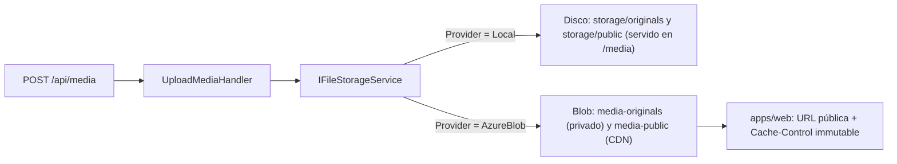

# Azure Blob Storage

> Almacenamiento de objetos de Azure para archivos (imágenes, videos) organizados en contenedores; [[Itzamna.Dionisio]] guarda ahí originales privados y variantes públicas de la biblioteca de medios, con el SDK `Azure.Storage.Blobs` 12.

## Qué es y qué problema resuelve
Guardar archivos en el disco del servidor no escala (varias instancias, reinicios, discos efímeros en App Service) y obliga a la API a servirlos. Blob Storage guarda **objetos** (bytes + metadatos) con llave de texto, los sirve por HTTPS (opcionalmente detrás de un CDN) y cobra por GB y por operación.

## Cómo funciona por dentro
- Jerarquía: **cuenta** → **contenedor** → **blob** (la "carpeta" es solo parte de la llave: `creador/asset/w960.webp`).
- Acceso: contenedores **privados** (requieren credencial o SAS) o con lectura pública anónima.
- Headers HTTP por blob (`Content-Type`, `Cache-Control`) que el navegador/CDN respeta.
- SDK: `BlobServiceClient` → `GetBlobContainerClient` → `GetBlobClient` → `UploadAsync` / `OpenReadAsync` / `DeleteIfExistsAsync`.



## Cuándo usarla y cuándo no
### Ventajas
- Escala sin administrar discos; barato por GB.
- Servido directo al navegador (o vía CDN) sin pasar por la API.
- Headers de caché por objeto.
### Desventajas
- Costo por operación y por egreso; hay que poner cuotas.
- Contenedor público = cualquiera con la URL lo ve.
- Consistencia de borrado: borrar en base y en blob no es atómico.

## Alternativas
| Alternativa | En qué se diferencia |
|---|---|
| Disco local / `wwwroot` | Lo que usa Dionisio en desarrollo; no sirve para varias instancias. |
| Amazon S3 / [[Cloudflare R2]] | Equivalentes en otras nubes (R2 sin costo de egreso; misma API que S3). |
| Azure Files | Recurso compartido SMB; pensado para montar como disco. |
| Base de datos (`varbinary`) | Simple, pero cara y lenta para archivos grandes. |

## Cómo se usó en Itzamna
- **Puerto** `IFileStorageService` en Application (`SaveAsync`, `OpenReadAsync`, `DeleteAsync`, `GetPublicUrl`) con dos contenedores lógicos en `StorageContainers`: `Originals = "media-originals"` ("Privado: nunca se sirve") y `Public = "media-public"` ("Público vía CDN o /media").
- **Adaptadores** (`Infrastructure/Storage/`): `LocalFileStorageService` (desarrollo; protege contra rutas fuera de la raíz) y `AzureBlobFileStorageService`. Se elige por `Storage:Provider` en `Infrastructure/DependencyInjection.cs` (`Local` por defecto, `AzureBlob` en `appsettings.Production.json`).
- **Configuración** `StorageOptions` ([[Options pattern]]): `PublicBaseUrl` ("Azure: el CDN o el contenedor"), `AzureConnectionString`, nombres de contenedores.

Subida con `Cache-Control` según contenedor (`Itzamna.Dionisio/src/Itzamna.Dionisio.Infrastructure/Storage/AzureBlobFileStorageService.cs`):
```csharp
var client = Container(container);
await client.CreateIfNotExistsAsync(cancellationToken: cancellationToken);
var blob = client.GetBlobClient(key);
await blob.UploadAsync(content, new BlobUploadOptions
{
    HttpHeaders = new BlobHttpHeaders
    {
        ContentType = contentType,
        CacheControl = container == StorageContainers.Public ? "public, max-age=31536000, immutable" : "private"
    }
}, cancellationToken);
```
- **Llaves**: `{creatorId:N}/{assetId:N}/original.ext`, `.../w{ancho}.webp`, `.../video.ext`. Como cada asset tiene id nuevo, una llave nunca cambia de contenido → `immutable` es seguro.
- **Costos** (`MediaLimitsOptions`): en producción 1 GB por creador y 10 GB totales de originales; los archivos repetidos (mismo SHA-256) se reutilizan. Al borrar un medio se elimina solo el original privado ([[Borrado lógico y auditoría]]).
- En local, `Program.cs` sirve `storage/public` en `/media` con el mismo `Cache-Control`.

Funcionalidad: [[Biblioteca de medios]]. Procesamiento de imágenes: [[ImageSharp]].

> [!note] Pendiente de confirmar
> El repo no muestra si hay CDN delante del contenedor público ni si el contenedor tiene acceso anónimo habilitado (se configura en Azure, no en código). `CreateIfNotExistsAsync` crea el contenedor sin acceso público, así que si no existe previamente las URLs públicas no funcionarían. La autenticación es por cadena de conexión (no identidad administrada).

> [!tip] Reutilizable
> El puerto `IFileStorageService` con adaptador Local + Azure, elegido por configuración, permite desarrollar sin Azure y desplegar sin tocar los casos de uso.

## Errores comunes y buenas prácticas
- Servir originales: pueden traer EXIF con ubicación. Aquí solo se publican variantes sin metadatos.
- `immutable` con llaves reutilizables: el navegador mostraría la versión vieja. Usar llaves únicas por contenido.
- Cadena de conexión en Git: va en App Settings.
- Sin cuotas: un usuario puede disparar el costo.

## Qué estudiar después
- [[ImageSharp]], [[Imágenes responsive]], [[Options pattern]]
- SAS tokens, identidad administrada, Azure CDN / Front Door, ciclo de vida (tiers cool/archive).

## Documentación oficial
- https://learn.microsoft.com/azure/storage/blobs/storage-blobs-introduction
- https://learn.microsoft.com/dotnet/api/overview/azure/storage.blobs-readme

## Subtemas

- [[Blob Storage - SAS (firmas de acceso compartido)]]
- [[Blob Storage - niveles de acceso y ciclo de vida]]

## Autoevaluación

Contesta primero en voz alta o en papel; luego despliega la respuesta.

> [!question]- ¿Cuál es la jerarquía de Blob Storage y qué es una «carpeta» ahí?
> Cuenta → contenedor → blob. Las carpetas no existen como tales: son parte del **nombre** del blob (`creador/asset/w960.webp`), salvo que actives el espacio de nombres jerárquico (Data Lake Gen2).

> [!question]- ¿Cómo das acceso temporal a un blob privado sin hacer público el contenedor?
> Con una **SAS** de corta duración, idealmente *user delegation SAS* firmada con Entra ID. Ver [[Blob Storage - SAS (firmas de acceso compartido)]].

> [!question]- ¿Por qué conviene Managed Identity en lugar de la cadena de conexión con llave de cuenta?
> La llave da **control total** de la cuenta y si se filtra hay que rotarla. Con Managed Identity + rol *Storage Blob Data Contributor* no hay secreto y el permiso es acotado.

> [!question]- Error común: subir imágenes sin `Content-Type`.
> El navegador puede descargarlas en vez de mostrarlas. Fija `ContentType` (y `CacheControl`) en `BlobHttpHeaders` al subir.

## Práctica

- [[Lab 3 - Blob Storage con SAS]]

