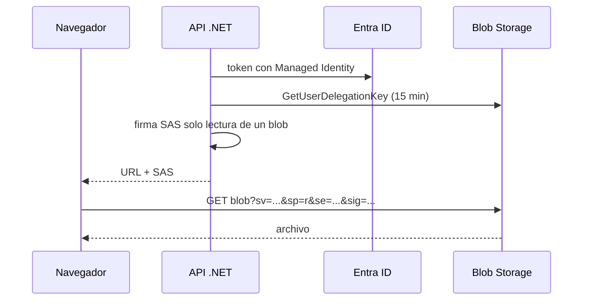

# Blob Storage - SAS (firmas de acceso compartido)

Parte de: [[Azure Blob Storage]]

> [!info] Cómo avanzar
> `progreso`: **pendiente** → **viendo** (estudiando) → **visto** (contestaste la autoevaluación sin abrir las respuestas) → **dominado** (hiciste el laboratorio o lo aplicaste de verdad).

## Contenido

### Qué es
Una **SAS** (*shared access signature*) es un conjunto de parámetros firmados que se agregan a la URL de un blob o contenedor. Quien tenga esa URL puede hacer exactamente lo que la firma permite (leer, escribir, listar…) y solo hasta la fecha de expiración, sin tener cuenta en tu tenant ni conocer las llaves. Es la forma estándar de dejar que un navegador descargue un reporte o suba una foto directamente a Storage sin pasar los bytes por tu API.

### Cómo funciona
Hay tres tipos, y la diferencia está en **con qué se firma**:

| Tipo | Se firma con | Alcance | Comentario |
|---|---|---|---|
| **User delegation SAS** | Una *user delegation key* obtenida con credenciales de Entra ID | Blobs y contenedores | La recomendada: no usa la llave de la cuenta y queda ligada a una identidad auditable |
| **Service SAS** | La llave de la cuenta | Un servicio (Blob, Queue, Table o File) | Puede ligarse a una *stored access policy* |
| **Account SAS** | La llave de la cuenta | Varios servicios a la vez | La más amplia; evítala salvo casos muy concretos |

Parámetros que siempre debes leer antes de compartir una SAS:

- `sp`: permisos (`r` leer, `w` escribir, `c` crear, `d` borrar, `l` listar). Para una descarga, solo `r`.
- `st` / `se`: inicio y expiración. Corto: minutos u horas, no semanas.
- `spr=https`: obliga HTTPS.
- `sr`: recurso (`b` blob, `c` contenedor). Un `sr=c` con `l` deja listar todo el contenedor.
- `sip`: rango de IP permitido (opcional).
- `sig`: la firma; si alguien cambia cualquier parámetro, la firma ya no coincide y Storage rechaza la petición.

**Revocación**, el punto delicado. Una SAS no se guarda en ningún lado: Storage solo valida la firma. Por eso:
- Si es **service SAS ligada a una stored access policy**, borras o modificas la política y todas las SAS que la usan dejan de funcionar.
- Si es service o account SAS **sin política**, la única forma es **rotar la llave** con que se firmó, lo que invalida todo lo demás firmado con esa llave (y cualquier cadena de conexión que la use).
- Si es **user delegation SAS**, puedes revocar las *user delegation keys* de la cuenta, o quitar el rol a la identidad que la generó. Además su vigencia máxima es de 7 días.



### Ejemplo
En Wee.Reporteria, la API genera el Excel, lo guarda en `reportes/` y devuelve una URL de descarga válida 15 minutos. La identidad de la app necesita un rol de datos (por ejemplo *Storage Blob Data Contributor*), que incluye el permiso para pedir la llave de delegación.

```csharp
using Azure.Identity;
using Azure.Storage.Blobs;
using Azure.Storage.Sas;

public sealed class GeneradorUrlDescarga(BlobServiceClient servicio)
{
    public async Task<Uri> CrearAsync(string contenedor, string nombreBlob, CancellationToken ct)
    {
        var inicio = DateTimeOffset.UtcNow.AddMinutes(-2);   // tolera relojes desfasados
        var fin = DateTimeOffset.UtcNow.AddMinutes(15);

        var llave = await servicio.GetUserDelegationKeyAsync(inicio, fin, ct);

        var sas = new BlobSasBuilder
        {
            BlobContainerName = contenedor,
            BlobName = nombreBlob,
            Resource = "b",                 // un solo blob
            StartsOn = inicio,
            ExpiresOn = fin,
            Protocol = SasProtocol.Https
        };
        sas.SetPermissions(BlobSasPermissions.Read);

        var blob = servicio.GetBlobContainerClient(contenedor).GetBlobClient(nombreBlob);
        var uri = new BlobUriBuilder(blob.Uri)
        {
            Sas = sas.ToSasQueryParameters(llave.Value, servicio.AccountName)
        };
        return uri.ToUri();
    }
}

// Program.cs
// builder.Services.AddSingleton(new BlobServiceClient(
//     new Uri("https://streporteriadev.blob.core.windows.net"), new DefaultAzureCredential()));
```

### Cuándo usarlo y cuándo no
Úsala para delegar acceso **temporal y acotado** a clientes que no tienen identidad en tu tenant: descargas, cargas directas desde React, compartir un archivo con un proveedor. No la uses como mecanismo de acceso permanente entre servicios: para eso, Managed Identity con RBAC. Y si el contenido debe protegerse por usuario (solo el dueño ve su archivo), la API debe validar la autorización **antes** de firmar la URL.

### Errores comunes
- **SAS de semanas o meses.** Si se filtra en un log o un correo, queda expuesta todo ese tiempo. Duración corta y genera otra cuando haga falta.
- **Firmar con la llave de la cuenta "porque es más fácil".** Tener la llave en la configuración de la app ya es un riesgo; con user delegation no la necesitas y puedes deshabilitar el acceso por llave compartida.
- **Permisos de más**: dar `rwdl` cuando solo se necesita `r`, o `sr=c` cuando bastaba un blob.
- **Relojes desfasados**: un `st` igual a "ahora" falla en clientes con el reloj adelantado; resta un par de minutos o no lo pongas.
- **Registrar la URL completa** en logs o Application Insights. La firma es la credencial; registra solo el nombre del blob.

### Para profundizar
- [Conceder acceso limitado con SAS (Microsoft Learn)](https://learn.microsoft.com/azure/storage/common/storage-sas-overview)
- [Crear una user delegation SAS con .NET](https://learn.microsoft.com/azure/storage/blobs/storage-blob-user-delegation-sas-create-dotnet)
- [Stored access policies](https://learn.microsoft.com/rest/api/storageservices/define-stored-access-policy)
- Práctica guiada: [[Lab 3 - Blob Storage con SAS]]

## Autoevaluación

Contesta primero en voz alta o en papel; luego despliega la respuesta.

> [!question]- ¿Qué es una SAS y qué tipos hay?
> Un token en la URL que concede permisos limitados (lectura, escritura…) por tiempo limitado. Tipos: **user delegation SAS** (firmada con credenciales de Entra ID, la recomendada), **service SAS** y **account SAS** (firmadas con la llave de la cuenta).

> [!question]- Se filtró una service SAS válida por 30 días. ¿Cómo la revocas?
> Si estaba ligada a una **stored access policy**, borras o cambias la política. Si no, solo **rotando la llave** de la cuenta con que se firmó (lo que invalida todo lo firmado con ella). Por eso: duración corta y user delegation SAS (se revoca revocando la delegación).

> [!question]- ¿Qué parámetros de una SAS revisas antes de compartirla?
> `sp` (permisos: solo `r` si es lectura), `se` (expiración), `spr=https`, el recurso (`sr`: blob vs contenedor) y opcionalmente `sip` (rango de IP).

## Práctica

- [[Lab 3 - Blob Storage con SAS]]

