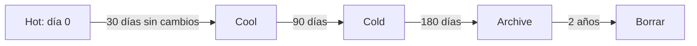

# Blob Storage - niveles de acceso y ciclo de vida

Parte de: [[Azure Blob Storage]]

> [!info] Cómo avanzar
> `progreso`: **pendiente** → **viendo** (estudiando) → **visto** (contestaste la autoevaluación sin abrir las respuestas) → **dominado** (hiciste el laboratorio o lo aplicaste de verdad).

## Contenido

### Qué es
Blob Storage cobra por dos cosas principales: **guardar** datos (GB al mes) y **operar** sobre ellos (lecturas, escrituras, recuperación de datos). Los **niveles de acceso** (*access tiers*) te dejan cambiar esa proporción: niveles donde guardar es caro pero leer es barato, y niveles donde guardar es baratísimo pero leer cuesta más o incluso tarda horas. La **política de ciclo de vida** mueve o borra blobs automáticamente según su antigüedad, para que no tengas que hacerlo a mano.

### Cómo funciona
Niveles disponibles (verificado en Microsoft Learn, noviembre 2026):

| Nivel | Tipo | Estancia mínima (GPv2) | Idea |
|---|---|---|---|
| **Hot** | En línea | No tiene | Datos que se leen o escriben seguido |
| **Cool** | En línea | 30 días | Acceso poco frecuente, se lee al instante |
| **Cold** | En línea | 90 días | Acceso raro, almacenamiento aún más barato |
| **Archive** | Sin conexión | 180 días | Respaldo de largo plazo; no se puede leer directamente |

Claves para entender la tabla:

- **Estancia mínima y penalización por salida anticipada**: si borras, sobrescribes o cambias de nivel un blob antes de que pase su mínimo, pagas los días restantes prorrateados. Un blob en Cool borrado a los 21 días paga 9 días más; uno en Archive borrado a los 45 días paga 135.
- **Archive está fuera de línea**: para leerlo hay que **rehidratarlo** a Hot, Cool o Cold con *Set Blob Tier* o copiándolo (*Copy Blob*). Con prioridad estándar puede tardar **hasta 15 horas**; con prioridad alta es más rápido pero más caro. Los metadatos y etiquetas sí se pueden leer mientras está archivado.
- El **nivel predeterminado de la cuenta** puede ser Hot, Cool o Cold, nunca Archive; Archive se asigna por blob.
- Microsoft agregó también un modo **smart tier** que mueve datos entre Hot, Cool y Cold según el uso (Pendiente de confirmar disponibilidad por región y precio).

La **política de ciclo de vida** es un JSON a nivel cuenta con reglas: un filtro (tipo de blob, prefijo, etiquetas de índice) y acciones con condiciones como `daysAfterModificationGreaterThan`, `daysAfterCreationGreaterThan` o `daysAfterLastAccessTimeGreaterThan` (este último requiere activar el seguimiento de último acceso). Azure evalúa las políticas aproximadamente una vez al día, así que el cambio no es inmediato. Las políticas **no pueden rehidratar** blobs archivados.



### Ejemplo
Wee.Reporteria guarda cada Excel generado en `reportes/`. Los usuarios lo descargan en los primeros días y casi nunca después; por auditoría debes conservarlos un año. Política:

```json
{
  "rules": [
    {
      "name": "reportes-a-frio",
      "enabled": true,
      "type": "Lifecycle",
      "definition": {
        "filters": { "blobTypes": [ "blockBlob" ], "prefixMatch": [ "reportes/" ] },
        "actions": {
          "baseBlob": {
            "tierToCool":  { "daysAfterModificationGreaterThan": 7 },
            "tierToCold":  { "daysAfterModificationGreaterThan": 60 },
            "delete":      { "daysAfterModificationGreaterThan": 365 }
          }
        }
      }
    }
  ]
}
```

```bash
# Aplica la política a la cuenta
az storage account management-policy create \
  --account-name streporteriadev -g rg-reporteria-dev \
  --policy @politica.json
```

No se manda a Archive porque un auditor puede pedir un reporte "para hoy" y no puede esperar 15 horas. Fíjate en las fechas: el blob entra a Cool el día 7 y sale a Cold el día 60, es decir, pasa 53 días en Cool, más que el mínimo de 30, así que no hay penalización.

### Cuándo usarlo y cuándo no
- **Hot**: archivos que la app sirve constantemente (imágenes de productos, adjuntos recientes).
- **Cool / Cold**: reportes viejos, respaldos que se consultan de vez en cuando, datos de auditoría.
- **Archive**: respaldos de cumplimiento que casi nunca se leen y donde esperar horas es aceptable.
- No uses niveles fríos para archivos pequeñísimos y muy numerosos con mucha lectura: lo que ahorras en almacenamiento lo pagas en operaciones. Calcula con la calculadora de precios antes de decidir.

### Errores comunes
- **Archivar lo que la app todavía lee.** La lectura falla con error hasta rehidratar y la salida anticipada se cobra. Archive solo para lo que de verdad es "por si acaso".
- **Encadenar reglas sin respetar mínimos**: mover a Cold a los 40 días algo que entró a Cool el día 30 genera penalización.
- **Esperar que la política actúe al instante.** Corre aproximadamente una vez al día; las primeras ejecuciones pueden tardar más.
- **Usar `daysAfterLastAccessTimeGreaterThan` sin activar** el seguimiento de último acceso en la cuenta.
- **Olvidar las versiones y snapshots**: si tienes versionado activo, agrega acciones para `version` o `snapshot`, o seguirán ocupando espacio en Hot.

### Para profundizar
- [Niveles de acceso para datos de blob](https://learn.microsoft.com/azure/storage/blobs/access-tiers-overview)
- [Rehidratar blobs desde Archive](https://learn.microsoft.com/azure/storage/blobs/archive-rehydrate-overview)
- [Políticas de administración del ciclo de vida](https://learn.microsoft.com/azure/storage/blobs/lifecycle-management-overview)
- Panorama del servicio: [[Azure Blob Storage]]

## Autoevaluación

Contesta primero en voz alta o en papel; luego despliega la respuesta.

> [!question]- ¿Qué niveles de acceso existen y cuál es la idea de cada uno?
> **Hot** (acceso frecuente), **Cool** y **Cold** (acceso poco frecuente: almacenamiento más barato, lectura más cara y estancia mínima) y **Archive** (sin conexión: hay que **rehidratar** antes de leer, puede tardar horas). Precios y mínimos (verificar en la página oficial).

> [!question]- ¿Qué hace una política de ciclo de vida?
> Reglas automáticas por antigüedad o último acceso: mover blobs a Cool/Cold/Archive o borrarlos (p. ej. logs después de 90 días).

> [!question]- Error común con Archive.
> Mandar ahí datos que la app lee de vez en cuando: la lectura falla hasta rehidratar y la salida anticipada tiene penalización.

