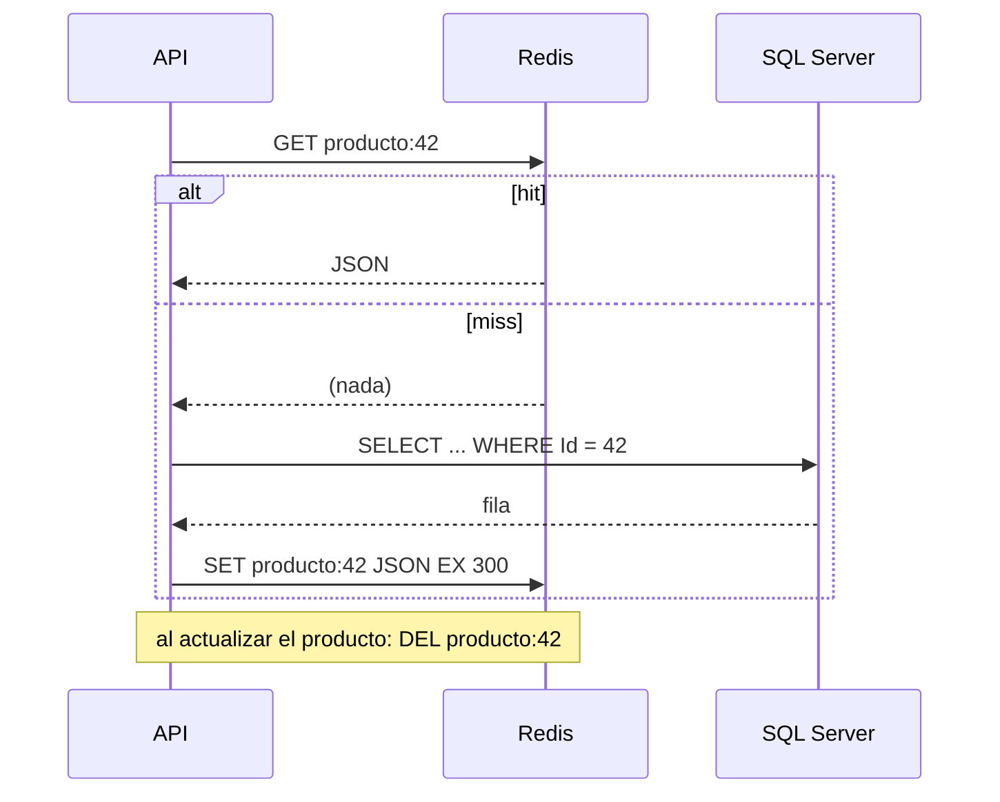

# Azure Cache for Redis

Parte de: [[07-Azure/04 Datos/_Índice Datos|Datos]]

> [!info] Cómo avanzar
> `progreso`: **pendiente** → **viendo** (estudiando) → **visto** (contestaste la autoevaluación sin abrir las respuestas) → **dominado** (hiciste el laboratorio o lo aplicaste de verdad).

## Contenido

### Qué es
Redis es un almacén **en memoria** de llave-valor con estructuras de datos (cadenas, hashes, listas, conjuntos, conjuntos ordenados, streams). Azure lo ofrece administrado: tú no instalas ni parchas servidores, solo eliges tamaño y te conectas. Frente a una API sirve sobre todo como **caché**: respuestas en microsegundos o pocos milisegundos para datos que se leen mucho y cambian poco, quitándole carga a SQL Server.

### Cómo funciona
Usos típicos frente a tu API:
- **Caché de datos** (catálogos, configuración, resultados de consultas caras).
- **Sesiones o estado compartido** entre varias instancias de App Service: si escalas a tres instancias, la memoria local de cada una no se comparte; Redis sí.
- **Rate limiting** con contadores atómicos (`INCR` + expiración) — ver [[Rate limiting]].
- **Pub/sub** y colas ligeras, cuando no necesitas las garantías de [[Service Bus]].

El patrón principal es **cache-aside** (la app administra la caché):



El **TTL** (tiempo de vida) es tu red de seguridad. Si es muy largo, los usuarios ven datos **obsoletos** (un precio viejo, un permiso revocado que sigue vigente). Si es muy corto, casi todo es *miss* y la caché no ayuda. Elige el TTL por cuánto tiempo tolera el negocio un dato viejo, e **invalida** la llave cuando escribes. Otro riesgo es la **estampida** (*cache stampede*): expira una llave muy popular y cien peticiones van a la base a la vez; se mitiga con un candado, TTL con variación aleatoria, o la `HybridCache` de .NET, que deduplica las cargas concurrentes.

**Cambio de producto que debes vigilar** (verificado en Microsoft Learn): Microsoft está migrando la oferta a **Azure Managed Redis**. Los niveles Basic, Standard y Premium de Azure Cache for Redis se retiran el **30 de septiembre de 2028** (las instancias restantes se deshabilitan desde el 1 de octubre de 2028), y Enterprise y Enterprise Flash el **31 de marzo de 2027**. Azure Managed Redis tiene niveles Memory Optimized, Balanced, Compute Optimized y Flash Optimized; el más pequeño es Balanced B0 (0.5 GB). Para algo nuevo, empieza ya en Azure Managed Redis.

### Ejemplo
Cache-aside explícito en Itzamna.Dionisio con `IDistributedCache` (paquete `Microsoft.Extensions.Caching.StackExchangeRedis`) y Dapper:

```csharp
// Program.cs
builder.Services.AddStackExchangeRedisCache(o =>
{
    o.Configuration = builder.Configuration.GetConnectionString("Redis"); // desde Key Vault
    o.InstanceName = "dionisio:";
});

// Features/Productos/ObtenerProducto.cs
public sealed class ObtenerProductoHandler(IDistributedCache cache, IProductoPorIdQuery query)
{
    private static readonly DistributedCacheEntryOptions Ttl = new()
    {
        AbsoluteExpirationRelativeToNow = TimeSpan.FromMinutes(5)
    };

    public async Task<ProductoDto?> HandleAsync(int id, CancellationToken ct)
    {
        string llave = $"producto:{id}";
        string? json = await cache.GetStringAsync(llave, ct);
        if (json is not null)
            return JsonSerializer.Deserialize<ProductoDto>(json);      // hit

        ProductoDto? producto = await query.EjecutarAsync(id, ct);    // miss: SQL en archivo .sql
        if (producto is not null)
            await cache.SetStringAsync(llave, JsonSerializer.Serialize(producto), Ttl, ct);
        return producto;
    }
}

// Al actualizar: await cache.RemoveAsync($"producto:{id}", ct);
```

Para la autenticación, Azure Managed Redis soporta Entra ID, así que puedes evitar la llave de acceso usando Managed Identity (paquete `Microsoft.Azure.StackExchangeRedis`).

### Cuándo usarlo y cuándo no
Úsalo cuando la misma información se lee muchas veces por segundo, cuando tienes varias instancias que deben compartir estado o cuando necesitas contadores rápidos. No lo uses como base de datos principal de información que no puedes perder, ni para cachear datos que cambian en cada petición. Con una sola instancia y datos pequeños, `IMemoryCache` (o `HybridCache` solo en memoria) es gratis y más simple. Redis administrado cobra por hora desde que lo creas: bórralo al terminar una práctica.

### Errores comunes
- **Sin TTL**: llaves eternas que se vuelven obsoletas y llenan la memoria hasta que Redis empieza a desalojar.
- **No invalidar al escribir**: actualizas SQL y la caché sigue sirviendo el valor viejo hasta que expira.
- **Valores gigantes** (listas completas de miles de registros en una llave): latencia alta y presión de red; cachea por elemento o pagina.
- **Crear una conexión por petición**: `ConnectionMultiplexer` debe ser único y reutilizado; `AddStackExchangeRedisCache` ya lo maneja.
- **Tratar la caché como obligatoria**: si Redis no responde, la API debe poder ir a la base (con tiempo de espera corto), no caerse.

### Para profundizar
- [Azure Managed Redis: introducción](https://learn.microsoft.com/azure/redis/overview)
- [Preguntas frecuentes del retiro de Azure Cache for Redis](https://learn.microsoft.com/azure/azure-cache-for-redis/retirement-faq)
- [Patrón Cache-Aside (Azure Architecture Center)](https://learn.microsoft.com/azure/architecture/patterns/cache-aside)
- [Caché distribuida en ASP.NET Core](https://learn.microsoft.com/aspnet/core/performance/caching/distributed)

## Autoevaluación

Contesta primero en voz alta o en papel; luego despliega la respuesta.

> [!question]- ¿Para qué usarías Redis frente a tu API?
> Caché de datos leídos con frecuencia (patrón *cache-aside*), sesiones compartidas entre instancias, *rate limiting*, colas ligeras y pub/sub.

> [!question]- Explica el patrón cache-aside.
> La app busca en caché; si no está (*miss*), lee de la base, guarda en caché con expiración (TTL) y responde. Al actualizar el dato, invalida la llave.

> [!question]- ¿Qué riesgo hay si pones un TTL muy largo?
> Datos **obsoletos**: los usuarios ven valores viejos. Elige TTL según cuánto tolera el negocio y invalida al escribir.

> [!question]- ¿Qué cambio de producto conviene vigilar?
> Microsoft está moviendo la oferta hacia **Azure Managed Redis** y anunció el retiro de niveles de Azure Cache for Redis (Pendiente de confirmar fechas y alcance).

