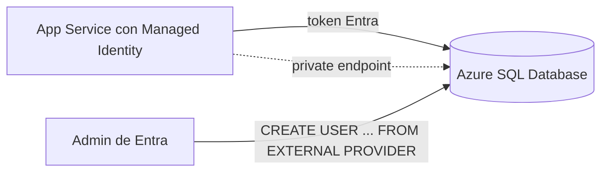

# Azure SQL Database

Parte de: [[07-Azure/04 Datos/_Índice Datos|Datos]]

> [!info] Cómo avanzar
> `progreso`: **pendiente** → **viendo** (estudiando) → **visto** (contestaste la autoevaluación sin abrir las respuestas) → **dominado** (hiciste el laboratorio o lo aplicaste de verdad).

## Contenido

### Qué es
Azure SQL Database es SQL Server como **servicio (PaaS)**: el mismo motor y casi el mismo T-SQL, pero Azure se encarga de respaldos automáticos, parches, alta disponibilidad y escalado. Tú administras esquemas, índices, procedimientos y permisos; no hay sistema operativo ni instancia que cuidar. La diferencia con SQL Server en una VM es justo esa: en la VM tienes control total (SQL Agent, linked servers, consultas entre bases, configuración de instancia) pero también todo el trabajo de operación. Detalle de diferencias en [[Azure SQL - diferencias con SQL Server]].

### Cómo funciona
**Servidor lógico y bases.** Creas un *servidor lógico* (`mi-servidor.database.windows.net`), que es solo un punto de conexión, firewall y administración; dentro creas bases independientes, cada una con su propio tamaño y precio.

**Modelos de compra:**
- **DTU**: paquetes fijos que combinan CPU, IO y memoria (Basic, Standard, Premium). Simple, pero no eliges cada recurso por separado.
- **vCore**: eliges núcleos y almacenamiento por separado, en niveles **General Purpose**, **Business Critical** e **Hyperscale**. Permite usar licencias existentes (Azure Hybrid Benefit) y la opción **serverless**.

**Serverless** escala el cómputo automáticamente entre un mínimo y un máximo de vCores, y en General Purpose puede **pausarse** tras un periodo sin actividad (mínimo 15 minutos, predeterminado 60): mientras está pausada solo pagas almacenamiento. La siguiente conexión la reanuda, pero esa primera conexión falla con un error transitorio mientras despierta. Por eso tu app **debe reintentar**, y debes evitar que health checks, jobs o herramientas abiertas la mantengan despierta. Ver [[Azure SQL serverless (auto-pausa y reintentos)]].

**Oferta gratuita** (verificada en Microsoft Learn): hasta **10 bases General Purpose serverless gratis por suscripción**, cada una con **100,000 segundos de vCore**, **32 GB de datos** y 32 GB de respaldo al mes, mientras viva la suscripción. Al agotar el mes eliges entre pausar hasta el mes siguiente o seguir pagando. No tiene SLA y se pausa tras 15 minutos de inactividad.

**Red y firewall.** Por defecto nadie puede conectarse. El firewall del servidor admite reglas por IP, la opción *Allow Azure services* (amplia: abre a cualquier recurso de Azure, incluso de otros clientes), o lo mejor: **private endpoint** y desactivar el acceso público (ver [[Private Endpoints]]). Si App Service recibe «Client with IP address ... is not allowed», es el firewall.

**Autenticación sin contraseña.** Defines un administrador de Entra ID en el servidor, activas [[Managed Identity]] en la app y creas un usuario para esa identidad dentro de la base.



### Ejemplo
Usuario para la identidad de Itzamna.Dionisio (se ejecuta conectado como admin de Entra):

```sql
-- db/seguridad/usuario-app.sql
CREATE USER [app-dionisio-prod] FROM EXTERNAL PROVIDER;
ALTER ROLE db_datareader ADD MEMBER [app-dionisio-prod];
ALTER ROLE db_datawriter ADD MEMBER [app-dionisio-prod];
GRANT EXECUTE ON SCHEMA::dbo TO [app-dionisio-prod];  -- procedimientos
```

Conexión con Dapper, Managed Identity y reintentos integrados de `Microsoft.Data.SqlClient`:

```csharp
// appsettings: "Server=tcp:sql-dionisio-prod.database.windows.net,1433;Database=dionisio;
//               Authentication=Active Directory Default;Encrypt=True;"
public sealed class SqlConnectionFactory(IConfiguration config)
{
    private static readonly SqlRetryLogicBaseProvider Reintentos =
        SqlConfigurableRetryFactory.CreateExponentialRetryProvider(new SqlRetryLogicOption
        {
            NumberOfTries = 5,
            DeltaTime = TimeSpan.FromSeconds(2),
            MaxTimeInterval = TimeSpan.FromSeconds(30)
        });

    public async Task<SqlConnection> AbrirAsync(CancellationToken ct)
    {
        var cn = new SqlConnection(config.GetConnectionString("Dionisio"))
        {
            RetryLogicProvider = Reintentos   // cubre la reanudación de serverless
        };
        await cn.OpenAsync(ct);
        return cn;
    }
}
```

Si usas [[Entity Framework Core]], el equivalente es `options.UseSqlServer(cs, sql => sql.EnableRetryOnFailure())`.

### Cuándo usarlo y cuándo no
Úsalo para apps nuevas o migradas que solo usan una base y T-SQL estándar: procedimientos, vistas, funciones, JSON, índices columnstore. Si dependes de SQL Agent, consultas entre bases, CLR o configuración de instancia, evalúa **Azure SQL Managed Instance**; si necesitas control total del SO o versiones específicas, SQL Server en una VM. Para aprender, la oferta gratuita cubre casi todo.

### Errores comunes
- **Activar *Allow Azure services* "para que funcione"** y olvidarlo: abre el servidor a cualquier recurso de Azure. Prefiere private endpoint o reglas concretas.
- **Serverless sin reintentos**: el primer usuario de la mañana recibe un error 500.
- **Mantener la base despierta sin querer** con un health check que hace `SELECT 1` cada minuto o con SSMS abierto: consume segundos de vCore.
- **Usuario y contraseña SQL en `appsettings.json`** del repositorio. Usa Managed Identity; si no se puede, Key Vault.
- **Dimensionar por miedo**: empezar en Business Critical para un sistema interno pequeño. Empieza chico, mide con Query Store y escala.

### Para profundizar
- [¿Qué es Azure SQL Database?](https://learn.microsoft.com/azure/azure-sql/database/sql-database-paas-overview)
- [Modelos de compra DTU y vCore](https://learn.microsoft.com/azure/azure-sql/database/purchasing-models)
- [Nivel serverless](https://learn.microsoft.com/azure/azure-sql/database/serverless-tier-overview)
- [Oferta gratuita de Azure SQL Database](https://learn.microsoft.com/azure/azure-sql/database/free-offer)

## Autoevaluación

Contesta primero en voz alta o en papel; luego despliega la respuesta.

> [!question]- ¿Qué es Azure SQL Database y en qué se diferencia de SQL Server en una VM?
> Base de datos PaaS con el motor de SQL Server: Azure hace respaldos, parches y alta disponibilidad. No hay acceso al SO ni algunas funciones de instancia (Agent, cross-database clásico). Ver [[Azure SQL - diferencias con SQL Server]].

> [!question]- ¿Qué son los modelos DTU y vCore?
> **DTU**: paquetes fijos de CPU/IO/memoria (Basic, Standard, Premium). **vCore**: eliges núcleos y almacenamiento por separado (General Purpose, Business Critical, Hyperscale) e incluye la opción **serverless**.

> [!question]- ¿Qué tienes que hacer en tu app para usar serverless con auto-pausa?
> Manejar **reintentos**: la primera conexión tras una pausa falla mientras la base reanuda. En EF Core, `EnableRetryOnFailure()`. Y evitar que health checks o jobs la mantengan despierta. Ver [[Azure SQL serverless (auto-pausa y reintentos)]].

> [!question]- Tu app en App Service no conecta a la base: «Client with IP address ... is not allowed». ¿Qué pasa?
> El **firewall** del servidor lógico bloquea la IP. Opciones: regla de firewall, *Allow Azure services* (amplio: permite cualquier recurso de Azure), o mejor, private endpoint + VNet integration.

> [!question]- ¿Cómo te autenticas sin contraseña desde App Service?
> Activa Managed Identity en la app, define un admin de Entra en el servidor y crea el usuario: `CREATE USER [nombre-app] FROM EXTERNAL PROVIDER; ALTER ROLE db_datareader ADD MEMBER [nombre-app];`. Cadena con `Authentication=Active Directory Default`.

