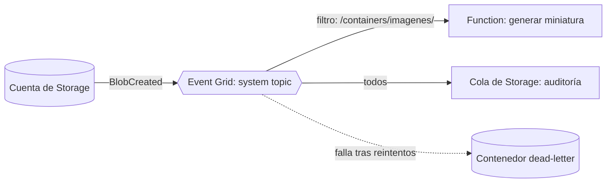

# Event Grid

Parte de: [[07-Azure/04 Datos/_Índice Datos|Datos]]

> [!info] Cómo avanzar
> `progreso`: **pendiente** → **viendo** (estudiando) → **visto** (contestaste la autoevaluación sin abrir las respuestas) → **dominado** (hiciste el laboratorio o lo aplicaste de verdad).

## Contenido

### Qué es
Azure Event Grid es un servicio de **enrutamiento de eventos** con modelo publicar/suscribir. Una fuente avisa que "algo pasó" (se creó un blob, se borró un recurso, se registró un pedido) y Event Grid **empuja** ese evento a cada suscriptor interesado: una Azure Function, un webhook, una cola de Storage, un tema de Service Bus o Event Hubs. Tu código no sondea nada: reacciona en segundos.

### Cómo funciona
Piezas:

- **Evento**: un JSON pequeño que describe el hecho (tipo, sujeto, hora, datos). Event Grid soporta su esquema propio y el estándar **CloudEvents 1.0**.
- **Fuente / tema (topic)**: dónde se publican. Los **system topics** son los de servicios de Azure (Storage, grupos de recursos, Key Vault, Container Registry…); los **custom topics** los creas tú para publicar tus propios eventos de negocio. También existe el modelo de **namespaces**, que agrega entrega por *pull* y MQTT.
- **Suscripción**: indica qué tipos de evento te interesan, filtros (por ejemplo `subjectBeginsWith` para un contenedor) y el destino (*handler*).

Entrega: Event Grid intenta entregar con **reintentos** y retroceso exponencial durante un tiempo; si no lo logra, puede mandar el evento a un contenedor de **dead-letter** que tú configuras. La entrega es *al menos una vez*: un evento puede llegar duplicado, así que el handler debe ser **idempotente** (ver [[Idempotencia]]). Tampoco garantiza orden.



**Regla rápida para elegir:**
- **Event Grid**: notificaciones discretas de que algo pasó; reaccionar. Volumen moderado, el evento es pequeño y el emisor no espera respuesta.
- **[[Service Bus]]**: comandos y mensajes de negocio que **deben** procesarse, con orden, sesiones, transacciones y dead-letter administrada.
- **[[Event Hubs]]**: flujos de muchísimos eventos (telemetría, clics, logs) que se guardan un tiempo y varios consumidores leen a su ritmo.

### Ejemplo
Procesar cada imagen subida al contenedor `imagenes` de la cuenta de Itzamna.Clio para generar miniaturas. Primero la Function (.NET 10, modelo *isolated worker*):

```csharp
using Azure.Messaging.EventGrid;
using Azure.Messaging.EventGrid.SystemEvents;
using Microsoft.Azure.Functions.Worker;

public sealed class GenerarMiniatura(ILogger<GenerarMiniatura> log, IServicioMiniaturas miniaturas)
{
    [Function(nameof(GenerarMiniatura))]
    public async Task Run([EventGridTrigger] EventGridEvent evento, CancellationToken ct)
    {
        if (!evento.TryGetSystemEventData(out object datos) || datos is not StorageBlobCreatedEventData blob)
            return;

        log.LogInformation("Nuevo blob {Url} (evento {Id})", blob.Url, evento.Id);
        // Idempotente: si la miniatura ya existe, no se vuelve a generar
        await miniaturas.GenerarSiNoExisteAsync(new Uri(blob.Url), ct);
    }
}
```

Luego la suscripción al *system topic* de la cuenta, filtrada por tipo y prefijo:

```bash
STORAGE_ID=$(az storage account show -n stcliodev -g rg-clio-dev --query id -o tsv)
FUNC_ID=$(az functionapp function show -g rg-clio-dev -n func-clio-dev \
  --function-name GenerarMiniatura --query id -o tsv)

az eventgrid event-subscription create \
  --name imagenes-a-miniaturas \
  --source-resource-id "$STORAGE_ID" \
  --endpoint-type azurefunction \
  --endpoint "$FUNC_ID" \
  --included-event-types Microsoft.Storage.BlobCreated \
  --subject-begins-with /blobServices/default/containers/imagenes/
```

El sujeto de un evento de blob tiene la forma `/blobServices/default/containers/<contenedor>/blobs/<nombre>`, por eso el filtro por prefijo selecciona un contenedor. Si la Function también escribe la miniatura en el mismo contenedor, agrega `--subject-ends-with` o escribe en otro contenedor para no crear un ciclo infinito.

### Cuándo usarlo y cuándo no
Úsalo para automatización reactiva sobre recursos de Azure (procesar archivos, reaccionar a despliegues o a secretos por vencer en Key Vault) y para difundir eventos de dominio a varios sistemas sin acoplarlos (ver [[Eventos de dominio y reacciones]]). No lo uses cuando necesitas orden estricto, procesamiento transaccional o mensajes grandes (el evento es pequeño: manda una referencia, no el archivo), ni para telemetría de alto volumen.

### Errores comunes
- **Handler no idempotente**: un evento duplicado genera dos cobros o dos correos.
- **Ciclos infinitos**: la Function escribe en el mismo contenedor que dispara el evento.
- **Sin dead-letter**: los eventos que fallan todos los reintentos se pierden sin dejar rastro.
- **Webhook sin validar**: los endpoints webhook deben responder el *handshake* de validación; si no, la suscripción no se crea.
- **Meter lógica pesada en el handler**: si tarda mucho, Event Grid lo cuenta como fallo y reintenta; encola el trabajo y responde rápido.

### Para profundizar
- [¿Qué es Azure Event Grid?](https://learn.microsoft.com/azure/event-grid/overview)
- [Eventos de Blob Storage en Event Grid](https://learn.microsoft.com/azure/event-grid/event-schema-blob-storage)
- [Comparación entre Event Grid, Event Hubs y Service Bus](https://learn.microsoft.com/azure/service-bus-messaging/compare-messaging-services)

## Autoevaluación

Contesta primero en voz alta o en papel; luego despliega la respuesta.

> [!question]- ¿Qué es Event Grid?
> Servicio de **enrutamiento de eventos** pub/sub: fuentes (p. ej. una cuenta de almacenamiento, un grupo de recursos o tus temas personalizados) publican eventos discretos y Event Grid los **empuja** a suscriptores (Functions, webhooks, colas).

> [!question]- Quieres procesar cada imagen subida a un contenedor. ¿Cómo lo armarías con Event Grid?
> Suscripción a `Microsoft.Storage.BlobCreated` del *system topic* de la cuenta, filtrada por prefijo del contenedor, con destino a una Function. Reacciona en segundos sin sondear.

> [!question]- ¿Event Grid, Service Bus o Event Hubs? Regla rápida.
> **Event Grid**: «algo pasó», reaccionar. **Service Bus**: comandos/mensajes de negocio con entrega confiable. **Event Hubs**: flujos de muchos eventos (telemetría) para analizar.

