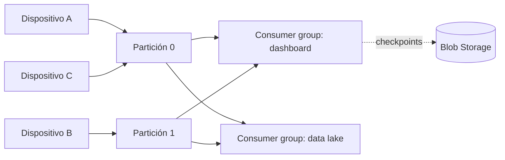

# Event Hubs

Parte de: [[07-Azure/04 Datos/_Índice Datos|Datos]]

> [!info] Cómo avanzar
> `progreso`: **pendiente** → **viendo** (estudiando) → **visto** (contestaste la autoevaluación sin abrir las respuestas) → **dominado** (hiciste el laboratorio o lo aplicaste de verdad).

## Contenido

### Qué es
Azure Event Hubs es una plataforma de **ingesta de streams de eventos** a gran escala: recibe millones de eventos por segundo (telemetría de dispositivos, logs, clics, cambios de datos), los **retiene** durante un periodo y permite que varias aplicaciones los lean, cada una a su ritmo y desde donde se quedó. Se parece más a un log distribuido como Apache Kafka que a una cola: leer un evento no lo borra.

### Cómo funciona
- **Namespace**: el contenedor administrativo, con su nivel (Basic, Standard, Premium, Dedicated) y su capacidad.
- **Event hub**: el stream concreto (equivale a un *topic* de Kafka).
- **Particiones**: el event hub se divide en particiones; cada una es una secuencia ordenada de eventos. Los productores mandan eventos con una **partition key** (por ejemplo el id del dispositivo) y todos los eventos con la misma llave caen en la misma partición, así que **se conserva el orden por llave**. Entre particiones no hay orden global. El número de particiones define el paralelismo máximo de lectura.
- **Consumer group**: una vista independiente del stream. Cada aplicación lectora usa su propio consumer group y lleva su propio **checkpoint** (offset por partición) para saber dónde va. Así el dashboard en tiempo real y el proceso que guarda en un data lake leen los mismos eventos sin estorbarse.
- **Retención**: los eventos se borran cuando vence su tiempo de retención, no cuando se leen.
- **Capture**: guarda automáticamente el stream en Blob Storage o Data Lake en formato Avro o Parquet.

Límites por nivel (verificados en Microsoft Learn):

| Nivel | Retención máxima | Consumer groups por event hub | Kafka |
|---|---|---|---|
| Basic | 1 día | 1 | No |
| Standard | 7 días | 20 | Sí |
| Premium | 90 días | 100 | Sí |
| Dedicated | 90 días | 1,000 | Sí |

**Compatibilidad con Kafka.** Desde Standard, Event Hubs expone un endpoint que habla el protocolo de Apache Kafka (puerto 9093). Una app que ya usa un cliente Kafka puede apuntar al namespace cambiando la configuración (servidor `<namespace>.servicebus.windows.net:9093`, SASL sobre TLS) sin reescribir código ni operar un clúster Kafka.



### Ejemplo
Productor y consumidor en .NET 10 (paquetes `Azure.Messaging.EventHubs` y `Azure.Messaging.EventHubs.Processor`). El procesador reparte particiones entre instancias y guarda checkpoints en un contenedor de blobs.

```csharp
// Productor: telemetría del dron agrupada por número de serie
await using var productor = new EventHubProducerClient(
    "evh-telemetria-dev.servicebus.windows.net", "vuelos", new DefaultAzureCredential());

using EventDataBatch lote = await productor.CreateBatchAsync(
    new CreateBatchOptions { PartitionKey = "mini4k-SN123" });
lote.TryAdd(new EventData(JsonSerializer.SerializeToUtf8Bytes(new { altura = 87.5, bateria = 64 })));
await productor.SendAsync(lote);

// Consumidor con checkpoints
var checkpoints = new BlobContainerClient(
    new Uri("https://sttelemetriadev.blob.core.windows.net/checkpoints"), new DefaultAzureCredential());

var procesador = new EventProcessorClient(checkpoints, "dashboard",
    "evh-telemetria-dev.servicebus.windows.net", "vuelos", new DefaultAzureCredential());

procesador.ProcessEventAsync += async args =>
{
    Console.WriteLine($"P{args.Partition.PartitionId}: {args.Data.EventBody}");
    await args.UpdateCheckpointAsync();   // en producción, cada N eventos, no en cada uno
};
procesador.ProcessErrorAsync += args =>
{
    Console.Error.WriteLine(args.Exception.Message);
    return Task.CompletedTask;
};

await procesador.StartProcessingAsync();
```

### Cuándo usarlo y cuándo no
Úsalo para flujos continuos y masivos: telemetría, logs centralizados, *clickstream*, captura de cambios, o como reemplazo administrado de Kafka. No lo uses para mensajes de negocio que deben procesarse una vez con reintentos por mensaje y dead-letter (eso es [[Service Bus]]), ni para notificaciones esporádicas de "algo pasó" ([[Event Grid]]). En Event Hubs no puedes "rechazar" un evento individual: el consumidor avanza su checkpoint y decide qué hacer con los errores.

### Errores comunes
- **Pocas particiones**: limitan el paralelismo de lectura y en niveles Basic y Standard no se pueden aumentar después. Calcula el máximo de consumidores paralelos que necesitarás.
- **Varias apps en el mismo consumer group**: se roban particiones y checkpoints. Un consumer group por aplicación.
- **Checkpoint en cada evento**: muchas escrituras a Blob y menos rendimiento. Hazlo por lotes o por tiempo, y acepta reprocesar algunos eventos tras un reinicio (procesamiento idempotente).
- **Usar una partition key de baja cardinalidad**: todo cae en una partición caliente.
- **Esperar Kafka en Basic**: no está disponible.

### Para profundizar
- [¿Qué es Azure Event Hubs?](https://learn.microsoft.com/azure/event-hubs/event-hubs-about)
- [Comparación de niveles de Event Hubs](https://learn.microsoft.com/azure/event-hubs/compare-tiers)
- [Event Hubs para Apache Kafka](https://learn.microsoft.com/azure/event-hubs/azure-event-hubs-apache-kafka-overview)

## Autoevaluación

Contesta primero en voz alta o en papel; luego despliega la respuesta.

> [!question]- ¿Para qué sirve Event Hubs?
> Ingesta de **streams** de eventos a gran escala (telemetría, logs, clics). Los eventos se retienen un tiempo y varios consumidores los leen a su ritmo.

> [!question]- ¿Qué son particiones y consumer groups?
> Las **particiones** reparten el flujo y dan orden dentro de cada una (por *partition key*). Un **consumer group** es una vista independiente del stream: cada aplicación lectora lleva su propio avance (*checkpoint*).

> [!question]- ¿Por qué tus apps Kafka pueden usar Event Hubs?
> Event Hubs expone un endpoint compatible con el protocolo de **Apache Kafka** (en los niveles que lo incluyen), así que muchos clientes Kafka funcionan cambiando la configuración (verificar en la página oficial).

