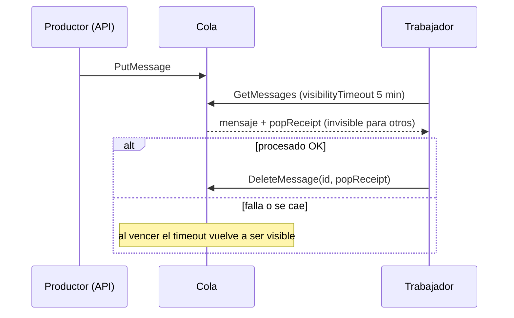

# Queue Storage y Table Storage

Parte de: [[07-Azure/04 Datos/_Índice Datos|Datos]]

> [!info] Cómo avanzar
> `progreso`: **pendiente** → **viendo** (estudiando) → **visto** (contestaste la autoevaluación sin abrir las respuestas) → **dominado** (hiciste el laboratorio o lo aplicaste de verdad).

## Contenido

### Qué es
Son dos servicios que viven dentro de una **cuenta de Azure Storage**, junto a Blob, y comparten su modelo de precios muy bajo:

- **Queue Storage**: colas simples para desacoplar trabajo. Un productor encola mensajes pequeños y uno o varios trabajadores los procesan después.
- **Table Storage**: almacén NoSQL de **entidades** llave-valor con esquema flexible, pensado para grandes volúmenes de datos sencillos que se buscan por llave.

### Cómo funciona
**Queue Storage.** Cada mensaje puede medir hasta **64 KB** (verificado en Microsoft Learn) y, si no indicas otra cosa, vive **7 días** antes de expirar; con versiones recientes de la API puedes darle cualquier tiempo de vida o `-1` para que no expire. Una cola puede tener millones de mensajes, hasta la capacidad de la cuenta. El ciclo de un mensaje:



Al leer, el mensaje no se borra: se vuelve **invisible** durante el *visibility timeout*. Si el trabajador no lo borra a tiempo, reaparece y otro lo toma. Por eso la entrega es *al menos una vez* y el trabajador debe ser idempotente. Cada mensaje trae un `DequeueCount`: úsalo para mandar a una cola de "venenosos" los que fallan una y otra vez (Azure Functions lo hace solo, con la cola `<nombre>-poison`). No hay orden garantizado ni dead-letter nativa.

**¿Cuándo pasar a [[Service Bus]]?** Cuando necesites orden FIFO (sesiones), dead-letter integrada, temas con suscripciones (pub/sub), transacciones, detección de duplicados, mensajes de más de 64 KB o bloqueo con renovación. Queue Storage gana en simplicidad y costo cuando solo quieres "una lista de pendientes".

**Table Storage.** Cada entidad tiene **PartitionKey** y **RowKey**; juntas forman la llave primaria única, y la tabla se ordena por ellas. Las demás propiedades son libres (hasta 252 propiedades por entidad, 1 MB por entidad). Consultas eficientes:
- Por `PartitionKey` + `RowKey`: búsqueda puntual, la más rápida.
- Por `PartitionKey` y un rango de `RowKey`: barrido de una partición.
- Por cualquier otra propiedad: **recorre la tabla** (lento y caro). No hay índices secundarios.

Diseñas las llaves pensando en cómo vas a leer. Si después necesitas índices secundarios, distribución global o más rendimiento, existe la **API Table de [[Cosmos DB]]**, que usa el mismo SDK (`Azure.Data.Tables`).

### Ejemplo
Itzamna.Dionisio encola la generación de un reporte pesado y un worker lo procesa; el estado del trabajo se guarda en Table Storage.

```csharp
using Azure.Data.Tables;
using Azure.Identity;
using Azure.Storage.Queues;

var cred = new DefaultAzureCredential();
var cola = new QueueClient(new Uri("https://stdionisiodev.queue.core.windows.net/reportes"), cred,
    new QueueClientOptions { MessageEncoding = QueueMessageEncoding.Base64 }); // Base64 lo espera Functions
var tabla = new TableClient(new Uri("https://stdionisiodev.table.core.windows.net"), "TrabajosReporte", cred);

// Productor (API)
var trabajo = new TrabajoReporte { PartitionKey = "tenant-017", RowKey = Guid.NewGuid().ToString("N"), Estado = "Pendiente" };
await tabla.AddEntityAsync(trabajo);
await cola.SendMessageAsync(JsonSerializer.Serialize(new { trabajo.PartitionKey, trabajo.RowKey }));

// Trabajador
foreach (var msg in (await cola.ReceiveMessagesAsync(maxMessages: 10, visibilityTimeout: TimeSpan.FromMinutes(5))).Value)
{
    var ids = JsonSerializer.Deserialize<IdsTrabajo>(msg.MessageText)!;
    // ... generar el Excel ...
    await tabla.UpdateEntityAsync(new TrabajoReporte { PartitionKey = ids.PartitionKey, RowKey = ids.RowKey, Estado = "Listo" },
        ETag.All, TableUpdateMode.Merge);
    await cola.DeleteMessageAsync(msg.MessageId, msg.PopReceipt);   // solo si terminó bien
}

public sealed class TrabajoReporte : ITableEntity
{
    public string PartitionKey { get; set; } = "";
    public string RowKey { get; set; } = "";
    public string Estado { get; set; } = "";
    public DateTimeOffset? Timestamp { get; set; }
    public ETag ETag { get; set; }
}
public record IdsTrabajo(string PartitionKey, string RowKey);
```

La identidad necesita los roles *Storage Queue Data Contributor* y *Storage Table Data Contributor*.

### Cuándo usarlo y cuándo no
Queue Storage: trabajos en segundo plano sencillos, picos de carga que quieres amortiguar, integración con un trigger de cola de [[Azure Functions]]. Table Storage: logs de negocio, estados de trabajos, configuraciones por tenant, catálogos grandes que se leen por llave. Evítalos si necesitas consultas relacionales, orden de mensajes o garantías transaccionales entre colas.

### Errores comunes
- **Borrar el mensaje antes de procesarlo**: si el proceso falla, el trabajo se pierde.
- **Visibility timeout más corto que el trabajo**: el mensaje reaparece y dos workers hacen lo mismo.
- **Mandar el archivo en el mensaje**: 64 KB se acaban rápido; guarda el archivo en Blob y encola la referencia.
- **Consultar Table Storage por una propiedad que no es llave** en tablas grandes: recorrido completo y lentitud.
- **PartitionKey única para todo**: todas las operaciones caen en una partición y limitas el rendimiento.

### Para profundizar
- [¿Qué es Azure Queue Storage?](https://learn.microsoft.com/azure/storage/queues/storage-queues-introduction)
- [Colas de Storage frente a colas de Service Bus](https://learn.microsoft.com/azure/service-bus-messaging/service-bus-azure-and-service-bus-queues-compared-contrasted)
- [Guía de diseño de Table Storage](https://learn.microsoft.com/azure/storage/tables/table-storage-design-guidelines)

## Autoevaluación

Contesta primero en voz alta o en papel; luego despliega la respuesta.

> [!question]- ¿Para qué sirve Queue Storage?
> Colas simples y baratas para desacoplar trabajo: un productor encola mensajes pequeños (máximo 64 KB) y uno o varios trabajadores los procesan; si el trabajador no borra el mensaje a tiempo, vuelve a ser visible.

> [!question]- ¿Cuándo eliges Service Bus en lugar de Queue Storage?
> Cuando necesitas orden FIFO (sesiones), *dead-letter* nativa, temas/suscripciones (pub/sub), transacciones, detección de duplicados o mensajes más grandes.

> [!question]- ¿Qué es Table Storage y cuál es su llave?
> Almacén NoSQL clave-valor de entidades con esquema flexible. Llave: **PartitionKey + RowKey**; las consultas por otras propiedades recorren la tabla. Hoy también existe la API Table de Cosmos DB.

