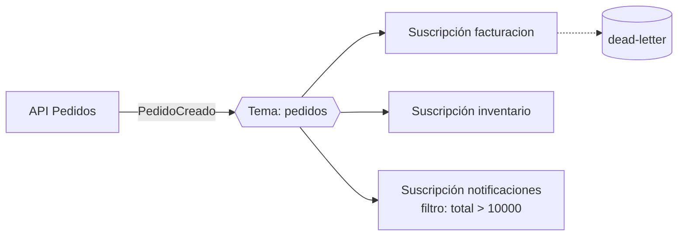

# Service Bus

Parte de: [[07-Azure/04 Datos/_Índice Datos|Datos]]

> [!info] Cómo avanzar
> `progreso`: **pendiente** → **viendo** (estudiando) → **visto** (contestaste la autoevaluación sin abrir las respuestas) → **dominado** (hiciste el laboratorio o lo aplicaste de verdad).

## Contenido

### Qué es
Azure Service Bus es un **broker de mensajes empresarial** administrado. Sirve para que un sistema mande **comandos o mensajes de negocio** a otro de forma confiable: el mensaje queda guardado hasta que alguien lo procesa con éxito, aunque el consumidor esté caído o lento. Ofrece colas, temas con suscripciones, sesiones para orden FIFO, dead-letter, transacciones, mensajes programados y detección de duplicados.

### Cómo funciona
**Cola vs tema.**
- **Cola**: punto a punto. Cada mensaje lo procesa **un solo** consumidor, aunque haya varios compitiendo (*competing consumers*).
- **Tema (topic)**: publicar/suscribir. El emisor publica una vez y **cada suscripción recibe su propia copia**; cada suscripción se comporta como una cola y puede tener **filtros** (SQL o por propiedades) para recibir solo lo que le interesa. Los temas requieren nivel Standard o Premium.



**Modos de recepción.**
- **Peek-lock** (el normal): el mensaje se entrega **bloqueado** por un tiempo (*lock duration*). Si terminas bien llamas a *Complete* y se borra; si algo falla llamas a *Abandon* (o dejas expirar el bloqueo) y vuelve a estar disponible. Cada intento incrementa su *DeliveryCount*.
- **Receive and delete**: el mensaje se borra en cuanto se entrega. Más rápido, pero si tu proceso se cae a la mitad, **el mensaje se pierde**. Solo para datos que puedes perder.

**Dead-letter queue (DLQ).** Cada cola y cada suscripción tiene una subcola `$DeadLetterQueue`. Ahí van los mensajes que superan el **número máximo de entregas** (`MaxDeliveryCount`, 10 por defecto), los que **expiran** (si activaste dead-letter por expiración), los que no pasan una regla de filtro configurada así, y los que tu código manda explícitamente con *DeadLetter* (con motivo y descripción). Nada sale de la DLQ solo: hay que **monitorearla** (alerta por número de mensajes) y decidir si se reprocesan o se descartan.

**Sesiones.** Si activas sesiones en la entidad y los mensajes llevan `SessionId` (por ejemplo el id del pedido), Service Bus garantiza que todos los mensajes de una sesión se entregan **en orden** y a **un solo consumidor a la vez**. Así "PedidoCreado → PedidoPagado → PedidoEnviado" nunca se procesan desordenados ni en paralelo.

**Niveles y tamaños** (verificado en Microsoft Learn): Basic (solo colas), Standard (256 KB por mensaje) y Premium (recursos dedicados, 1 MB predeterminado y hasta 100 MB por entidad usando AMQP).

### Ejemplo
Itzamna.Dionisio publica `PedidoCreado` y el servicio de facturación lo consume en peek-lock. Paquete `Azure.Messaging.ServiceBus`, autenticación con Managed Identity (roles *Azure Service Bus Data Sender* / *Data Receiver*).

```csharp
await using var cliente = new ServiceBusClient("sb-dionisio-prod.servicebus.windows.net", new DefaultAzureCredential());

// Publicar
ServiceBusSender emisor = cliente.CreateSender("pedidos");
var msg = new ServiceBusMessage(BinaryData.FromObjectAsJson(new { PedidoId = 1042, Total = 18500m }))
{
    MessageId = "pedido-1042-creado",   // con detección de duplicados, reenvíos con el mismo id se descartan
    Subject = "PedidoCreado",
    SessionId = "pedido-1042",
    ContentType = "application/json"
};
await emisor.SendMessageAsync(msg);

// Consumir una suscripción con sesiones
ServiceBusSessionProcessor proc = cliente.CreateSessionProcessor("pedidos", "facturacion",
    new ServiceBusSessionProcessorOptions { AutoCompleteMessages = false, MaxConcurrentSessions = 8 });

proc.ProcessMessageAsync += async args =>
{
    try
    {
        var pedido = args.Message.Body.ToObjectFromJson<PedidoCreado>();
        await facturacion.EmitirAsync(pedido, args.CancellationToken);   // idempotente
        await args.CompleteMessageAsync(args.Message);
    }
    catch (DatosInvalidosException ex)
    {
        // No tiene caso reintentar: directo a la DLQ con el motivo
        await args.DeadLetterMessageAsync(args.Message, "DatosInvalidos", ex.Message);
    }
    // Otras excepciones: no se completa; al vencer el lock se reintenta hasta MaxDeliveryCount
};
proc.ProcessErrorAsync += args => { logger.LogError(args.Exception, "Service Bus"); return Task.CompletedTask; };
await proc.StartProcessingAsync();

public record PedidoCreado(int PedidoId, decimal Total);
```

Para publicar de forma consistente con tu transacción de base de datos, combina esto con el [[Patrón Outbox]].

### Cuándo usarlo y cuándo no
Úsalo para integraciones de negocio donde perder o duplicar un mensaje cuesta dinero: pedidos, pagos, facturación, sincronización entre sistemas, flujos con orden por entidad. Para simples trabajos en segundo plano baratos basta [[Queue Storage y Table Storage]]; para notificaciones de recursos de Azure, [[Event Grid]]; para telemetría masiva, [[Event Hubs]].

### Errores comunes
- **Nadie mira la DLQ**: los mensajes fallidos se acumulan durante meses. Crea una alerta sobre la métrica de mensajes en dead-letter.
- **Receive and delete en procesos críticos**: un reinicio del contenedor pierde el mensaje.
- **Trabajo más largo que el lock**: el mensaje se libera y otro consumidor lo procesa en paralelo. Ajusta la duración, renueva el bloqueo (el procesador lo hace con `MaxAutoLockRenewalDuration`) o divide el trabajo.
- **Consumidores no idempotentes**: la entrega es al menos una vez; un reintento puede repetir un cobro.
- **Cadena de conexión con la llave `RootManageSharedAccessKey`** en la app: da control total del namespace. Usa Managed Identity con roles de datos.

### Para profundizar
- [¿Qué es Azure Service Bus?](https://learn.microsoft.com/azure/service-bus-messaging/service-bus-messaging-overview)
- [Colas, temas y suscripciones](https://learn.microsoft.com/azure/service-bus-messaging/service-bus-queues-topics-subscriptions)
- [Dead-letter queues](https://learn.microsoft.com/azure/service-bus-messaging/service-bus-dead-letter-queues)
- [Sesiones de mensajes](https://learn.microsoft.com/azure/service-bus-messaging/message-sessions)

## Autoevaluación

Contesta primero en voz alta o en papel; luego despliega la respuesta.

> [!question]- ¿Qué diferencia hay entre una cola y un tema (topic) de Service Bus?
> Cola: cada mensaje lo procesa **un** consumidor. Tema: cada **suscripción** recibe su copia (pub/sub), con filtros opcionales.

> [!question]- ¿Qué es la *dead-letter queue*?
> Subcola donde van los mensajes que superan el número máximo de entregas, expiran o se rechazan explícitamente. Hay que monitorearla y reprocesar o descartar.

> [!question]- Diferencia entre modos *Peek-lock* y *Receive and delete*.
> Peek-lock bloquea el mensaje y solo se elimina al **completarlo**; si el consumidor falla, vuelve a la cola. Receive and delete lo borra al recibirlo: si el proceso falla, el mensaje se pierde.

> [!question]- ¿Para qué son las sesiones?
> Garantizar orden FIFO y procesamiento por un solo consumidor para mensajes del mismo `SessionId` (p. ej. todos los de un pedido).

