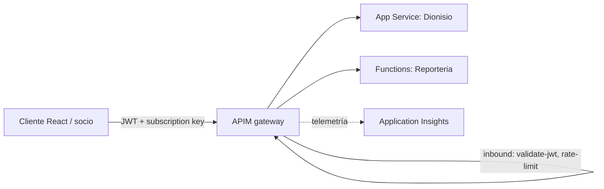

# API Management

Parte de: [[07-Azure/05 Integración/_Índice Integración|Integración]]

> [!info] Cómo avanzar
> `progreso`: **pendiente** → **viendo** (estudiando) → **visto** (contestaste la autoevaluación sin abrir las respuestas) → **dominado** (hiciste el laboratorio o lo aplicaste de verdad).

## Contenido

### Qué es
Azure API Management (APIM) es un **gateway administrado** que se pone delante de tus APIs (App Service, Functions, Container Apps, servicios on-premises o de terceros). Los clientes llaman a APIM y APIM reenvía al backend, aplicando en el camino reglas comunes: validar tokens, limitar llamadas, transformar peticiones, cachear respuestas, registrar métricas. Incluye además un **portal para desarrolladores** donde los consumidores leen la documentación, prueban operaciones y obtienen sus llaves.

### Cómo funciona
Tiene tres planos:
- **Gateway**: recibe el tráfico y ejecuta las **políticas**.
- **Plano de administración**: donde defines APIs (importando un OpenAPI, por ejemplo el que genera tu ASP.NET Core), operaciones, productos y políticas.
- **Portal del desarrollador**: documentación y autoservicio.

**Políticas.** Son instrucciones XML que se ejecutan en cuatro secciones: `inbound` (antes de llamar al backend), `backend`, `outbound` (al regresar la respuesta) y `on-error`. Se aplican en ámbitos anidados: **global → producto → API → operación**, y `<base />` indica dónde se ejecuta lo heredado del ámbito superior. Ejemplos útiles:
- `validate-jwt`: valida firma, emisor, audiencia y claims del token.
- `rate-limit-by-key` / `quota-by-key`: límite de llamadas por ventana o cuota por periodo, por la llave que elijas (IP, suscripción, claim del usuario).
- `set-header`, `rewrite-uri`, `set-backend-service`: transformar y enrutar.
- `cache-lookup` / `cache-store`: cachear respuestas.
- `cors`: responder CORS en el gateway.

**Productos y suscripciones.** Un **producto** agrupa una o varias APIs para publicarlas (por ejemplo "Socios - Básico" con 1,000 llamadas al día). Una **suscripción** entrega un par de llaves; el cliente manda una en el encabezado `Ocp-Apim-Subscription-Key`. La llave identifica a la **aplicación consumidora**, no al usuario final: sirve para cuotas, analítica y revocar a un socio, pero **no reemplaza** la autenticación. Para saber quién es el usuario usa OAuth 2.0/OIDC con JWT (`validate-jwt` en APIM) y, aun así, tu API debe validar el token y autorizar cada operación (ver [[JWT y autenticación con Bearer]]).



**Niveles** (verificado en Microsoft Learn): clásicos Consumption, Developer, Basic, Standard y Premium, y los niveles v2 Basic v2, Standard v2 y Premium v2. Developer **no tiene SLA** y es solo para no producción; Consumption no incluye portal del desarrollador ni caché integrada; la inyección en VNet solo está en Developer, Premium y Premium v2, y Standard v2 puede conectarse a backends en una VNet. Revisa precios actuales en la página oficial: los niveles dedicados se cobran por hora aunque no haya tráfico.

### Ejemplo
Política a nivel API para Itzamna.Dionisio: valida tokens emitidos por Xolotl.Hecate, limita a 100 llamadas por minuto por usuario y quita un encabezado interno de la respuesta.

```xml
<policies>
  <inbound>
    <base />
    <validate-jwt header-name="Authorization" failed-validation-httpcode="401"
                  failed-validation-error-message="Token inválido" require-scheme="Bearer">
      <openid-config url="https://hecate.midominio.mx/.well-known/openid-configuration" />
      <audiences>
        <audience>api://dionisio</audience>
      </audiences>
      <issuers>
        <issuer>https://hecate.midominio.mx</issuer>
      </issuers>
    </validate-jwt>
    <rate-limit-by-key calls="100" renewal-period="60"
        counter-key="@(context.Request.Headers.GetValueOrDefault("Authorization","").Split(' ').Last().AsJwt()?.Subject ?? context.Request.IpAddress)" />
    <set-header name="X-Origen" exists-action="override">
      <value>apim</value>
    </set-header>
  </inbound>
  <backend>
    <base />
  </backend>
  <outbound>
    <base />
    <set-header name="X-Powered-By" exists-action="delete" />
  </outbound>
  <on-error>
    <base />
  </on-error>
</policies>
```

Cuando el límite se excede, APIM responde 429 sin tocar tu API. Para que nadie se salte APIM, restringe el backend (restricciones de acceso de App Service, red privada o un encabezado secreto validado en la API).

### Cuándo usarlo y cuándo no
Úsalo cuando expones APIs a socios o a varios equipos y necesitas un punto central para seguridad, cuotas, versionado y documentación; o cuando unificas muchos backends detrás de un solo dominio. Para una sola API interna consumida por tu propio front, suele bastar con validar JWT y aplicar rate limiting dentro de ASP.NET Core; APIM agrega costo, latencia y otra pieza que operar. Si lo que buscas es un balanceador global con WAF, mira [[Front Door]].

### Errores comunes
- **Creer que la subscription key es autenticación**: cualquiera que la copie de una app móvil la puede usar. Combínala con OAuth.
- **Lógica de negocio en políticas**: las políticas son para preocupaciones transversales; reglas de negocio complejas en XML se vuelven imposibles de probar.
- **Olvidar `<base />`**: se pierden las políticas heredadas (por ejemplo la validación global de JWT).
- **Usar Developer en producción** para ahorrar: no tiene SLA.
- **Backend expuesto públicamente** sin restricción: APIM se vuelve opcional para un atacante.

### Para profundizar
- [Conceptos clave de API Management](https://learn.microsoft.com/azure/api-management/api-management-key-concepts)
- [Referencia de políticas](https://learn.microsoft.com/azure/api-management/api-management-policies)
- [Comparación de características por nivel](https://learn.microsoft.com/azure/api-management/api-management-features)

## Autoevaluación

Contesta primero en voz alta o en papel; luego despliega la respuesta.

> [!question]- ¿Qué es API Management (APIM)?
> Un **gateway** frente a tus APIs que centraliza seguridad, límites, transformaciones, versionado, analítica y un portal para desarrolladores.

> [!question]- Da ejemplos de políticas útiles.
> `validate-jwt` (validar token), `rate-limit-by-key` / `quota-by-key` (límites), `set-header`, `rewrite-uri`, `cache-lookup`/`cache-store`, `cors`. Se aplican en ámbito global, producto, API u operación.

> [!question]- ¿Qué son productos y suscripciones en APIM?
> Un **producto** agrupa APIs para publicarlas a consumidores; una **suscripción** da una llave (`Ocp-Apim-Subscription-Key`) para usar un producto o API.

> [!question]- ¿La llave de suscripción reemplaza la autenticación de usuarios?
> No. Identifica a la **app consumidora**, no al usuario; para eso usa OAuth/JWT (`validate-jwt`) y la API igual debe validar autorización.

