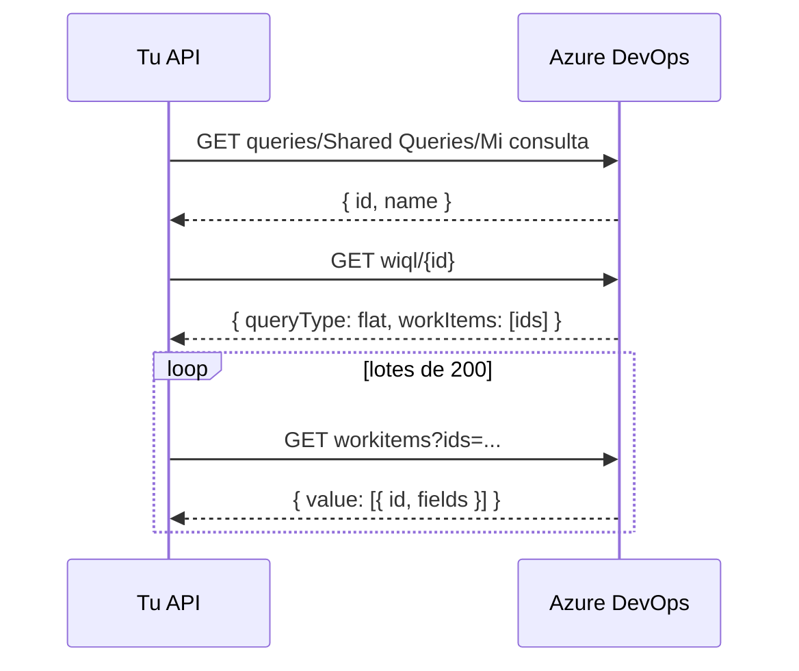

---
proyecto:
  - ReporteriaAzure
proyectos:
  - "[[ReporteriaAzure]]"
tipo: herramienta
nivel: intermedio
estado: completo
tags:
  - conocimiento
  - backend
  - azure-devops
  - integracion
progreso: pendiente
area: Azure
---
# Azure DevOps REST API

> API HTTP de Azure DevOps para leer y escribir work items, consultas, repos, pipelines… [[ReporteriaAzure]] la usa para convertir una consulta guardada en un reporte.

## Qué es y qué problema resuelve
Todo lo que se ve en Azure Boards se puede leer por HTTP en `https://dev.azure.com/{organización}/{proyecto}/_apis/...?api-version=7.1`. Sirve para reportes, sincronizaciones y automatizaciones sin exportar a mano.

## Cómo funciona por dentro
- **Autenticación**: un **PAT** (Personal Access Token) por Basic auth, con usuario vacío: `Authorization: Basic base64(":" + PAT)`. El PAT tiene **alcances** (p. ej. *Work Items: Read*) y fecha de caducidad.
- **Versión**: parámetro `api-version` obligatorio en cada llamada.
- **Work Item Tracking (`_apis/wit`)**, en tres pasos típicos:
  1. `GET queries/{carpeta}/{nombre}` → la consulta guardada (`id`, `name`, `wiql`…).
  2. `GET wiql/{id}` → ejecuta la consulta y regresa **solo referencias**: `queryType` (`flat`, `tree`, `oneHop`) y `workItems: [{ id, url }]` (las de árbol traen `workItemRelations`).
  3. `GET workitems?ids=1,2,3` → los campos (`fields`) de hasta **200 ids** por llamada. Se puede limitar con `fields=` o `$expand=`.
- **Campos**: llaves con nombre de referencia (`System.Title`, `Microsoft.VSTS.Common.Severity`, `Custom.X` para los personalizados). Los de persona son objetos `{ displayName, uniqueName, … }`; las fechas, texto ISO 8601 en UTC.



## Cuándo usarla y cuándo no
### Ventajas
- Las consultas se mantienen en Azure DevOps: cambiar el filtro no requiere desplegar.
- Datos en vivo, sin copia.
### Desventajas
- Un PAT es un secreto personal que caduca; si se filtra da acceso con los permisos de su dueño.
- Varios viajes por reporte (consulta + WIQL + N lotes).
- WIQL limita a 20 000 resultados.

## Alternativas
| Alternativa | En qué se diferencia |
|---|---|
| Analytics / OData (`analytics.dev.azure.com`) | Pensado para reportes y Power BI, con agregaciones e historial; otro modelo de datos |
| SDK .NET (`Microsoft.TeamFoundationServer.Client`) | Cliente tipado oficial; más pesado que llamar REST con [[Flurl]] |
| WIQL en el cuerpo (`POST wiql`) | La consulta vive en el código en vez de en Azure DevOps |
| Service principal / Managed Identity (Entra ID) | Sin PAT personal; mejor para servidores |

## Cómo se usó en ReporteriaAzure
- Las tres llamadas viven en `Infrastructure/AzureDevOps/AzureDevOpsClient.cs`, con las URL como plantillas en `appsettings.json` (`Azure:Endpoints`).
- Lotes de 200 con `ids.Chunk(LoteWorkItems)`.
- Se rechazan las consultas que no son `flat`, porque las de árbol no traen `workItems`.
- Un PAT inválido **no** responde 401: Azure contesta `203` con la página HTML de login (o un 302). Por eso se apagan los redirects y un error al leer JSON se traduce a `azure_devops_sin_acceso`.

```csharp
// ReporteriaAzure/Infrastructure/AzureDevOps/AzureDevOpsClient.cs
foreach (var lote in ids.Chunk(LoteWorkItems))
{
    var url = Url(_o.Endpoints.GetWorkItems, ("ids", string.Join(",", lote)));
    var respuesta = await EjecutarAsync(
        () => Peticion(url).GetJsonAsync<WorkItemsDto>(cancellationToken: ct),
        noEncontrado: "Algunos work items de la consulta ya no existen en Azure DevOps.");
```

Funcionalidad: [[Consulta de tablero]].

> [!tip] Reutilizable
> El flujo consulta guardada → WIQL → lotes de 200, junto con la traducción de errores, sirve para cualquier reporte de Azure Boards.

## Errores comunes y buenas prácticas
- Pedir más de 200 ids en una llamada (`workitems?ids=`): Azure responde 400.
- Esperar 401 con un PAT malo: llega 203 + HTML.
- Leer campos con `fields["X"]` sin revisar: los campos vacíos **no vienen** en la respuesta.
- Dar al PAT más alcance del necesario; para reportes basta *Work Items: Read*.

## Qué estudiar después
- [[Flurl]], [[Secretos con User Secrets]], [[Options pattern]]
- Analytics OData para reportes con historial.

## Documentación oficial
- https://learn.microsoft.com/rest/api/azure/devops/wit/
- https://learn.microsoft.com/azure/devops/organizations/accounts/use-personal-access-tokens-to-authenticate

## Autoevaluación

Contesta primero en voz alta o en papel; luego despliega la respuesta.

> [!question]- ¿Cuáles son las tres llamadas para convertir una consulta guardada en datos?
> 1) `GET _apis/wit/queries/{ruta}` → id; 2) `GET _apis/wit/wiql/{id}` → solo ids de work items; 3) `GET _apis/wit/workitems?ids=...` en lotes de hasta **200**.

> [!question]- Un PAT inválido no devuelve 401. ¿Qué devuelve y cómo lo detectas?
> Suele llegar `203` con la página HTML de login (o un `302`). Desactiva los redirects y trata como «sin acceso» cualquier respuesta que no sea JSON.

> [!question]- ¿Qué alternativa a un PAT usarías en un servidor?
> Un **service principal** o **Managed Identity** de Entra ID agregado a la organización de Azure DevOps; evita depender del token personal de alguien que caduca.

