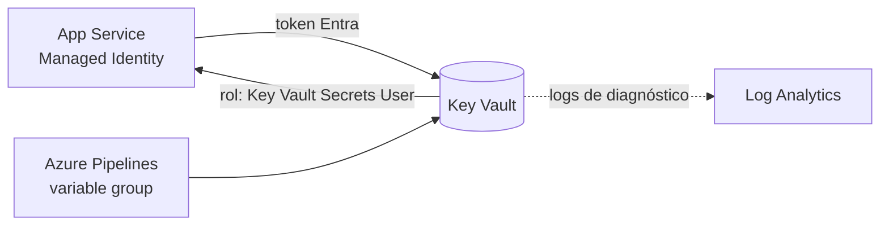

# Key Vault

Parte de: [[07-Azure/06 Seguridad/_Índice Seguridad|Seguridad]]

> [!info] Cómo avanzar
> `progreso`: **pendiente** → **viendo** (estudiando) → **visto** (contestaste la autoevaluación sin abrir las respuestas) → **dominado** (hiciste el laboratorio o lo aplicaste de verdad).

## Contenido

### Qué es
Azure Key Vault es el servicio administrado para guardar **secretos**, **llaves criptográficas** y **certificados** fuera de tu código y de tu configuración. Las apps los leen en tiempo de ejecución con su identidad, cada acceso queda auditado y puedes rotar valores sin volver a desplegar. Es la respuesta en Azure a la regla de "secretos fuera del repo".

### Cómo funciona
**Qué guarda:**
- **Secretos**: cualquier cadena (cadenas de conexión, API keys, contraseñas). Tienen versiones; puedes fijar una o leer siempre la actual.
- **Llaves**: RSA o EC para firmar, verificar, cifrar o envolver otras llaves. La operación ocurre **dentro** del vault: la llave privada no sale. Por ejemplo, Xolotl.Hecate podría firmar sus JWT RS256 con una llave de Key Vault.
- **Certificados**: X.509 con su llave privada; Key Vault puede generarlos y **renovarlos** automáticamente con ciertas autoridades integradas.

**Permisos: Azure RBAC o access policies.** Hay dos modelos:
- **Azure RBAC** (el recomendado): asignas roles de plano de datos como *Key Vault Secrets User* (leer secretos), *Key Vault Secrets Officer* (administrarlos), *Key Vault Crypto User* o *Key Vault Certificates Officer*, en el ámbito del vault o incluso de un solo secreto. Se audita y administra igual que el resto de Azure (ver [[Azure - RBAC]]).
- **Access policies**: el modelo heredado, una lista de permisos por identidad dentro del vault, sin granularidad por secreto.

Verificado en Microsoft Learn: con la API de control `2026-02-01` o posterior (y Azure CLI 2.90.0 o superior), **los vaults nuevos se crean con RBAC por defecto**; los existentes conservan su modelo hasta que lo cambies, y Microsoft recomienda migrar.

**Key Vault references en App Service y Functions.** Sin tocar código, un App Setting puede apuntar a un secreto:

```text
ConnectionStrings__Dionisio = @Microsoft.KeyVault(SecretUri=https://kv-dionisio-prod.vault.azure.net/secrets/SqlConn/)
```

La plataforma resuelve el valor con la [[Managed Identity]] de la app (que necesita *Key Vault Secrets User*) y tu app lo lee como una configuración normal (ver [[Options pattern]]). Si omites la versión al final del URI, toma la más reciente y la refresca periódicamente.

**Protección contra borrado** (verificado en Microsoft Learn):
- **Soft-delete**: siempre activo en vaults nuevos y no se puede desactivar. Un vault o secreto borrado se conserva durante el periodo de retención (de **7 a 90 días**, 90 por defecto, fijado al crear el vault) y se puede recuperar. Mientras tanto, el nombre sigue ocupado.
- **Purge protection**: opcional. Impide **purgar** (eliminar definitivamente) antes de que termine la retención, ni siquiera un administrador. Es obligatoria para algunos escenarios, como llaves administradas por el cliente en Storage.



### Ejemplo
Crear el vault de producción, dar lectura a la app y leer el secreto desde código cuando no usas references:

```bash
az keyvault create -n kv-dionisio-prod -g rg-dionisio-prod -l mexicocentral \
  --enable-purge-protection true --retention-days 90

KV_ID=$(az keyvault show -n kv-dionisio-prod --query id -o tsv)
APP_PID=$(az webapp identity show -g rg-dionisio-prod -n app-dionisio-prod --query principalId -o tsv)

az role assignment create --assignee-object-id "$APP_PID" --assignee-principal-type ServicePrincipal \
  --role "Key Vault Secrets User" --scope "$KV_ID"

az keyvault secret set --vault-name kv-dionisio-prod -n SqlConn --value "<cadena>"
```

```csharp
// Program.cs: agrega Key Vault como fuente de configuración (paquete Azure.Extensions.AspNetCore.Configuration.Secrets)
builder.Configuration.AddAzureKeyVault(
    new Uri("https://kv-dionisio-prod.vault.azure.net/"),
    new DefaultAzureCredential());
// Un secreto llamado "ConnectionStrings--Dionisio" aparece como ConnectionStrings:Dionisio
```

Verifica que la región exista en tu suscripción (`az account list-locations -o table`); usa la más cercana a tus usuarios.

### Cuándo usarlo y cuándo no
Úsalo para todo secreto de ambientes en Azure: cadenas de conexión que aún no puedes eliminar, llaves de APIs de terceros, certificados TLS, llaves de firma. En desarrollo local usa [[Secretos con User Secrets]] o un vault de dev. Mejor aún que guardar un secreto es **no tenerlo**: si el servicio destino acepta Entra ID (SQL, Storage, Service Bus), usa Managed Identity directamente.

**Organización recomendada:** un vault **por aplicación y por ambiente** (`kv-dionisio-dev`, `kv-dionisio-prod`). Un vault por secreto multiplica recursos y permisos sin beneficio; un vault compartido por toda la empresa hace que cualquier app con acceso pueda leer secretos ajenos y que un error tenga un radio de impacto enorme.

### Errores comunes
- **Dar *Key Vault Administrator* o *Secrets Officer* a la app** cuando solo lee: usa *Secrets User*.
- **403 tras asignar el rol**: la asignación tarda unos minutos en propagarse, o se dio en otro ámbito.
- **Reutilizar el nombre de un vault borrado**: falla mientras esté en soft-delete; recupéralo o espera (o purga si no hay purge protection).
- **Cachear el secreto para siempre**: si lo rotas, la app sigue con el viejo. Usa references sin versión o recarga periódica.
- **Firewall del vault cerrado** sin permitir a la app: si restringes red, agrega private endpoint o reglas, no solo el rol.

### Para profundizar
- [Información general de Azure Key Vault](https://learn.microsoft.com/azure/key-vault/general/overview)
- [RBAC para Key Vault](https://learn.microsoft.com/azure/key-vault/general/rbac-guide)
- [Key Vault references en App Service](https://learn.microsoft.com/azure/app-service/app-service-key-vault-references)
- [Soft-delete y purge protection](https://learn.microsoft.com/azure/key-vault/key-vault-ovw-soft-delete)

## Autoevaluación

Contesta primero en voz alta o en papel; luego despliega la respuesta.

> [!question]- ¿Qué guarda Key Vault?
> **Secretos** (cadenas de conexión, API keys), **llaves** criptográficas (firma/cifrado sin que salgan del vault) y **certificados** (con renovación automática con ciertas CA).

> [!question]- ¿Qué modelo de permisos usar: Azure RBAC o access policies?
> **Azure RBAC** (recomendado): roles como *Key Vault Secrets User* (leer) o *Key Vault Secrets Officer* (administrar), asignables por vault o por secreto, auditables como el resto de Azure. Las access policies son el modelo heredado.

> [!question]- ¿Cómo lee App Service un secreto sin cambiar código?
> Con una **Key Vault reference** en un App Setting: `@Microsoft.KeyVault(SecretUri=https://mi-kv.vault.azure.net/secrets/SqlConn/)`. La app necesita Managed Identity con rol de lectura sobre el vault.

> [!question]- ¿Qué son soft-delete y purge protection?
> Soft-delete conserva vaults y secretos borrados por un periodo para recuperarlos (siempre activo). Purge protection impide eliminarlos definitivamente antes de que pase ese periodo, ni siquiera un administrador.

> [!question]- Error común: un vault por cada secreto o un vault compartido por toda la empresa.
> Lo recomendado es **un vault por app y por ambiente** (dev/prod): limita el radio de impacto y simplifica permisos.

## Práctica

- [[Lab 4 - Key Vault y Managed Identity]]

