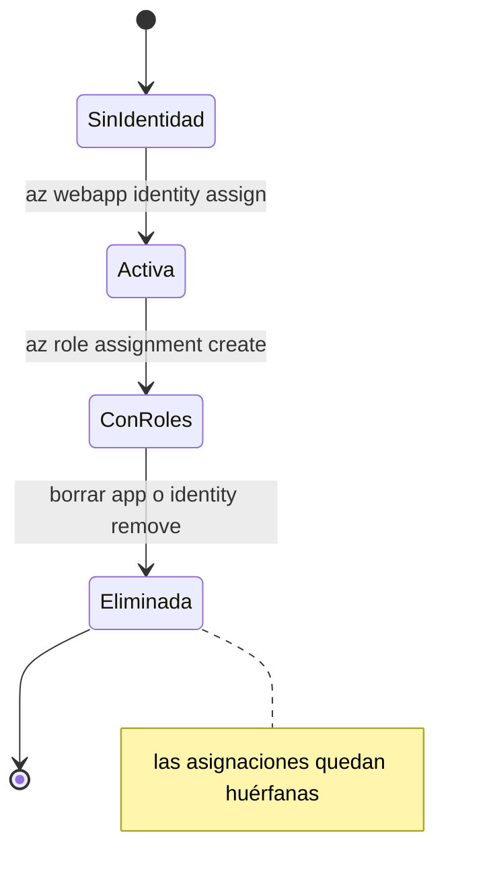

# Managed Identity asignada por el sistema

Parte de: [[Managed Identity]]

> [!info] Cómo avanzar
> `progreso`: **pendiente** → **viendo** (estudiando) → **visto** (contestaste la autoevaluación sin abrir las respuestas) → **dominado** (hiciste el laboratorio o lo aplicaste de verdad).

## Contenido

### Qué es
La identidad **asignada por el sistema** (*system-assigned*) es una identidad de Entra ID que Azure crea **dentro de un recurso concreto** (una web app, una Function, una VM) cuando la activas. Es parte del recurso: tiene su mismo nombre, no se puede compartir con otro recurso y **se borra automáticamente** cuando borras el recurso. Es la forma más sencilla de dar a una app acceso sin secretos a Key Vault, SQL o Storage. El panorama general está en [[Managed Identity]].

### Cómo funciona
**Ciclo de vida:**
1. Activas la identidad en el recurso. Azure crea un *service principal* en tu tenant con un **principalId** (object id) nuevo y único.
2. Asignas roles a ese principalId en los recursos destino.
3. El código pide tokens al endpoint de identidad local del recurso (en App Service, mediante las variables `IDENTITY_ENDPOINT` e `IDENTITY_HEADER`, que el SDK usa solo).
4. Si **desactivas** la identidad o **borras** el recurso, el service principal se elimina. Las asignaciones de rol quedan huérfanas (en el portal aparecen como "Identidad no encontrada") y ya no sirven para nada.

El punto clave: el principalId **no depende del nombre del recurso**. Si borras `app-dionisio-prod` y creas otra con el mismo nombre, la nueva identidad tiene **otro principalId**. Las asignaciones antiguas apuntaban a la identidad muerta, así que la app nueva recibe 403 en Key Vault hasta que vuelvas a asignar los roles. Lo mismo pasa con cada **deployment slot**: cada slot tiene su propia identidad system-assigned y necesita sus propias asignaciones (ver [[App Service - deployment slots]]).



### Ejemplo
Activar la identidad en la web app de Itzamna.Dionisio con Azure CLI y darle lectura del vault:

```bash
# 1. Activar: devuelve principalId y tenantId
az webapp identity assign -g rg-dionisio-prod -n app-dionisio-prod

# 2. Guardar el principalId en una variable
PID=$(az webapp identity show -g rg-dionisio-prod -n app-dionisio-prod --query principalId -o tsv)

# 3. Asignar el rol en el vault
az role assignment create \
  --assignee-object-id "$PID" --assignee-principal-type ServicePrincipal \
  --role "Key Vault Secrets User" \
  --scope "$(az keyvault show -n kv-dionisio-prod --query id -o tsv)"

# 4. Para Azure SQL: el usuario de base se crea con el NOMBRE del recurso
#    CREATE USER [app-dionisio-prod] FROM EXTERNAL PROVIDER;
```

En Bicep se declara en el propio recurso y el principalId se lee como salida, lo que permite crear la asignación en el mismo despliegue:

```bicep
resource app 'Microsoft.Web/sites@2024-04-01' = {
  name: 'app-dionisio-prod'
  location: location
  identity: { type: 'SystemAssigned' }
  properties: { serverFarmId: plan.id }
}

resource lectorSecretos 'Microsoft.Authorization/roleAssignments@2022-04-01' = {
  name: guid(kv.id, app.id, 'kv-secrets-user')
  scope: kv
  properties: {
    principalId: app.identity.principalId
    principalType: 'ServicePrincipal'
    roleDefinitionId: subscriptionResourceId('Microsoft.Authorization/roleDefinitions', '4633458b-17de-408a-b874-0445c86b69e6') // Key Vault Secrets User
  }
}
```

En código no hace falta indicar nada: `DefaultAzureCredential` o `new ManagedIdentityCredential(ManagedIdentityId.SystemAssigned)` la encuentran solas.

### Cuándo usarlo y cuándo no
Úsala cuando una sola app necesita permisos propios y está bien que esos permisos desaparezcan con ella: es el caso más común y el más limpio (no quedan identidades olvidadas). Prefiere una [[Managed Identity asignada por el usuario]] cuando:
- recreas recursos con frecuencia (entornos efímeros, despliegues que borran y crean);
- necesitas los permisos **antes** de que exista la app (por ejemplo, para que App Service pueda jalar la imagen de [[Container Registry]] en el primer arranque);
- varias apps comparten exactamente los mismos permisos.

### Errores comunes
- **Recrear la app y no reasignar roles**: el nombre es igual, la identidad no.
- **Olvidar los slots**: el slot de staging falla al leer Key Vault porque su identidad no tiene rol.
- **Desactivar la identidad "para probar"**: al reactivarla se crea otra identidad con otro principalId.
- **Dejar asignaciones huérfanas**: no dan acceso, pero ensucian las auditorías; límpialas.
- **Confundir principalId con clientId**: los roles se asignan al object id (principalId); el clientId sirve para elegir identidad en código.

### Para profundizar
- [Identidades administradas en App Service y Functions](https://learn.microsoft.com/azure/app-service/overview-managed-identity)
- [Tipos de identidades administradas](https://learn.microsoft.com/entra/identity/managed-identities-azure-resources/overview#managed-identity-types)
- [az webapp identity (referencia de CLI)](https://learn.microsoft.com/cli/azure/webapp/identity)

## Autoevaluación

Contesta primero en voz alta o en papel; luego despliega la respuesta.

> [!question]- ¿Cuál es el ciclo de vida de una identidad asignada por el sistema?
> Nace y muere con el recurso: al borrar la app se borra la identidad y sus asignaciones dejan de servir.

> [!question]- ¿Cómo la activas con CLI en una web app?
> `az webapp identity assign -g rg -n mi-app`; devuelve el `principalId` que usas para asignar roles.

> [!question]- Recreaste la app con el mismo nombre y ya no puede leer Key Vault. ¿Por qué?
> La nueva identidad tiene **otro principalId**; las asignaciones de rol apuntaban a la anterior. Hay que asignarlas de nuevo (o usar una user-assigned).

## Práctica

- [[Lab 4 - Key Vault y Managed Identity]]

