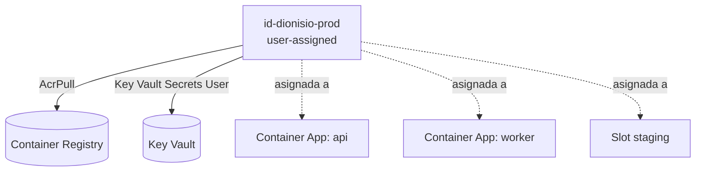

# Managed Identity asignada por el usuario

Parte de: [[Managed Identity]]

> [!info] Cómo avanzar
> `progreso`: **pendiente** → **viendo** (estudiando) → **visto** (contestaste la autoevaluación sin abrir las respuestas) → **dominado** (hiciste el laboratorio o lo aplicaste de verdad).

## Contenido

### Qué es
Una identidad **asignada por el usuario** (*user-assigned*) es un **recurso de Azure independiente**, de tipo `Microsoft.ManagedIdentity/userAssignedIdentities`, que vive en un grupo de recursos con su propio nombre. Tú la creas, le das roles y luego la **asocias** a uno o varios recursos (web apps, Functions, Container Apps, VMs). Si borras esos recursos, la identidad y sus permisos siguen existiendo. El concepto general está en [[Managed Identity]].

### Cómo funciona
Tiene tres identificadores que conviene no confundir:
- **principalId** (object id): al que se le asignan roles.
- **clientId**: el que se usa en código para elegir esa identidad.
- **resource id**: el que se usa para asociarla a un recurso (`/subscriptions/.../userAssignedIdentities/id-dionisio-prod`).

Un recurso puede tener **varias** identidades a la vez: la system-assigned y una o más user-assigned. En ese caso el SDK no puede adivinar cuál quieres; debes indicarle el **clientId**, ya sea en código o con la variable de entorno `AZURE_CLIENT_ID`, que `DefaultAzureCredential` y `ManagedIdentityCredential` leen.



**Por qué brilla en IaC.** Con system-assigned hay un problema de "huevo y gallina": la identidad no existe hasta que se crea la app, pero la app necesita permisos desde el primer arranque (por ejemplo, jalar su imagen de ACR o resolver una Key Vault reference). Con user-assigned, el despliegue crea **primero** la identidad, luego sus asignaciones de rol, y al final la app ya asociada a una identidad con permisos. Además, recrear la app no cambia la identidad, así que los permisos no se pierden.

### Ejemplo
Bicep: identidad, permisos y Container App que la usa para ACR y para el código.

```bicep
param location string = resourceGroup().location

resource id 'Microsoft.ManagedIdentity/userAssignedIdentities@2023-01-31' = {
  name: 'id-dionisio-prod'
  location: location
}

resource acr 'Microsoft.ContainerRegistry/registries@2023-07-01' existing = {
  name: 'acrdionisioprod'
}

resource acrPull 'Microsoft.Authorization/roleAssignments@2022-04-01' = {
  name: guid(acr.id, id.id, 'acrpull')
  scope: acr
  properties: {
    principalId: id.properties.principalId
    principalType: 'ServicePrincipal'
    roleDefinitionId: subscriptionResourceId('Microsoft.Authorization/roleDefinitions', '7f951dda-4ed3-4680-a7ca-43fe172d538d') // AcrPull
  }
}

resource api 'Microsoft.App/containerApps@2024-03-01' = {
  name: 'ca-dionisio-api'
  location: location
  identity: {
    type: 'UserAssigned'
    userAssignedIdentities: { '${id.id}': {} }
  }
  properties: {
    managedEnvironmentId: entorno.id
    configuration: {
      registries: [ { server: acr.properties.loginServer, identity: id.id } ]
    }
    template: {
      containers: [ {
        name: 'api'
        image: '${acr.properties.loginServer}/dionisio-api:1.4.0'
        env: [ { name: 'AZURE_CLIENT_ID', value: id.properties.clientId } ]
      } ]
    }
  }
  dependsOn: [ acrPull ]
}
```

En C#, si prefieres ser explícito en lugar de la variable de entorno:

```csharp
var credencial = new DefaultAzureCredential(new DefaultAzureCredentialOptions
{
    ManagedIdentityClientId = builder.Configuration["Identidad:ClientId"]
});
// o: new ManagedIdentityCredential(ManagedIdentityId.FromUserAssignedClientId(clientId))
```

Con CLI: `az identity create -g rg-dionisio-prod -n id-dionisio-prod` y `az webapp identity assign -g rg -n app --identities <resource-id>`.

### Cuándo usarlo y cuándo no
Úsala cuando varias apps comparten los mismos permisos (api y worker de la misma solución), cuando el despliegue necesita la identidad antes que el recurso, con deployment slots que deben tener los mismos permisos, o con entornos que se destruyen y recrean. No la uses para "todas las apps de la empresa": una identidad compartida por sistemas distintos rompe el principio de mínimo privilegio y, si una app se compromete, todas sus puertas quedan abiertas. Una identidad por aplicación y ambiente es un buen punto de partida.

### Errores comunes
- **No indicar el clientId** con varias identidades: el SDK falla o toma otra identidad.
- **Asignar roles al clientId**: los roles se asignan al principalId.
- **Olvidar que sobrevive**: al dar de baja una solución, borra también la identidad y sus asignaciones.
- **Compartirla entre ambientes** (dev y prod con la misma identidad): un error en dev puede tocar prod.
- **Crear la app antes que la asignación de rol** en IaC sin `dependsOn`: el primer arranque falla al jalar la imagen.

### Para profundizar
- [Administrar identidades asignadas por el usuario](https://learn.microsoft.com/entra/identity/managed-identities-azure-resources/how-manage-user-assigned-managed-identities)
- [Recomendaciones de uso de identidades administradas](https://learn.microsoft.com/entra/identity/managed-identities-azure-resources/managed-identity-best-practice-recommendations)
- [Identidades en Container Apps](https://learn.microsoft.com/azure/container-apps/managed-identity)

## Autoevaluación

Contesta primero en voz alta o en papel; luego despliega la respuesta.

> [!question]- ¿Qué es una identidad asignada por el usuario?
> Un **recurso independiente** (`Microsoft.ManagedIdentity/userAssignedIdentities`) que puedes asociar a varios recursos; sobrevive aunque los borres.

> [!question]- ¿Qué hay que indicar en el código cuando la app tiene varias identidades?
> El **client ID** de la que quieres usar, p. ej. `new DefaultAzureCredential(new DefaultAzureCredentialOptions { ManagedIdentityClientId = "<client-id>" })` o la variable `AZURE_CLIENT_ID`.

> [!question]- ¿Por qué es útil en IaC?
> Puedes crear la identidad y sus permisos (Key Vault, ACR) **antes** que la app, evitando el problema del huevo y la gallina al desplegar.

