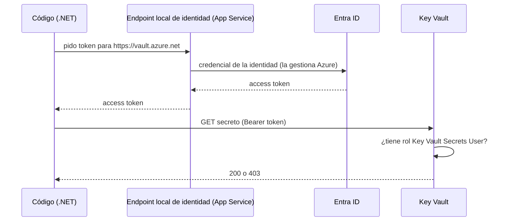

# Managed Identity

Parte de: [[07-Azure/06 Seguridad/_Índice Seguridad|Seguridad]]

> [!info] Cómo avanzar
> `progreso`: **pendiente** → **viendo** (estudiando) → **visto** (contestaste la autoevaluación sin abrir las respuestas) → **dominado** (hiciste el laboratorio o lo aplicaste de verdad).

## Contenido

### Qué es
Una **Managed Identity** es una identidad de Microsoft Entra ID que Azure crea y administra para un recurso: App Service, Functions, Container Apps, VMs, AKS, Logic Apps, Data Factory, etc. Con ella, tu código obtiene tokens para hablar con Key Vault, SQL, Storage, Service Bus o cualquier API protegida por Entra **sin guardar ningún secreto**: no hay contraseña de service principal que caduque, se filtre o haya que rotar. Azure emite y renueva las credenciales por debajo.

### Cómo funciona
Hay dos tipos, con la misma forma de uso en código:

- [[Managed Identity asignada por el sistema]]: está **ligada a un recurso**; nace al activarla y muere al borrar el recurso.
- [[Managed Identity asignada por el usuario]]: es un **recurso independiente** que asignas a uno o varios recursos y que sobrevive a ellos.

El flujo es siempre el mismo: la identidad **autentica** (dice quién eres), y una **asignación de rol** en el recurso destino **autoriza** (dice qué puedes hacer). Son dos pasos separados; olvidar el segundo es la causa número uno del 403.



**`DefaultAzureCredential`** (paquete `Azure.Identity`) es lo que hace que el mismo código funcione en tu PC y en Azure. Prueba una cadena de credenciales en orden y usa la primera que responde: variables de entorno (service principal), workload identity (AKS), **Managed Identity** (cuando corre en Azure), y luego las de desarrollo: Visual Studio, Azure CLI (`az login`), Azure PowerShell, Azure Developer CLI. En tu máquina se autentica con tu usuario; en App Service, con la identidad del recurso. Por eso, en desarrollo tu usuario también necesita los roles adecuados en los recursos de dev.

En producción conviene ser explícito para evitar sorpresas y reducir latencia: usar `ManagedIdentityCredential` directamente, o configurar `DefaultAzureCredential` excluyendo credenciales que no aplican.

### Ejemplo
Itzamna.Dionisio lee secretos de Key Vault y blobs de Storage con la misma credencial:

```csharp
using Azure.Core;
using Azure.Identity;

TokenCredential credencial = builder.Environment.IsDevelopment()
    ? new DefaultAzureCredential()                        // tu az login / Visual Studio
    : new ManagedIdentityCredential(ManagedIdentityId.SystemAssigned); // solo la identidad del recurso

builder.Services.AddSingleton(credencial);
builder.Services.AddSingleton(sp => new SecretClient(
    new Uri(builder.Configuration["KeyVault:Uri"]!), sp.GetRequiredService<TokenCredential>()));
builder.Services.AddSingleton(sp => new BlobServiceClient(
    new Uri(builder.Configuration["Storage:Uri"]!), sp.GetRequiredService<TokenCredential>()));
```

Y la parte de autorización:

```bash
PID=$(az webapp identity assign -g rg-dionisio-prod -n app-dionisio-prod --query principalId -o tsv)
az role assignment create --assignee-object-id "$PID" --assignee-principal-type ServicePrincipal \
  --role "Key Vault Secrets User" \
  --scope $(az keyvault show -n kv-dionisio-prod --query id -o tsv)
az role assignment create --assignee-object-id "$PID" --assignee-principal-type ServicePrincipal \
  --role "Storage Blob Data Reader" \
  --scope $(az storage account show -n stdionisioprod --query id -o tsv)
```

Si después de esto recibes **403**, revisa: que el rol sea de **plano de datos** (*Reader* a secas no deja leer secretos ni blobs), que el ámbito sea el recurso correcto y espera unos minutos a que la asignación se propague. La práctica completa está en [[Lab 4 - Key Vault y Managed Identity]].

### Cuándo usarlo y cuándo no
Úsala siempre que el código corra en un recurso de Azure que la soporte y el destino acepte Entra ID. **Regla rápida para elegir tipo:** system-assigned para una sola app cuyo ciclo de vida coincide con el de sus permisos; user-assigned cuando varias apps comparten los mismos permisos, cuando necesitas crear identidad y permisos **antes** que el recurso (IaC, slots, recrear apps) o cuando quieres que los permisos sobrevivan a la app. No sirve para código que corre fuera de Azure (tu PC, un servidor on-premises, GitHub Actions): ahí usa tu usuario, un service principal con certificado o *workload identity federation*.

### Errores comunes
- **Activar la identidad y no asignar el rol**: autentica, pero no autoriza → 403.
- **Asignar roles de control (*Contributor*) en lugar de roles de datos**: *Contributor* administra el recurso pero no lee secretos ni blobs.
- **Esperar que funcione en local sin `az login`** o con una cuenta sin permisos en dev.
- **Varias identidades asignadas y no indicar cuál**: el SDK no sabe cuál usar; indica el client id.
- **Seguir guardando la cadena con llave "por si acaso"**: elimina las llaves y deshabilita la autenticación local cuando el servicio lo permita.

### Para profundizar
- [¿Qué son las identidades administradas?](https://learn.microsoft.com/entra/identity/managed-identities-azure-resources/overview)
- [Servicios que soportan identidades administradas](https://learn.microsoft.com/entra/identity/managed-identities-azure-resources/managed-identities-status)
- [DefaultAzureCredential en .NET](https://learn.microsoft.com/dotnet/azure/sdk/authentication/credential-chains)

## Subtemas

- [[Managed Identity asignada por el sistema]]
- [[Managed Identity asignada por el usuario]]

## Autoevaluación

Contesta primero en voz alta o en papel; luego despliega la respuesta.

> [!question]- ¿Qué problema resuelve Managed Identity?
> Da a un recurso de Azure (App Service, Function, VM, Container App) una identidad en Entra ID **sin secretos**: Azure emite y rota los tokens. La app los obtiene con `DefaultAzureCredential` o `ManagedIdentityCredential`.

> [!question]- ¿Qué hace `DefaultAzureCredential` en tu PC y en Azure?
> Prueba credenciales en orden: variables de entorno, workload identity, **Managed Identity** (en Azure), y en desarrollo tu sesión de Visual Studio, Azure CLI (`az login`), etc. El mismo código funciona en ambos lados.

> [!question]- Diste la identidad a la app pero recibe 403 al leer el secreto. ¿Qué falta?
> La **asignación de rol** (p. ej. *Key Vault Secrets User*) en el ámbito correcto. La identidad solo autentica; el permiso es aparte. Puede tardar unos minutos en propagarse.

> [!question]- ¿System-assigned o user-assigned? Regla rápida.
> System-assigned para una sola app con su ciclo de vida. User-assigned cuando varias apps comparten permisos o necesitas la identidad **antes** de crear el recurso (IaC, slots).

## Práctica

- [[Lab 4 - Key Vault y Managed Identity]]

## Progreso de los subtemas

```base
filters:
  and:
    - file.inFolder("07-Azure/06 Seguridad/Managed Identity")
    - file.name != "Managed Identity"
views:
  - type: table
    name: Progreso
    order:
      - file.name
      - progreso
      - nivel
```
