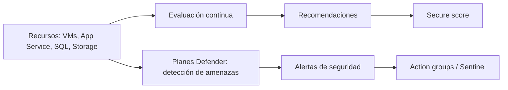

# Microsoft Defender (conceptos)

Parte de: [[07-Azure/06 Seguridad/_Índice Seguridad|Seguridad]]

> [!info] Cómo avanzar
> `progreso`: **pendiente** → **viendo** (estudiando) → **visto** (contestaste la autoevaluación sin abrir las respuestas) → **dominado** (hiciste el laboratorio o lo aplicaste de verdad).

## Contenido

### Qué es
**Microsoft Defender for Cloud** es la plataforma de seguridad de Azure (también cubre AWS, GCP y servidores on-premises) que hace dos trabajos distintos:
- **CSPM** (*cloud security posture management*): revisa la **configuración** de tus recursos contra buenas prácticas y te dice qué está mal, con un puntaje (*secure score*) y recomendaciones priorizadas.
- **CWP** (*cloud workload protection*): **protege cargas en ejecución** con planes específicos (Defender for Servers, Storage, SQL, Containers, App Service, Key Vault, Resource Manager…) que detectan amenazas y generan alertas: malware subido a un blob, intentos de fuerza bruta, accesos anómalos a una base.

### Cómo funciona
**Postura (CSPM).** Defender evalúa continuamente tus recursos con el *Microsoft cloud security benchmark* y genera **recomendaciones**: "Los puertos de administración de las VMs deben cerrarse", "Las cuentas de Storage deben restringir el acceso de red", "Key Vault debe tener purge protection". Cada recomendación tiene recursos afectados, severidad, pasos de corrección (muchas con botón *Fix* o una Azure Policy) y la opción de **exención** justificada. El **secure score** resume el porcentaje de controles cumplidos: sube cuando corriges recursos y baja cuando agregas recursos que no cumplen.

**Qué cuesta y qué no** (verificado en Microsoft Learn, noviembre 2026):
- **Foundational CSPM** es **gratis**: recomendaciones de seguridad y secure score. Cambio importante: desde el **27 de octubre de 2026**, las **suscripciones nuevas** de Azure ya **no lo traen activado por defecto**; hay que habilitarlo en la suscripción. Las existentes que lo tenían activo lo conservan. Microsoft también está moviendo la administración de la postura al portal de Microsoft Defender.
- **Defender CSPM** (postura avanzada: análisis de rutas de ataque, explorador de seguridad, escaneo sin agente) y los **planes de protección de cargas** son **de pago**, normalmente por recurso y por hora o por transacción. Precios exactos: página oficial (Pendiente de confirmar al activar cualquier plan).



### Ejemplo
Creaste una VM de prueba para un agente autohospedado de Azure Pipelines y el secure score bajó. Pasos:

1. En Defender for Cloud → **Recomendaciones**, filtra por el recurso. Aparecen, por ejemplo: puerto 22 abierto a internet en el NSG, discos sin cifrado en host, falta de actualizaciones del sistema y sin solución de detección de malware.
2. **Corrige** lo que aplica: cierra el puerto 22 y usa Azure Bastion o *Just-in-time access*; activa actualizaciones automáticas.
3. Lo que no aplica por una razón válida (la VM se borra en dos horas), **exímelo** con justificación y fecha de expiración, en lugar de ignorarlo.
4. Revisa en unas horas: la evaluación no es instantánea.

Consulta rápida de recomendaciones con Azure Resource Graph desde la CLI:

```bash
az graph query -q "
securityresources
| where type == 'microsoft.security/assessments'
| where properties.status.code == 'Unhealthy'
| project recurso = tostring(properties.resourceDetails.Id),
          recomendacion = tostring(properties.displayName),
          severidad = tostring(properties.metadata.severity)
| order by severidad asc" -o table
```

(requiere la extensión `resource-graph`: `az extension add --name resource-graph`).

Para habilitar la postura gratuita en una suscripción nueva, desde el portal: Defender for Cloud → Configuración del entorno → tu suscripción → Planes de Defender → activa *Foundational CSPM*. Antes de activar cualquier plan de pago, revisa el precio por recurso y usa una suscripción de prueba.

### Cuándo usarlo y cuándo no
La postura gratuita conviene **siempre**, incluso en suscripciones personales de aprendizaje: te enseña configuraciones inseguras que de otro modo pasarías por alto y complementa el pilar de seguridad del [[Azure Well-Architected Framework]] (ver [[Well-Architected - Seguridad]]). Los planes de pago valen la pena en producción con datos sensibles o requisitos de cumplimiento; actívalos de forma selectiva (por ejemplo, Defender for Storage en la cuenta que recibe archivos de usuarios). Para un laboratorio de una tarde no tiene sentido activar Defender for Servers.

### Errores comunes
- **Perseguir el 100 % de secure score** corrigiendo recomendaciones irrelevantes en lugar de priorizar las de severidad alta en recursos expuestos.
- **Ignorar sin eximir**: la recomendación queda abierta, el score sigue bajo y nadie recuerda por qué.
- **Activar todos los planes en una suscripción de laboratorio** y llevarse un cargo inesperado: los planes cobran por recurso protegido.
- **Asumir que viene activado** en una suscripción creada después del 27 de octubre de 2026.
- **No enrutar alertas**: las alertas de amenazas solo sirven si alguien las ve; conéctalas a un action group o a Microsoft Sentinel.

### Para profundizar
- [¿Qué es Microsoft Defender for Cloud?](https://learn.microsoft.com/azure/defender-for-cloud/defender-for-cloud-introduction)
- [Cloud security posture management (CSPM)](https://learn.microsoft.com/azure/defender-for-cloud/concept-cloud-security-posture-management)
- [Foundational CSPM ahora es opcional en suscripciones nuevas](https://learn.microsoft.com/azure/defender-for-cloud/foundational-cspm-opt-in)

## Autoevaluación

Contesta primero en voz alta o en papel; luego despliega la respuesta.

> [!question]- ¿Qué es Microsoft Defender for Cloud?
> Plataforma de seguridad de la nube con dos partes: **CSPM** (postura: recomendaciones y *secure score* sobre tu configuración) y **CWP** (protección de cargas: planes Defender for Servers, Storage, SQL, Containers, App Service…).

> [!question]- ¿Qué te da sin costo y qué requiere planes de pago?
> La postura básica (recomendaciones y secure score) viene incluida; la detección de amenazas y CSPM avanzado son planes de pago por recurso (verificar en la página oficial).

> [!question]- Tu secure score bajó tras crear una VM. ¿Qué haces?
> Revisa las **recomendaciones** del recurso (p. ej. puertos de administración abiertos, discos sin cifrado, falta de parches) y corrige o justifica la excepción.

