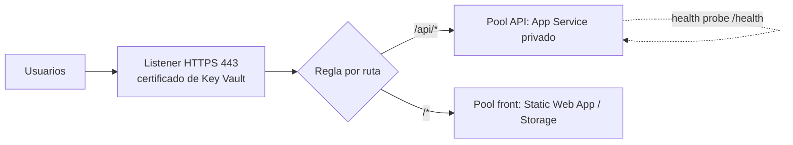

# Application Gateway

Parte de: [[07-Azure/07 Redes en Azure/_Índice Redes en Azure|Redes en Azure]]

> [!info] Cómo avanzar
> `progreso`: **pendiente** → **viendo** (estudiando) → **visto** (contestaste la autoevaluación sin abrir las respuestas) → **dominado** (hiciste el laboratorio o lo aplicaste de verdad).

## Contenido

### Qué es
Azure Application Gateway es un **balanceador de carga regional de capa 7** (HTTP/HTTPS) que se despliega dentro de una subred de tu VNet. Entiende URLs, encabezados y nombres de host, así que puede mandar `/api/*` a un grupo de servidores y `/` a otro, terminar TLS, reescribir encabezados, mantener afinidad de sesión y, con el SKU **WAF_v2**, aplicar un **Web Application Firewall** con reglas OWASP contra inyección SQL, XSS y similares.

### Cómo funciona
Piezas de configuración:
- **Frontend IP**: pública, privada o ambas.
- **Listener**: puerto, protocolo, certificado y nombre de host que escucha (`api.midominio.mx:443`).
- **Regla de enrutamiento**: une un listener con un destino; puede ser básica o **basada en rutas** (path-based).
- **Backend pool**: los destinos (IPs, FQDNs, VMs, App Service, Container Apps).
- **Backend settings**: protocolo y puerto hacia el backend, *host header*, afinidad por cookie, tiempo de espera.
- **Health probe**: la petición que confirma que un backend está sano; si falla, deja de recibir tráfico.



**Application Gateway vs Azure Load Balancer.** Load Balancer trabaja en **capa 4** (TCP/UDP): reparte conexiones por IP y puerto, muy rápido y barato, pero no ve URLs ni encabezados ni termina TLS. Sirve para bases de datos en VMs, tráfico no HTTP o balanceo interno simple. Application Gateway es capa 7: decisiones por contenido, TLS y WAF. Y frente a [[Front Door]]: Application Gateway es **regional** y vive en tu VNet (puede llegar a backends privados); Front Door es **global** en el borde de Microsoft. Es común usarlos juntos: Front Door afuera, Application Gateway adentro.

**Subred dedicada** (verificado en Microsoft Learn): Application Gateway necesita una subred **solo para él** (pueden compartirla varios Application Gateway, pero no otros recursos ni mezclar v1 con v2). Para v2, Microsoft recomienda **al menos `/24`**: el gateway escala hasta 125 instancias y cada una toma una IP, además de la IP privada del frontend y las 5 reservadas de Azure. Una subred chica bloquea el autoescalado y las actualizaciones de mantenimiento.

### Ejemplo
Crear un WAF_v2 con autoescalado delante de la API privada de Itzamna.Dionisio (versión mínima; en producción conviene declararlo en [[Bicep]]):

```bash
az network vnet subnet create -g rg-dionisio-prod --vnet-name vnet-dionisio-prod \
  -n snet-agw --address-prefixes 10.10.10.0/24

az network public-ip create -g rg-dionisio-prod -n pip-agw-dionisio --sku Standard

az network application-gateway waf-policy create -g rg-dionisio-prod -n waf-dionisio

az network application-gateway create -g rg-dionisio-prod -n agw-dionisio \
  --sku WAF_v2 --min-capacity 1 --max-capacity 4 \
  --vnet-name vnet-dionisio-prod --subnet snet-agw \
  --public-ip-address pip-agw-dionisio \
  --servers app-dionisio-prod.azurewebsites.net \
  --waf-policy waf-dionisio --priority 100
```

Luego ajustas: listener HTTPS con certificado desde Key Vault (con una identidad user-assigned del gateway), backend settings con *pick host name from backend* (App Service enruta por host header) y una sonda a `/health` que devuelva 200 sin requerir autenticación. En ASP.NET Core, recuerda que la API ve la IP del gateway: usa `UseForwardedHeaders` para leer `X-Forwarded-For` y `X-Forwarded-Proto`.

### Cuándo usarlo y cuándo no
Úsalo cuando necesites un punto de entrada regional con WAF hacia backends dentro de una VNet, enrutamiento por ruta o host entre varios servicios, o exposición controlada de apps internas. Si tus usuarios están en varias regiones o quieres CDN, empieza por [[Front Door]]. Si solo tienes una App Service pública y no necesitas WAF, Application Gateway agrega costo fijo por hora sin aportar mucho. Para tráfico TCP no HTTP usa Load Balancer.

### Errores comunes
- **Subred compartida o de `/28`**: el despliegue falla o no puede escalar. Dedicada y `/24`.
- **Health probe a una ruta protegida** (`/` con login): devuelve 302 o 401, el backend se marca como no sano y todo responde 502.
- **Host header incorrecto hacia App Service**: App Service no reconoce el host y responde 404; usa el nombre del backend o configura el dominio personalizado en ambos lados.
- **WAF en modo prevención desde el día uno** sin revisar falsos positivos: bloquea peticiones legítimas (JSON con caracteres especiales). Empieza en detección, revisa los logs y ajusta exclusiones.
- **Dejar el backend accesible directamente**: restringe App Service para aceptar solo tráfico de la subred del gateway.

### Para profundizar
- [¿Qué es Azure Application Gateway?](https://learn.microsoft.com/azure/application-gateway/overview)
- [Configuración de infraestructura (subred, tamaño)](https://learn.microsoft.com/azure/application-gateway/configuration-infrastructure)
- [WAF en Application Gateway](https://learn.microsoft.com/azure/web-application-firewall/ag/ag-overview)

## Autoevaluación

Contesta primero en voz alta o en papel; luego despliega la respuesta.

> [!question]- ¿Qué es Application Gateway?
> Balanceador de carga **regional de capa 7** (HTTP/HTTPS) que vive en una subred de tu VNet: enrutamiento por ruta o host, terminación TLS, afinidad de sesión y WAF opcional.

> [!question]- Application Gateway vs Azure Load Balancer.
> Load Balancer es **capa 4** (TCP/UDP): no entiende URLs ni encabezados. Application Gateway es capa 7: puede mandar `/api/*` a un pool y `/` a otro.

> [!question]- Error común al desplegarlo.
> Ponerlo en una subred compartida o muy pequeña: necesita una **subred dedicada** con espacio para escalar.

