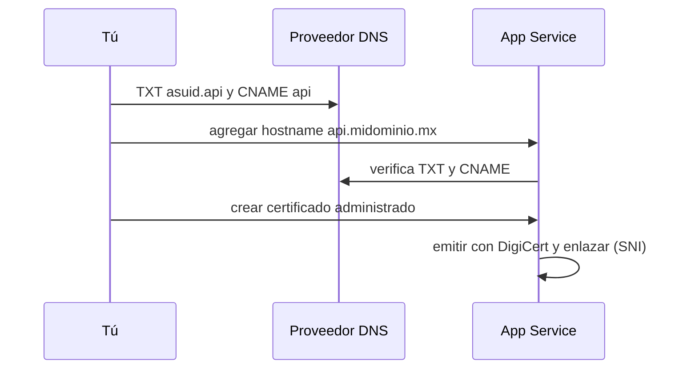

# Dominios personalizados y certificados

Parte de: [[07-Azure/07 Redes en Azure/_Índice Redes en Azure|Redes en Azure]]

> [!info] Cómo avanzar
> `progreso`: **pendiente** → **viendo** (estudiando) → **visto** (contestaste la autoevaluación sin abrir las respuestas) → **dominado** (hiciste el laboratorio o lo aplicaste de verdad).

## Contenido

### Qué es
Por defecto tus apps responden en nombres de Azure como `app-dionisio-prod.azurewebsites.net`. Un **dominio personalizado** (`api.midominio.mx`) hace que respondan con tu nombre, y un **certificado TLS** emitido para ese nombre permite HTTPS sin advertencias. Configurarlo implica tres cosas: demostrar que el dominio es tuyo, apuntar el DNS a Azure y asociar un certificado.

### Cómo funciona
**Registros DNS en App Service:**

| Caso | Registro de enrutamiento | Registro de verificación |
|---|---|---|
| Subdominio (`www`, `api`) | **CNAME** `api` → `app-dionisio-prod.azurewebsites.net` | **TXT** `asuid.api` = id de verificación |
| Dominio raíz (`midominio.mx`) | **A** `@` → IP de entrada de la app | **TXT** `asuid` = id de verificación |

El dominio raíz no puede ser CNAME por reglas del DNS, por eso usa un registro A (algunos proveedores ofrecen "ALIAS" o "CNAME flattening"). El **Custom Domain Verification ID** se obtiene en la app (`customDomainVerificationId`) y es el mismo para todas las apps de tu suscripción. Repaso de tipos de registro en [[DNS en la red (resolución, registros y servidores)]].

**Opciones de certificado:**
- **Certificado administrado de App Service**, gratis (verificado en Microsoft Learn): lo emite DigiCert y App Service lo **renueva solo**. Limitaciones: no admite **comodín** (`*.midominio.mx`), **no se puede exportar**, requiere plan Basic o superior (no Free ni Shared), no funciona con DNS privado ni en App Service Environment, y para dominio raíz exige un registro A a la app, sin restricciones de IP y sin Traffic Manager. Si tu dominio tiene registro **CAA**, debe permitir `digicert.com`. Solo uno por dominio.
- **Importar tu certificado desde Key Vault**: comodines, certificados de una CA corporativa o con validación extendida. La app lee el certificado con permisos sobre el vault, y Key Vault puede renovarlo si lo emite una CA integrada.
- **Terminar TLS antes**: en [[Front Door]] (con certificados administrados para tus dominios) o en [[Application Gateway]]. Entonces el certificado vive ahí, no en la app.
- [[Azure Static Web Apps]] también trae certificados gratuitos administrados para sus dominios personalizados.



### Ejemplo
Dominio `api.midominio.mx` para Itzamna.Dionisio:

```bash
# 1. Id de verificación
az webapp show -g rg-dionisio-prod -n app-dionisio-prod --query customDomainVerificationId -o tsv

# 2. En tu proveedor DNS:
#    TXT   asuid.api   <id de verificación>
#    CNAME api         app-dionisio-prod.azurewebsites.net
#    Comprueba la propagación:
nslookup -type=CNAME api.midominio.mx
nslookup -type=TXT asuid.api.midominio.mx

# 3. Agregar el dominio a la app
az webapp config hostname add -g rg-dionisio-prod --webapp-name app-dionisio-prod \
  --hostname api.midominio.mx

# 4. Certificado administrado gratuito y enlace SNI
THUMB=$(az webapp config ssl create -g rg-dionisio-prod -n app-dionisio-prod \
  --hostname api.midominio.mx --query thumbprint -o tsv)
az webapp config ssl bind -g rg-dionisio-prod -n app-dionisio-prod \
  --certificate-thumbprint "$THUMB" --ssl-type SNI

# 5. Forzar HTTPS
az webapp update -g rg-dionisio-prod -n app-dionisio-prod --https-only true
```

Si en el paso 3 Azure dice que no encuentra el CNAME, casi siempre es **propagación o caché**: tu proveedor tarda en publicar o tu resolvedor guarda la respuesta anterior hasta que vence su **TTL**. Verifica con `nslookup` contra un DNS público (`nslookup -type=CNAME api.midominio.mx 1.1.1.1`), revisa que no escribiste el dominio completo dentro del campo del nombre (muchos paneles agregan `.midominio.mx` solos) y espera el TTL antes de reintentar.

### Cuándo usarlo y cuándo no
Siempre que una app la usen personas o socios, ponle dominio propio: puedes mover la app de región o de servicio cambiando solo el DNS, y no expones nombres internos. El certificado administrado gratuito cubre la mayoría de casos con subdominios. Usa Key Vault cuando necesites comodín, exportar el certificado o una CA específica. Para entornos de prueba efímeros, el dominio `azurewebsites.net` con su HTTPS incluido basta.

### Errores comunes
- **Olvidar el TXT `asuid`**: la verificación falla aunque el CNAME esté bien.
- **TTL altos al migrar**: bájalos (por ejemplo a 300 segundos) un día antes de cambiar registros.
- **Registro CAA que no autoriza a DigiCert**: el certificado administrado nunca se emite.
- **Restricciones de IP en una app con dominio raíz y certificado administrado**: la renovación falla porque DigiCert no puede validar.
- **No activar HTTPS Only**: la app sigue respondiendo por HTTP.

### Para profundizar
- [Asignar un dominio personalizado a App Service](https://learn.microsoft.com/azure/app-service/app-service-web-tutorial-custom-domain)
- [Agregar y administrar certificados TLS en App Service](https://learn.microsoft.com/azure/app-service/configure-ssl-certificate)
- [Dominios personalizados en Azure Front Door](https://learn.microsoft.com/azure/frontdoor/standard-premium/how-to-add-custom-domain)

## Autoevaluación

Contesta primero en voz alta o en papel; luego despliega la respuesta.

> [!question]- ¿Qué registros DNS se usan para un dominio propio en App Service?
> Para un subdominio (`www`): **CNAME** a `mi-app.azurewebsites.net`. Para el dominio raíz: **registro A** a la IP de la app. En ambos casos un **TXT** `asuid.<subdominio>` con el id de verificación.

> [!question]- ¿Qué opciones de certificado TLS tienes?
> Certificado **administrado** gratuito de App Service o Static Web Apps (se renueva solo, con limitaciones como no ser comodín), importar el tuyo desde Key Vault, o terminar TLS en Front Door (verificar en la página oficial).

> [!question]- Cambiaste el CNAME y Azure dice que no lo encuentra. ¿Qué pasa?
> Propagación DNS o caché (TTL). Verifica con `nslookup -type=CNAME www.tudominio.com` y espera el TTL antes de reintentar.

