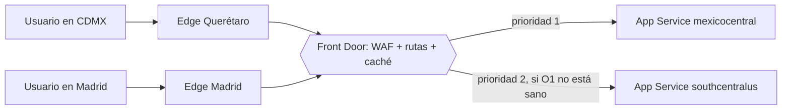

# Front Door

Parte de: [[07-Azure/07 Redes en Azure/_Índice Redes en Azure|Redes en Azure]]

> [!info] Cómo avanzar
> `progreso`: **pendiente** → **viendo** (estudiando) → **visto** (contestaste la autoevaluación sin abrir las respuestas) → **dominado** (hiciste el laboratorio o lo aplicaste de verdad).

## Contenido

### Qué es
Azure Front Door es un **punto de entrada global de capa 7** que corre en la red perimetral (*edge*) de Microsoft, con presencia en muchas ciudades del mundo. Los usuarios se conectan al punto de presencia más cercano y desde ahí Front Door lleva la petición por la red troncal de Microsoft hasta tu origen. Combina **CDN** (caché de contenido estático), **aceleración** de contenido dinámico, **balanceo global** entre regiones según salud y latencia, **terminación TLS** con certificados administrados y **WAF**.

### Cómo funciona
Conceptos de Front Door Standard/Premium:
- **Perfil**: el recurso, con nivel Standard o Premium.
- **Endpoint**: el nombre público (`xxxx.azurefd.net`) al que asocias tus **dominios personalizados**.
- **Origin group** y **origins**: los backends (App Service en México y en EE. UU., una Static Web App, un Storage) con prioridad, peso y **health probes**.
- **Routes**: qué patrones de ruta (`/api/*`, `/*`) van a qué origin group, con o sin caché.
- **Rule sets**: reglas para reescribir, redirigir o modificar encabezados.
- **Security policy**: asocia una política de WAF.

Diferencias clave entre niveles: **Premium** agrega reglas administradas de WAF más completas, protección contra bots y **Private Link hacia el origen** (Front Door se conecta a tu App Service por un private endpoint, sin que el origen tenga acceso público). Verificado en Microsoft Learn: **Front Door (classic)** ya no permite crear perfiles nuevos desde el 1 de abril de 2025 y **se retira el 31 de marzo de 2027**; los perfiles clásicos deben migrar a Standard o Premium.



**Front Door vs Application Gateway.** Front Door es **global**: ideal con usuarios dispersos, varias regiones, CDN y failover entre regiones. [[Application Gateway]] es **regional** y vive dentro de tu VNet, útil para backends privados y balanceo dentro de una región. Se combinan: Front Door en el borde y Application Gateway como origen privado en cada región.

**Que nadie se salte Front Door.** Si tu App Service sigue pública, un atacante puede llamarla directo y evitar el WAF. Hay dos capas:
1. **Restricción de acceso** en App Service con la *service tag* `AzureFrontDoor.Backend` (solo IPs de Front Door).
2. Validar el encabezado **`X-Azure-FDID`**, que Front Door agrega con el id único de **tu** perfil. Sin esto, cualquier otro cliente de Front Door (de otra empresa) también cabría en la service tag.

Con Premium puedes ir más lejos: origen por Private Link y deshabilitar el acceso público del App Service.

### Ejemplo
Restringir la API de Itzamna.Dionisio para aceptar solo tráfico de tu perfil de Front Door:

```bash
FDID=$(az afd profile show -g rg-dionisio-prod --profile-name afd-dionisio \
  --query frontDoorId -o tsv)

az webapp config access-restriction add -g rg-dionisio-prod -n app-dionisio-prod \
  --rule-name solo-front-door --action Allow --priority 100 \
  --service-tag AzureFrontDoor.Backend \
  --http-header x-azure-fdid="$FDID"
```

Al agregar una regla de permitir, App Service niega implícitamente lo demás. En la API, recuerda configurar `UseForwardedHeaders` para conocer la IP real del cliente (`X-Forwarded-For`) y el esquema original. Para el front de Itzamna.Clio (React + Vite compilado en una Static Web App o Storage), una ruta `/*` con caché activada sirve los archivos con hash desde el borde; `index.html` conviene no cachearlo mucho para que los despliegues se vean de inmediato.

### Cuándo usarlo y cuándo no
Úsalo cuando tienes usuarios en varias regiones, necesitas failover entre regiones, quieres CDN y WAF en un solo servicio o terminar TLS con certificados administrados para muchos dominios. Para una app regional de uso interno, o un proyecto personal en una sola región, puede ser costo innecesario (cuota fija mensual por perfil más tráfico; Pendiente de confirmar precios vigentes). Si tu front ya está en [[Azure Static Web Apps]], esa plataforma trae su propia distribución de contenido estático.

### Errores comunes
- **Restringir solo por service tag**, sin validar `X-Azure-FDID`.
- **Cachear respuestas de API personalizadas por usuario**: un usuario ve datos de otro. Solo cachea contenido realmente público o usa reglas que respeten `Cache-Control`.
- **Health probe pesada** (que consulta la base en cada sonda) multiplicada por todos los puntos de presencia: genera carga real. Usa un endpoint de salud ligero y ajusta frecuencia.
- **Dejar perfiles clásicos sin migrar**: se retiran el 31 de marzo de 2027.
- **Olvidar el DNS del dominio personalizado**: Front Door exige validar el dominio (registro TXT `_dnsauth`) antes de emitir el certificado.

### Para profundizar
- [¿Qué es Azure Front Door?](https://learn.microsoft.com/azure/frontdoor/front-door-overview)
- [Retiro de Front Door (classic)](https://learn.microsoft.com/azure/frontdoor/classic-retirement-faq)
- [Proteger el origen con Private Link y X-Azure-FDID](https://learn.microsoft.com/azure/frontdoor/origin-security)

## Autoevaluación

Contesta primero en voz alta o en papel; luego despliega la respuesta.

> [!question]- ¿Qué es Azure Front Door?
> Punto de entrada **global** de capa 7 en la red perimetral de Microsoft: CDN, aceleración, balanceo entre regiones por salud y latencia, terminación TLS y **WAF**.

> [!question]- Front Door vs Application Gateway: ¿cuándo cada uno?
> **Front Door**: usuarios globales, varias regiones, CDN. **Application Gateway**: balanceo **regional** dentro de una VNet hacia backends privados. Se pueden combinar.

> [!question]- ¿Cómo evitas que alguien se salte Front Door y llame directo a tu App Service?
> Restricciones de acceso en App Service con la *service tag* `AzureFrontDoor.Backend` **y** validando el encabezado `X-Azure-FDID` con el id de tu perfil; o backend privado con Private Link (nivel Premium).

