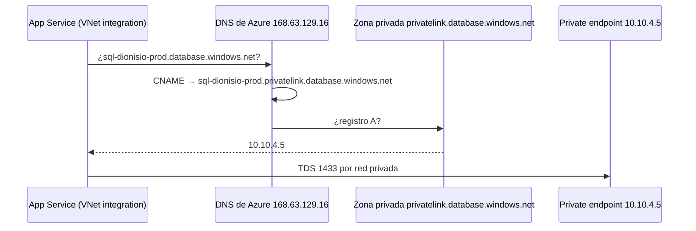

# Private Endpoints

Parte de: [[07-Azure/07 Redes en Azure/_Índice Redes en Azure|Redes en Azure]]

> [!info] Cómo avanzar
> `progreso`: **pendiente** → **viendo** (estudiando) → **visto** (contestaste la autoevaluación sin abrir las respuestas) → **dominado** (hiciste el laboratorio o lo aplicaste de verdad).

## Contenido

### Qué es
Un **private endpoint** es una interfaz de red (NIC) con una **IP privada de tu VNet** que representa a un servicio PaaS concreto: un servidor de Azure SQL, una cuenta de Storage (por subrecurso: blob, queue, table…), un Key Vault, una web app, un registro de contenedores. Tus recursos se conectan a esa IP privada y el tráfico viaja por la red de Microsoft (Azure Private Link) sin pasar por la IP pública del servicio. Con eso puedes **deshabilitar por completo el acceso público** al servicio.

### Cómo funciona
Al crear el private endpoint eliges el recurso destino y su **group id** (el subrecurso: `sqlServer`, `blob`, `vault`, `sites`, `registry`…). Azure crea la NIC en la subred que indiques y aprueba la conexión (automáticamente si tienes permisos sobre el recurso, o queda pendiente para que el dueño la apruebe).

La parte que más se olvida es el **DNS**. Tu app se conecta a `sql-dionisio-prod.database.windows.net`, no a una IP. Ese nombre público tiene un CNAME a `sql-dionisio-prod.privatelink.database.windows.net`. Si dentro de tu VNet existe una **zona DNS privada** `privatelink.database.windows.net` **vinculada** a la VNet, con un registro A que apunte a la IP privada, el nombre resuelve a `10.10.4.5`. Sin esa zona, el nombre sigue resolviendo a la IP pública y la conexión va por internet (o falla si apagaste el acceso público).



Zonas comunes: `privatelink.database.windows.net` (SQL), `privatelink.blob.core.windows.net` (Blob), `privatelink.vaultcore.azure.net` (Key Vault), `privatelink.azurewebsites.net` (App Service), `privatelink.azurecr.io` (ACR). Con un **DNS zone group** en el private endpoint, Azure crea y mantiene el registro A por ti.

**Private endpoint vs service endpoint:**

| | Service endpoint | Private endpoint |
|---|---|---|
| IP del servicio | Sigue siendo **pública** | IP **privada** en tu VNet |
| Qué logra | Ruta optimizada y permitir solo tu subred en el firewall del servicio | El servicio "vive" dentro de tu red |
| Acceso desde on-premises por VPN | No | Sí |
| Deshabilitar acceso público | No del todo | Sí |
| Costo | Gratis | Por hora y por GB procesado (Pendiente de confirmar precios vigentes) |

### Ejemplo
Private endpoint para el servidor SQL de Itzamna.Dionisio en la subred `snet-pe`:

```bash
SQL_ID=$(az sql server show -g rg-dionisio-prod -n sql-dionisio-prod --query id -o tsv)

az network private-endpoint create -g rg-dionisio-prod -n pe-sql-dionisio \
  --vnet-name vnet-dionisio-prod --subnet snet-pe \
  --private-connection-resource-id "$SQL_ID" --group-id sqlServer \
  --connection-name sql-dionisio-conn

# Zona DNS privada + vínculo con la VNet
az network private-dns zone create -g rg-dionisio-prod -n privatelink.database.windows.net
az network private-dns link vnet create -g rg-dionisio-prod \
  --zone-name privatelink.database.windows.net -n link-dionisio \
  --virtual-network vnet-dionisio-prod --registration-enabled false

# Que Azure mantenga el registro A
az network private-endpoint dns-zone-group create -g rg-dionisio-prod \
  --endpoint-name pe-sql-dionisio -n default \
  --private-dns-zone privatelink.database.windows.net --zone-name sql

# Cerrar la puerta pública
az sql server update -g rg-dionisio-prod -n sql-dionisio-prod --enable-public-network false
```

Comprueba desde la app (consola Kudu o SSH del contenedor): `nslookup sql-dionisio-prod.database.windows.net` debe devolver `10.10.4.x`. La app necesita **VNet integration** para salir por la VNet (ver [[Virtual Network]]).

### Cuándo usarlo y cuándo no
Úsalo en producción para bases de datos, vaults y storage con datos sensibles, cuando políticas de seguridad exigen "sin endpoints públicos", o cuando sistemas on-premises deben llegar a servicios PaaS por VPN. Para laboratorios y proyectos personales suele bastar el firewall por IP o un service endpoint, que no cuestan. Ten en cuenta que agregar private endpoints obliga a pensar en DNS para todos los que se conectan, incluidos tu PC y los agentes de Azure Pipelines (que ya no podrán llegar al recurso si son hospedados por Microsoft).

### Errores comunes
- **Sin zona DNS privada o sin vínculo con la VNet**: el nombre resuelve a la IP pública.
- **DNS personalizado en la VNet** (un controlador de dominio) que no reenvía a `168.63.129.16`: las zonas privadas nunca se consultan.
- **Conectarse por la IP privada directamente**: falla la validación TLS del certificado y algunos servicios rechazan la conexión; usa siempre el nombre.
- **Olvidar la VNet integration** de App Service: la app no sale por la VNet y no ve el endpoint.
- **Apagar el acceso público antes de probar**: te quedas sin acceso desde tu PC y desde los pipelines.

### Para profundizar
- [¿Qué es un private endpoint?](https://learn.microsoft.com/azure/private-link/private-endpoint-overview)
- [Configuración de DNS para private endpoints](https://learn.microsoft.com/azure/private-link/private-endpoint-dns)
- [Service endpoints de VNet](https://learn.microsoft.com/azure/virtual-network/virtual-network-service-endpoints-overview)

## Autoevaluación

Contesta primero en voz alta o en papel; luego despliega la respuesta.

> [!question]- ¿Qué es un private endpoint?
> Una NIC con **IP privada** en tu VNet que conecta a un servicio PaaS (SQL, Storage, Key Vault, una web app). El tráfico va por la red de Microsoft, sin pasar por la IP pública del servicio.

> [!question]- Creaste el private endpoint pero la app sigue resolviendo la IP pública. ¿Qué falta?
> El **DNS privado**: una zona como `privatelink.database.windows.net` vinculada a la VNet, con el registro A del endpoint. Sin eso, el nombre resuelve al público.

> [!question]- ¿Private endpoint o service endpoint?
> El **service endpoint** solo optimiza la ruta y permite restringir el servicio a una subred, pero el servicio conserva su IP pública. El **private endpoint** le da una IP privada en tu red y permite **deshabilitar el acceso público**.

