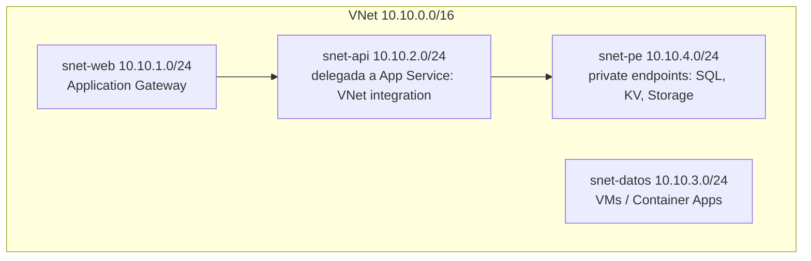

# Virtual Network

Parte de: [[07-Azure/07 Redes en Azure/_Índice Redes en Azure|Redes en Azure]]

> [!info] Cómo avanzar
> `progreso`: **pendiente** → **viendo** (estudiando) → **visto** (contestaste la autoevaluación sin abrir las respuestas) → **dominado** (hiciste el laboratorio o lo aplicaste de verdad).

## Contenido

### Qué es
Una **Virtual Network (VNet)** es tu red privada aislada dentro de Azure, en **una región**. Define un **espacio de direcciones** privado (por ejemplo `10.10.0.0/16`) que divides en **subredes**; dentro viven VMs, la integración de red de App Service, private endpoints, Application Gateway, Container Apps con red propia, etc. Los recursos de una VNet se ven entre sí por IP privada y, por defecto, no son accesibles desde internet ni desde otras VNets. Los fundamentos generales de redes en la nube están en [[Redes en la nube (VNet, subnets, NSG y peering)]].

### Cómo funciona
**Espacio de direcciones y subredes.** Usa rangos privados (RFC 1918: `10.0.0.0/8`, `172.16.0.0/12`, `192.168.0.0/16`). Cada subred toma un pedazo del espacio y **Azure reserva 5 IPs en cada subred**: la dirección de red, la `.1` (gateway predeterminado), la `.2` y `.3` (DNS de Azure) y la última (broadcast). Así:

| Prefijo | Direcciones | Utilizables en Azure |
|---|---|---|
| `/24` | 256 | 251 |
| `/26` | 64 | 59 |
| `/27` | 32 | 27 |
| `/28` | 16 | 11 |
| `/29` | 8 | 3 (la mínima que Azure acepta) |

Para elegir el tamaño, busca la subred más pequeña cuyo total menos 5 alcance lo que necesitas, más margen para crecer. Repaso del cálculo en [[Subnetting paso a paso]] y [[Máscara de subred y CIDR]].

**Qué más contiene una VNet:**
- **NSG** (*network security group*): lista de reglas con prioridad (100 a 4096, número menor se evalúa primero), origen, destino, puerto, protocolo y acción permitir/denegar. Se asocia a una subred o a una NIC. Trae reglas predeterminadas de prioridad 65000 en adelante: permite tráfico dentro de la VNet y desde el balanceador de Azure, y niega todo lo demás de entrada. Puedes usar *service tags* (`Internet`, `AzureLoadBalancer`, `Sql`) en lugar de IPs.
- **Tablas de rutas** (UDR) para forzar tráfico, por ejemplo, a través de un firewall.
- **Conectividad**: *peering* con otras VNets (misma o distinta región), VPN Gateway o ExpressRoute hacia tu red on-premises.

**Peering** une dos VNets como si fueran una, por la red troncal de Microsoft. Requisito: los espacios de direcciones **no pueden solaparse**. Dos VNets con `10.0.0.0/16` nunca podrán conectarse sin rehacer una. Por eso conviene un plan de direccionamiento desde el inicio: un `/16` distinto por ambiente o por región.

**App Service y la VNet.** Dos funciones distintas que se confunden mucho:
- **VNet integration**: tráfico **saliente**. La app sale por una subred delegada y puede llegar a recursos privados (una base con private endpoint, una VM).
- **Private endpoint de la app**: tráfico **entrante**. La app recibe peticiones por una IP privada dentro de la VNet (ver [[Private Endpoints]]).



### Ejemplo
Red de Itzamna.Dionisio con cuatro subredes `/24` y un NSG para la subred de datos:

```bash
az network vnet create -g rg-dionisio-prod -n vnet-dionisio-prod \
  --address-prefixes 10.10.0.0/16 \
  --subnet-name snet-web --subnet-prefixes 10.10.1.0/24

az network vnet subnet create -g rg-dionisio-prod --vnet-name vnet-dionisio-prod \
  -n snet-api --address-prefixes 10.10.2.0/24 --delegations Microsoft.Web/serverFarms
az network vnet subnet create -g rg-dionisio-prod --vnet-name vnet-dionisio-prod \
  -n snet-datos --address-prefixes 10.10.3.0/24
az network vnet subnet create -g rg-dionisio-prod --vnet-name vnet-dionisio-prod \
  -n snet-pe --address-prefixes 10.10.4.0/24

# NSG: solo la subred de la API puede llegar al 1433 de la subred de datos
az network nsg create -g rg-dionisio-prod -n nsg-datos
az network nsg rule create -g rg-dionisio-prod --nsg-name nsg-datos -n permitir-api-sql \
  --priority 100 --direction Inbound --access Allow --protocol Tcp \
  --source-address-prefixes 10.10.2.0/24 --destination-port-ranges 1433
az network vnet subnet update -g rg-dionisio-prod --vnet-name vnet-dionisio-prod \
  -n snet-datos --network-security-group nsg-datos

# Conectar la web app (salida) a su subred
az webapp vnet-integration add -g rg-dionisio-prod -n app-dionisio-prod \
  --vnet vnet-dionisio-prod --subnet snet-api
```

Cualquier `/24` dentro del `/16` que no se solape serviría; dejar huecos (`10.10.5.0/24` en adelante) da espacio para crecer.

### Cuándo usarlo y cuándo no
Necesitas VNet cuando quieres que bases, vaults y storage **no** tengan acceso público, cuando usas VMs, cuando conectas con tu red local o cuando un servicio lo exige (Application Gateway, ciertos planes de Container Apps). Para un laboratorio con App Service y SQL con firewall por IP puedes vivir sin VNet. La VNet en sí no cuesta, pero sí lo que pongas en ella (gateways, private endpoints, tráfico de peering).

### Errores comunes
- **Rangos solapados** entre ambientes o con la red de la oficina: bloquean peering y VPN para siempre.
- **Subredes demasiado pequeñas** para servicios que escalan (App Service integration, Application Gateway, Container Apps): crecer después obliga a recrear.
- **Olvidar las 5 IPs reservadas** al calcular.
- **NSG en subred y en NIC con reglas contradictorias**: el tráfico debe pasar ambos; revisa *effective security rules*.
- **Confundir VNet integration con private endpoint** y esperar que la app deje de ser pública solo por integrarla.

### Para profundizar
- [¿Qué es Azure Virtual Network?](https://learn.microsoft.com/azure/virtual-network/virtual-networks-overview)
- [Preguntas frecuentes de VNet (IPs reservadas, tamaños)](https://learn.microsoft.com/azure/virtual-network/virtual-networks-faq)
- [Grupos de seguridad de red](https://learn.microsoft.com/azure/virtual-network/network-security-groups-overview)
- [Integración de App Service con VNet](https://learn.microsoft.com/azure/app-service/overview-vnet-integration)

## Ejercicios

Resuélvelos en papel o en la herramienta; la solución está plegada.

> [!question]- ¿Cuántas IP utilizables tiene una subred `/24` en Azure?
> 256 − 5 = **251**. Azure reserva 5 por subred: la de red, `.1` (gateway predeterminado), `.2` y `.3` (DNS de Azure) y la de broadcast.

> [!question]- ¿Y una subred `/27`?
> 32 − 5 = **27**.

> [!question]- Tienes `10.10.0.0/16`. Propón cuatro subredes `/24` para web, api, datos y private endpoints.
> `10.10.1.0/24` web, `10.10.2.0/24` api, `10.10.3.0/24` datos, `10.10.4.0/24` private endpoints (cualquier /24 dentro del /16 que no se solape vale).

> [!question]- ¿Cuál es la subred más pequeña con al menos 50 IP utilizables en Azure?
> `/26`: 64 − 5 = 59. Un `/27` daría solo 27.

## Autoevaluación

Contesta primero en voz alta o en papel; luego despliega la respuesta.

> [!question]- ¿Qué es una VNet y qué contiene?
> Red privada aislada en una región: un **espacio de direcciones** (p. ej. `10.0.0.0/16`) dividido en **subredes**, con NSG para filtrar tráfico, tablas de rutas y conexión a otras redes por peering o VPN/ExpressRoute.

> [!question]- ¿Qué diferencia hay entre *VNet integration* y *private endpoint* en App Service?
> **VNet integration** es para tráfico **saliente** (la app llega a recursos dentro de la VNet). **Private endpoint** es para tráfico **entrante** (la app recibe peticiones por una IP privada).

> [!question]- Dos VNets con `10.0.0.0/16` cada una. ¿Puedes hacer peering?
> No: los espacios de direcciones **no deben solaparse**. Planea rangos únicos desde el inicio.

> [!question]- ¿Para qué sirve un NSG?
> Lista de reglas (prioridad, origen, destino, puerto, permitir/denegar) aplicada a una subred o NIC. Las reglas se evalúan por prioridad (número menor primero).

