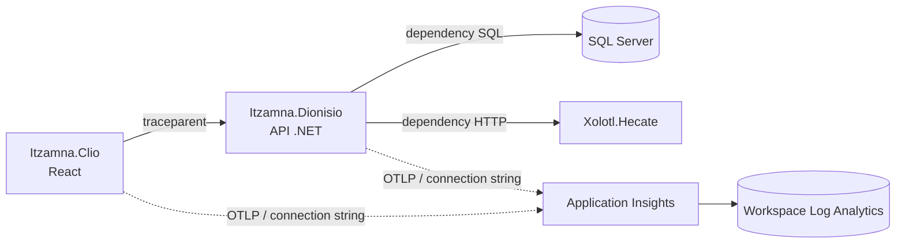

# Application Insights

Parte de: [[07-Azure/08 Observabilidad/_Índice Observabilidad|Observabilidad]]

> [!info] Cómo avanzar
> `progreso`: **pendiente** → **viendo** (estudiando) → **visto** (contestaste la autoevaluación sin abrir las respuestas) → **dominado** (hiciste el laboratorio o lo aplicaste de verdad).

## Contenido

### Qué es
Application Insights es la parte de **Azure Monitor** dedicada a la observabilidad de **aplicaciones** (APM). Recopila telemetría de tu API o front y te permite ver qué peticiones fallan, cuáles son lentas, qué dependencia (SQL, HTTP, Service Bus) causa el problema y cómo se encadenan las llamadas entre servicios. Los datos se guardan en un **workspace de [[Log Analytics]]** y se consultan con KQL.

### Cómo funciona
**Qué recopila:**
- **requests**: cada petición que recibe tu app (ruta, código, duración, éxito).
- **dependencies**: llamadas salientes (SQL, HTTP, Storage, Service Bus) con destino y duración.
- **exceptions**: excepciones no controladas y las que registres.
- **traces**: tus logs de `ILogger`.
- **customEvents / customMetrics**: eventos y métricas de negocio que tú emitas.
- **availabilityResults**: pruebas de disponibilidad que llaman a tu URL desde varias regiones.
- **pageViews** y datos de navegador, si instrumentas el front.

Todo comparte un **operation id** (el trace id de W3C Trace Context), así que una petición del front, la llamada a la API y la consulta SQL quedan correlacionadas en una sola transacción.

**Cómo se conecta hoy una app.** Con la **connection string** del recurso (contiene la instrumentation key y los endpoints de ingesta; la *instrumentation key sola* es el método heredado) y una de dos rutas:
- **Azure Monitor OpenTelemetry Distro** en el código: en ASP.NET Core, el paquete `Azure.Monitor.OpenTelemetry.AspNetCore` y `UseAzureMonitor()`. Es la vía recomendada para apps nuevas.
- **Autoinstrumentación** de App Service (se activa desde el portal, sin cambiar código), útil para empezar o para apps que no puedes recompilar.

Verificado en Microsoft Learn: el SDK clásico de .NET 2.x (`Microsoft.ApplicationInsights.AspNetCore`) está **en desuso y se retira el 31 de marzo de 2027**; migra a OpenTelemetry.

**Muestreo (sampling).** Para bajar costo e ingesta, se guarda solo un porcentaje de la telemetría. Cada registro guardado trae `itemCount`, que dice cuántos eventos representa. Si cuentas con `count()` sobre datos muestreados, **subestimas**; usa `sum(itemCount)`. Además, una petición concreta que buscas puede no estar guardada. Ajusta el porcentaje o excluye tipos críticos (excepciones) del muestreo.

**Application Map** dibuja tus componentes (front, API, base, servicios externos) y sus dependencias con tasa de error y latencia en cada flecha. Sirve para responder rápido "¿el problema está en la API, en SQL o en el proveedor de pagos?". Se apoya en el *cloud role name* de cada componente, así que dale un nombre claro a cada servicio.



### Ejemplo
Instrumentar Itzamna.Dionisio con OpenTelemetry. La connection string viene de la variable `APPLICATIONINSIGHTS_CONNECTION_STRING` (en App Service, un App Setting; en local, User Secrets):

```csharp
// dotnet add package Azure.Monitor.OpenTelemetry.AspNetCore
using Azure.Monitor.OpenTelemetry.AspNetCore;
using OpenTelemetry.Resources;

builder.Services.AddOpenTelemetry()
    .UseAzureMonitor(o =>
    {
        o.SamplingRatio = 0.5F;   // guarda ~50 % de las trazas (Pendiente de confirmar valor por defecto del distro)
    })
    .ConfigureResource(r => r.AddService(serviceName: "dionisio-api")); // nombre en Application Map

// Métrica de negocio
var medidor = new System.Diagnostics.Metrics.Meter("Dionisio.Pedidos");
var pedidos = medidor.CreateCounter<long>("pedidos_creados");
builder.Services.ConfigureOpenTelemetryMeterProvider(m => m.AddMeter("Dionisio.Pedidos"));

// En el handler:
// pedidos.Add(1, new KeyValuePair<string, object?>("canal", "web"));
// logger.LogInformation("Pedido {PedidoId} creado", id);   // llega como trace con la propiedad PedidoId
```

Usa logs estructurados (plantillas con `{PedidoId}`) para poder filtrar después, y no registres datos personales ni tokens. Para Dapper, las consultas a SQL Server aparecen como dependencias gracias a la instrumentación de `SqlClient` que incluye el distro.

### Cuándo usarlo y cuándo no
Úsalo en toda app que corra en Azure y que alguien vaya a operar: es la forma más directa de saber qué está fallando en producción. Para métricas de infraestructura (CPU del plan, memoria de una VM) usa las métricas de plataforma de [[Azure Monitor y alertas]]. Si tu organización ya estandarizó otra plataforma (Grafana, Datadog), OpenTelemetry te deja exportar a ella con el mismo código de instrumentación.

### Errores comunes
- **Usar solo la instrumentation key** o el SDK clásico en proyectos nuevos.
- **Contar con `count()` sobre datos muestreados** y reportar cifras incorrectas.
- **Registrar en nivel Debug en producción**: la factura de ingesta se dispara.
- **Mismo recurso para dev y prod**: mezcla datos y alertas. Uno por ambiente.
- **No poner cloud role name**: el Application Map muestra todo como un solo nodo genérico.

### Para profundizar
- [Introducción a Application Insights](https://learn.microsoft.com/azure/azure-monitor/app/app-insights-overview)
- [Habilitar Azure Monitor OpenTelemetry en .NET](https://learn.microsoft.com/azure/azure-monitor/app/opentelemetry-enable)
- [Muestreo con OpenTelemetry en Azure Monitor](https://learn.microsoft.com/azure/azure-monitor/app/opentelemetry-sampling)

## Autoevaluación

Contesta primero en voz alta o en papel; luego despliega la respuesta.

> [!question]- ¿Qué recopila Application Insights?
> Telemetría de la app: **requests**, **dependencies** (SQL, HTTP), **exceptions**, **traces** (logs), métricas y disponibilidad. Los datos viven en un workspace de Log Analytics.

> [!question]- ¿Cómo se conecta hoy una app a Application Insights?
> Con la **connection string** (no la *instrumentation key* sola) y la distribución de OpenTelemetry de Azure Monitor (`UseAzureMonitor()` en .NET) o la autoinstrumentación de App Service.

> [!question]- ¿Qué es el muestreo (sampling) y qué riesgo tiene?
> Guardar solo un porcentaje de la telemetría para bajar costo. Riesgo: contar mal si sumas eventos muestreados; usa `sum(itemCount)` en vez de `count()`.

> [!question]- ¿Para qué sirve el *Application Map*?
> Muestra componentes y dependencias con tasas de error y latencia; ayuda a ver si el problema está en la API, la base o un servicio externo.

