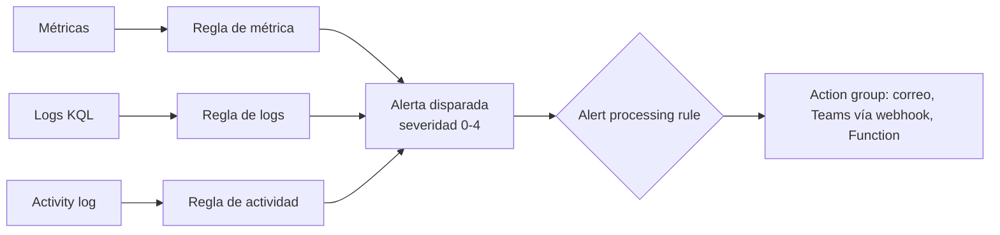

# Azure Monitor y alertas

Parte de: [[07-Azure/08 Observabilidad/_Índice Observabilidad|Observabilidad]]

> [!info] Cómo avanzar
> `progreso`: **pendiente** → **viendo** (estudiando) → **visto** (contestaste la autoevaluación sin abrir las respuestas) → **dominado** (hiciste el laboratorio o lo aplicaste de verdad).

## Contenido

### Qué es
**Azure Monitor** es la plataforma de observabilidad de Azure: recoge **métricas** y **logs** de recursos, aplicaciones e infraestructura, los muestra en gráficas y dashboards y dispara **alertas** cuando algo se sale de lo normal. [[Application Insights]] y [[Log Analytics]] son partes de Azure Monitor; las alertas son el mecanismo que convierte datos en acciones (avisar a alguien, ejecutar una automatización).

### Cómo funciona
**Dos tipos de datos:**
- **Métricas**: series numéricas ligeras a intervalos regulares (por minuto): CPU del plan de App Service, peticiones por segundo, mensajes activos en una cola, DTU de una base. Casi en tiempo real, baratas, con retención limitada y pocas dimensiones. Muchas vienen **gratis** de la plataforma.
- **Logs**: registros detallados con muchas columnas (cada petición, cada error, cada operación del plano de control), consultables con **KQL**. Más ricos y flexibles, pero con algo de retraso en la ingesta y costo por GB. Llegan a un workspace mediante **configuraciones de diagnóstico** o desde Application Insights.

**Tipos de regla de alerta:**
- **De métrica**: "promedio de tiempo de respuesta > 2 s durante 5 minutos". Rápidas; pueden usar umbral estático o **dinámico** (aprende el patrón normal).
- **De búsqueda de logs**: una consulta KQL que se evalúa cada cierto tiempo ("más de 20 excepciones `SqlException` en 10 minutos").
- **De registro de actividad**: operaciones del plano de control ("alguien borró un recurso o cambió una regla de NSG").
- **Service Health**: incidentes o mantenimientos de Azure que afectan tus regiones y servicios.
- **Resource Health**: un recurso concreto dejó de estar disponible por un problema de plataforma.

**Action groups.** Una lista reutilizable de "qué hacer" cuando se dispara una alerta: correo, SMS, notificación push a la app de Azure, llamada de voz, webhook, Azure Function, Logic App, runbook de Automation o conector ITSM. Defines el grupo una vez (por ejemplo `ag-dionisio-guardia`) y lo usan muchas reglas. Las **alert processing rules** permiten silenciar alertas en ventanas de mantenimiento o cambiar su destino sin editar cada regla.



### Ejemplo
Alerta por **síntoma** que ve el usuario: tasa de fallos de la API por encima del 5 % durante 10 minutos, con un action group de correo.

```bash
az monitor action-group create -g rg-dionisio-prod -n ag-dionisio-guardia \
  --short-name dionisio \
  --action email guardia guardia@midominio.mx

APPI_ID=$(az monitor app-insights component show -g rg-dionisio-prod \
  --app appi-dionisio-prod --query id -o tsv)

az monitor scheduled-query create -g rg-dionisio-prod -n alerta-tasa-fallos \
  --scopes "$APPI_ID" --severity 1 \
  --evaluation-frequency 5m --window-size 10m \
  --condition "count 'Fallos' > 0" \
  --condition-query Fallos="requests | summarize total = sum(itemCount), fallas = sumif(itemCount, success == false) | where total > 50 and 100.0 * fallas / total > 5" \
  --action-groups ag-dionisio-guardia \
  --description "Más de 5 % de peticiones fallidas en 10 min"
```

La consulta exige un mínimo de tráfico (`total > 50`) para no despertar a nadie porque fallaron 2 de 3 peticiones a las 4 a.m. (requiere la extensión `scheduled-query` de la CLI si tu versión no la trae).

**Error común: alertar por CPU > 70 % en todas las instancias.** Genera alertas ruidosas que nadie puede accionar: la CPU alta puede ser normal en un pico y no afectar a nadie. Alerta sobre **síntomas** que viven los usuarios (tasa de errores, latencia p95 contra tu objetivo, disponibilidad) y deja la CPU para dashboards y para el autoescalado. Esto conecta directo con definir objetivos de servicio: [[SLI, SLO y SLA]].

### Cuándo usarlo y cuándo no
Configura alertas para lo que exige que una persona actúe: la API devuelve errores, la latencia rompe el objetivo, la DLQ de [[Service Bus]] crece, un certificado está por vencer, alguien borró un recurso de producción, el presupuesto se acerca al límite (ver [[Cómo evitar cobros inesperados en la nube (presupuestos y alertas)]]). No alertes por todo lo que puedes medir: cada alerta sin acción entrena al equipo a ignorarlas. Cada regla tiene costo mensual según tipo y frecuencia (Pendiente de confirmar precios vigentes en la página oficial).

### Errores comunes
- **Alertas sin dueño ni acción**: si no sabes qué hacer al recibirla, no debería existir o debería ser informativa.
- **Umbrales sin mínimo de volumen**: porcentajes con poquísimo tráfico disparan falsas alarmas.
- **Contar con `count()` datos muestreados** en reglas de logs: usa `sum(itemCount)`.
- **Un action group que manda correo a una lista genérica** que nadie lee. Usa canales que alguien de guardia revise.
- **No silenciar durante mantenimientos**: usa alert processing rules en lugar de deshabilitar reglas y olvidarte de reactivarlas.

### Para profundizar
- [Información general de Azure Monitor](https://learn.microsoft.com/azure/azure-monitor/fundamentals/overview)
- [Tipos de alertas de Azure Monitor](https://learn.microsoft.com/azure/azure-monitor/alerts/alerts-types)
- [Action groups](https://learn.microsoft.com/azure/azure-monitor/alerts/action-groups)

## Autoevaluación

Contesta primero en voz alta o en papel; luego despliega la respuesta.

> [!question]- ¿Qué diferencia hay entre métricas y logs en Azure Monitor?
> **Métricas**: valores numéricos ligeros a intervalos, casi en tiempo real (CPU, requests/s). **Logs**: registros detallados consultables con KQL, con más retraso y costo.

> [!question]- ¿Qué tipos de regla de alerta existen?
> De **métrica**, de **búsqueda de logs** (consulta KQL), de **registro de actividad** (p. ej. alguien borró un recurso), de **Service Health** y de **Resource Health**.

> [!question]- ¿Qué es un action group?
> Lista reutilizable de acciones al disparar una alerta: correo, SMS, push, webhook, Function, Logic App, runbook o ITSM.

> [!question]- Error común: alertar por CPU > 70 % en todas las instancias.
> Alerta ruidosa y poco accionable. Prefiere alertas sobre **síntomas** que ve el usuario (tasa de errores, latencia p95 contra el SLO) y deja la CPU para dashboards. Ver [[SLI, SLO y SLA]].

