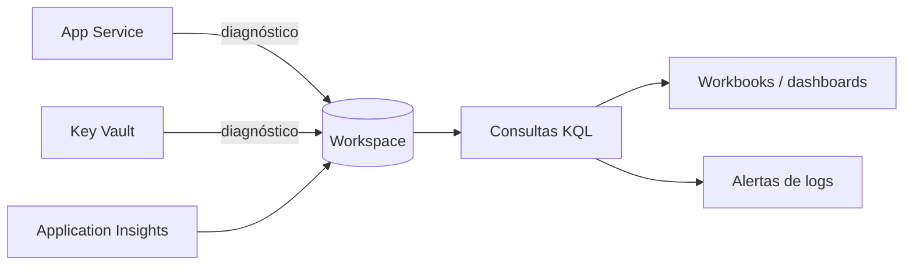

# Log Analytics

Parte de: [[07-Azure/08 Observabilidad/_Índice Observabilidad|Observabilidad]]

> [!info] Cómo avanzar
> `progreso`: **pendiente** → **viendo** (estudiando) → **visto** (contestaste la autoevaluación sin abrir las respuestas) → **dominado** (hiciste el laboratorio o lo aplicaste de verdad).

## Contenido

### Qué es
Un **workspace de Log Analytics** es el almacén de logs de Azure Monitor. Recibe datos de muchas fuentes —configuraciones de diagnóstico de recursos (App Service, SQL, Key Vault, Front Door), [[Application Insights]], agentes de VMs, el registro de actividad— y los guarda en **tablas** que se consultan con **KQL** (*Kusto Query Language*). Es donde investigas incidentes, construyes dashboards y defines alertas de logs.

### Cómo funciona
**Tablas y vistas.** Cada fuente escribe en sus tablas (`AppRequests`, `AppDependencies`, `AppExceptions`, `AzureDiagnostics`, `AppServiceHTTPLogs`, `AzureActivity`…). Application Insights tiene dos formas de ver los mismos datos:
- En la **vista de Application Insights** (Logs desde el recurso appi): tablas `requests`, `dependencies`, `exceptions`, `traces`, con columnas como `timestamp`, `resultCode`, `duration`.
- En el **workspace**: `AppRequests`, `AppDependencies`…, con columnas como `TimeGenerated`, `ResultCode`, `DurationMs`.

Es la misma telemetría con nombres distintos; si copias una consulta de un lado al otro, ajusta tablas y columnas.

**KQL en cinco operadores.** Una consulta es una tubería: fuente `|` filtro `|` transformación.
- `where` filtra (`timestamp > ago(1h)`).
- `summarize ... by` agrega (`count()`, `avg()`, `percentile(x, 95)`, `countif()`, `sum()`).
- `bin(timestamp, 5m)` agrupa en intervalos de tiempo.
- `top N by` / `order by` / `project` ordenan y eligen columnas.
- `render timechart` grafica.

Ejemplo de lectura: `requests | where timestamp > ago(1h) | summarize total = sum(itemCount) by resultCode` significa "de las peticiones de la última hora, cuántas hubo por código de respuesta". Si hay muestreo, suma `itemCount` en lugar de contar filas.

**Costo** (verificado en documentación de Microsoft): el plan **Analytics** cobra por GB ingerido e **incluye 31 días de retención** sin costo adicional; los planes **Basic** y **Auxiliary** cobran menos por ingesta pero cobran por GB consultado, útiles para logs voluminosos que casi no se consultan. Hay tablas que no cobran ingesta, como `AzureActivity`, `Heartbeat`, `Usage` y `Operation`, y la columna `_IsBillable` indica si un registro se cobra. Los niveles de compromiso (*commitment tiers*) dan descuento a partir de cierto volumen diario. Sobre el monto gratuito mensual por cuenta de facturación: Pendiente de confirmar en la página de precios. También puedes poner un **límite diario** de ingesta (*daily cap*) para un workspace de laboratorio.



### Ejemplo
Consultas típicas para Itzamna.Dionisio desde el workspace (versión con tablas `App*`):

```kusto
// Latencia p95 y volumen por operación, últimas 24 h
AppRequests
| where TimeGenerated > ago(24h)
| summarize p95 = percentile(DurationMs, 95), peticiones = sum(ItemCount) by Name
| order by p95 desc

// Excepciones más frecuentes de hoy, con un ejemplo de mensaje
AppExceptions
| where TimeGenerated > startofday(now())
| summarize veces = sum(ItemCount), ejemplo = take_any(OuterMessage) by ProblemId
| top 10 by veces desc

// Una transacción completa a partir de su operation id
union AppRequests, AppDependencies, AppExceptions, AppTraces
| where OperationId == "4bf92f3577b34da6a3ce929d0e0e4736"
| project TimeGenerated, Type, Name, DurationMs, Success, Message
| order by TimeGenerated asc
```

**Tu factura de logs se disparó: qué revisar.**

```kusto
// ¿Qué tablas ingieren más? (últimos 30 días, en GB)
Usage
| where TimeGenerated > ago(30d) and IsBillable == true
| summarize GB = sum(Quantity) / 1024 by DataType
| order by GB desc
```

Con eso localizas al culpable y luego revisas: configuraciones de diagnóstico que mandan **todas** las categorías (por ejemplo, logs HTTP completos de un App Service con mucho tráfico), logs en nivel `Debug` o `Information` excesivo en producción, falta de muestreo en Application Insights, y tablas que podrían ir a plan Basic. Filtra en el origen con niveles de log por categoría en `appsettings.Production.json`.

### Cuándo usarlo y cuándo no
Usa un workspace por ambiente (o por sistema y ambiente) para concentrar logs de tus recursos y de Application Insights; facilita investigar incidentes que cruzan servicios. Para un laboratorio, un solo workspace con límite diario basta. No mandes ahí datos de negocio para reportería (usa tu base o un almacén analítico) ni datos personales sin necesidad: los logs se retienen y los consultan muchas personas.

### Errores comunes
- **Mezclar tablas y columnas** de la vista de Application Insights con las del workspace (`timestamp` vs `TimeGenerated`).
- **Consultas sin filtro de tiempo** sobre tablas grandes: lentas y, en planes Basic/Auxiliary, caras.
- **Activar diagnóstico "todo" en cada recurso** "por si acaso".
- **Retención larga en Analytics para todo**: usa retención a largo plazo o planes más baratos para lo que solo guardas por cumplimiento.
- **No poner límite diario** en workspaces de prueba.

### Para profundizar
- [Información general de Log Analytics](https://learn.microsoft.com/azure/azure-monitor/logs/log-analytics-overview)
- [Tutorial de KQL](https://learn.microsoft.com/azure/data-explorer/kusto/query/tutorials/learn-common-operators)
- [Costos de Azure Monitor Logs](https://learn.microsoft.com/azure/azure-monitor/logs/cost-logs)

## Ejercicios

Resuélvelos en papel o en la herramienta; la solución está plegada.

> [!question]- (Vista de Application Insights) Cuenta las peticiones de la última hora por código de respuesta.
> ```kusto
> requests
> | where timestamp > ago(1h)
> | summarize total = count() by resultCode
> | order by total desc
> ```

> [!question]- Calcula la latencia p95 por operación en las últimas 24 h.
> ```kusto
> requests
> | where timestamp > ago(24h)
> | summarize p95 = percentile(duration, 95) by name
> | order by p95 desc
> ```

> [!question]- Grafica las peticiones fallidas en intervalos de 5 minutos.
> ```kusto
> requests
> | where timestamp > ago(6h) and success == false
> | summarize fallas = count() by bin(timestamp, 5m)
> | render timechart
> ```

> [!question]- Las 10 dependencias SQL más lentas de hoy.
> ```kusto
> dependencies
> | where timestamp > startofday(now()) and type == "SQL"
> | top 10 by duration desc
> | project timestamp, target, name, duration
> ```

> [!question]- Calcula el porcentaje de éxito de la última hora.
> ```kusto
> requests
> | where timestamp > ago(1h)
> | summarize exito = 100.0 * countif(success == true) / count()
> ```

## Autoevaluación

Contesta primero en voz alta o en papel; luego despliega la respuesta.

> [!question]- ¿Qué es un workspace de Log Analytics?
> El almacén de logs de Azure Monitor: recibe logs de recursos (configuración de diagnóstico), Application Insights, VMs, etc. Se consulta con **KQL**. Se cobra por ingesta y retención (verificar en la página oficial).

> [!question]- Tu factura de logs se disparó. ¿Qué revisas?
> Qué tablas ingieren más (`Usage | summarize sum(Quantity) by DataType`), configuraciones de diagnóstico que mandan todo, logs de nivel *Debug* en producción y falta de muestreo.

> [!question]- ¿Qué diferencia hay entre `requests` y `AppRequests`?
> Son la misma telemetría: `requests` es el nombre en la vista de Application Insights; `AppRequests` es la tabla en el workspace (con columnas como `TimeGenerated`, `ResultCode`, `DurationMs`).

