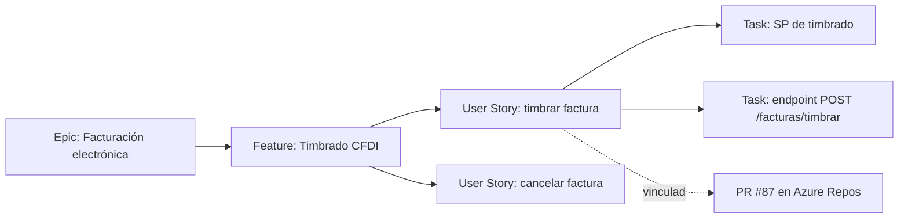

# Azure Boards

Parte de: [[07-Azure/09 Azure DevOps/_Índice Azure DevOps|Azure DevOps]]

> [!info] Cómo avanzar
> `progreso`: **pendiente** → **viendo** (estudiando) → **visto** (contestaste la autoevaluación sin abrir las respuestas) → **dominado** (hiciste el laboratorio o lo aplicaste de verdad).

## Contenido

### Qué es
Azure Boards es el servicio de Azure DevOps para **planear y dar seguimiento al trabajo**: historias, tareas, bugs, épicas, con backlogs priorizados, tableros kanban, sprints, consultas y dashboards. Se integra con Repos y Pipelines, así que cada work item puede mostrar los commits, PRs, builds y despliegues que lo resolvieron.

### Cómo funciona
**Tipos de work item según el proceso.** El proceso se elige al crear el proyecto y define los tipos disponibles y sus estados:

| Proceso | Jerarquía principal | Para quién |
|---|---|---|
| **Basic** | Epic → Issue → Task | Equipos que quieren lo mínimo |
| **Agile** | Epic → Feature → User Story → Task, más Bug | Equipos ágiles en general |
| **Scrum** | Epic → Feature → Product Backlog Item → Task, más Bug e Impediment | Equipos que siguen Scrum |
| **CMMI** | Epic → Feature → Requirement → Task, más Change Request, Risk, Review | Entornos formales y regulados |

Puedes crear un **proceso heredado** para agregar campos, estados o tipos propios (por ejemplo un campo "Cliente").

**Backlog, board y sprint** son tres vistas de los mismos work items:
- **Backlog**: lista **priorizada** (arrastras para ordenar) de lo que falta. Hay un backlog por nivel: épicas, features, historias.
- **Board**: tablero **kanban** con columnas que representan estados o etapas ("Nuevo, En análisis, En desarrollo, En revisión, Hecho"), con límites de WIP y *swimlanes*. Sirve para ver el flujo y los cuellos de botella.
- **Sprint**: una **iteración** con fechas y capacidad del equipo; asignas elementos del backlog, desglosas tareas y sigues el avance con el burndown.

**Áreas e iteraciones.** El *Area Path* clasifica por equipo o componente (`Itzamna\Dionisio`), el *Iteration Path* por tiempo (`Itzamna\2026\Sprint 22`). Los equipos ven solo sus áreas.

**WIQL** (*Work Item Query Language*) es el lenguaje tipo SQL detrás de las consultas de Boards. Lo que armas con el editor visual se guarda como WIQL, y puedes ejecutarlo por REST para automatizar reportes (ver [[Azure DevOps REST API]]).



### Ejemplo
Consulta WIQL de bugs activos asignados al sprint actual del equipo de Dionisio, ordenados por severidad:

```sql
SELECT [System.Id], [System.Title], [Microsoft.VSTS.Common.Severity], [System.AssignedTo]
FROM WorkItems
WHERE [System.TeamProject] = @project
  AND [System.WorkItemType] = 'Bug'
  AND [System.State] <> 'Closed'
  AND [System.AreaPath] UNDER 'Itzamna\Dionisio'
  AND [System.IterationPath] = @CurrentIteration('[Itzamna]\Dionisio Team')
ORDER BY [Microsoft.VSTS.Common.Severity] ASC, [System.ChangedDate] DESC
```

Ejecutarla desde la CLI o un script:

```bash
az boards query --project Itzamna --wiql "SELECT [System.Id], [System.Title] FROM WorkItems \
  WHERE [System.WorkItemType] = 'Bug' AND [System.State] = 'Active'" -o table

# Crear una historia vinculada a un área e iteración
az boards work-item create --project Itzamna --type "User Story" \
  --title "Exportar reporte de ventas a Excel" \
  --area "Itzamna\Dionisio" --iteration "Itzamna\2026\Sprint 22"
```

En el día a día: refinas el backlog por prioridad, en la planeación del sprint jalas historias según capacidad, y durante el sprint el board muestra el flujo. Al hacer commit o PR mencionas `#123` para vincular el trabajo (ver [[Azure Repos]]).

### Cuándo usarlo y cuándo no
Úsalo si ya trabajas en Azure DevOps y quieres trazabilidad de la idea al despliegue, o si tu organización necesita procesos con campos y estados formales. Para un proyecto personal muy chico, un board kanban con pocas columnas basta; no necesitas épicas ni sprints. Si el equipo vive en GitHub, GitHub Projects o Boards conectado a GitHub (con `AB#123`) son alternativas.

### Errores comunes
- **Elegir el proceso sin pensar**: cambiar después de Agile a Scrum requiere migrar tipos de work item.
- **Usar Boards como lista de pendientes sin priorizar**: el backlog pierde valor si el orden no significa nada.
- **Columnas de board que no reflejan el flujo real** o sin límites de WIP: todo se acumula en "En progreso".
- **Tareas sin área ni iteración**: no aparecen en los backlogs del equipo y "se pierden".
- **Consultas guardadas en "My Queries"** que el equipo necesita: guárdalas en "Shared Queries".

### Para profundizar
- [¿Qué es Azure Boards?](https://learn.microsoft.com/azure/devops/boards/get-started/what-is-azure-boards)
- [Elegir un proceso](https://learn.microsoft.com/azure/devops/boards/work-items/guidance/choose-process)
- [Sintaxis de WIQL](https://learn.microsoft.com/azure/devops/boards/queries/wiql-syntax)

## Autoevaluación

Contesta primero en voz alta o en papel; luego despliega la respuesta.

> [!question]- ¿Qué tipos de work item hay y de qué dependen?
> Del **proceso** del proyecto: Basic (Epic, Issue, Task), Agile (Epic, Feature, User Story, Task, Bug), Scrum (Epic, Feature, Product Backlog Item, Task, Bug, Impediment) o CMMI (Requirement…).

> [!question]- ¿Qué es WIQL?
> *Work Item Query Language*: lenguaje tipo SQL de las consultas de Boards (`SELECT [System.Id] FROM WorkItems WHERE [System.State] = 'Active'`). Las consultas guardadas se pueden ejecutar por REST. Ver [[Azure DevOps REST API]].

> [!question]- Diferencia entre backlog, board y sprint.
> **Backlog**: lista priorizada. **Board**: tablero kanban por columnas de estado. **Sprint**: iteración con capacidad y fechas donde se asignan elementos.

