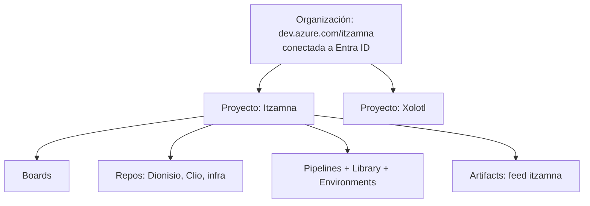

# Azure DevOps - organización y proyectos

Parte de: [[07-Azure/09 Azure DevOps/_Índice Azure DevOps|Azure DevOps]]

> [!info] Cómo avanzar
> `progreso`: **pendiente** → **viendo** (estudiando) → **visto** (contestaste la autoevaluación sin abrir las respuestas) → **dominado** (hiciste el laboratorio o lo aplicaste de verdad).

## Contenido

### Qué es
Azure DevOps Services es la plataforma en la nube de Microsoft para el ciclo completo de desarrollo: planear trabajo, versionar código, compilar y desplegar, probar y publicar paquetes. Se organiza en **organizaciones** y **proyectos**, y dentro de cada proyecto hay cinco servicios: **Boards**, **Repos**, **Pipelines**, **Test Plans** y **Artifacts**. Entender esta jerarquía te ayuda a decidir dónde poner permisos, pipelines y configuraciones compartidas.

### Cómo funciona
**Jerarquía:**
- **Organización** (`https://dev.azure.com/{org}`): la unidad de facturación y de usuarios. Se **conecta a un tenant de Microsoft Entra ID**, de modo que los usuarios inician sesión con sus cuentas corporativas y puedes usar grupos de Entra para dar acceso. Aquí se configuran políticas globales, facturación, pools de agentes de la organización y extensiones.
- **Proyecto**: contenedor de trabajo con su propio **proceso** de Boards (Basic, Agile, Scrum o CMMI), sus repos, pipelines, feeds, variable groups, service connections y environments, y sus permisos. Dentro de un proyecto hay **equipos** con sus propios backlogs y áreas.
- **Servicios**: [[Azure Boards]], [[Azure Repos]], [[Azure Pipelines]], [[Azure Test Plans]] y [[Azure Artifacts]]. Se pueden apagar por proyecto si no los usas.



**¿Un proyecto por app o un proyecto para todo?** Para un equipo pequeño, **un proyecto con varios repos** suele ser mejor: compartes un solo backlog, consultas entre apps, variable groups, service connections, environments y plantillas de pipeline sin duplicarlos. Crea proyectos separados cuando hay **equipos distintos con permisos distintos** (un proveedor externo que no debe ver tu código), procesos de trabajo realmente diferentes o requisitos de auditoría que exigen aislamiento. Muchos proyectos pequeños fragmentan la configuración y complican mover trabajo entre ellos.

**Niveles de acceso** (verificados en la página oficial de precios, noviembre 2026). Definen qué partes puede usar cada usuario, independientemente de sus permisos:
- **Stakeholder**: gratis e ilimitado. Acceso limitado a Boards (ver y crear elementos, sin la experiencia completa de backlogs y sprints) y la posibilidad de ver y aprobar en Pipelines; ideal para clientes o gerentes que revisan avance.
- **Basic**: Repos, Pipelines, Boards completo y Artifacts. **Los primeros 5 usuarios Basic son gratis**; después, **6 USD por usuario al mes**.
- **Basic + Test Plans**: todo lo anterior más crear y administrar planes de prueba; **52 USD por usuario al mes**.
- Los suscriptores de Visual Studio reciben el nivel correspondiente a su suscripción sin costo adicional.

Otras inclusiones gratuitas: 1 job paralelo hospedado por Microsoft con 1,800 minutos al mes, 1 job paralelo autohospedado con minutos ilimitados y 2 GiB de Artifacts (ver [[Azure Pipelines - agentes]]). Microsoft también anunció el retiro de los **proyectos públicos**: ya no se pueden crear nuevos y los existentes pasarán a privados en 2027.

### Ejemplo
Estructura recomendada para los proyectos del usuario: una organización, un proyecto `Itzamna` con repos `Itzamna.Dionisio`, `Itzamna.Clio` e `infra`, y otro proyecto `Xolotl` para identidad (otro equipo, otros permisos). Con la extensión `azure-devops` de la CLI:

```bash
az extension add --name azure-devops
az devops configure --defaults organization=https://dev.azure.com/itzamna

az devops project create --name Itzamna --process Agile --visibility private
az repos create --name Itzamna.Dionisio --project Itzamna
az repos create --name Itzamna.Clio --project Itzamna

# Un usuario Stakeholder para el cliente
az devops user add --email-id cliente@empresa.mx --license-type stakeholder \
  --send-email-invite false
```

Organiza permisos con **grupos** (de Entra o del proyecto: Readers, Contributors, Project Administrators) en lugar de usuario por usuario.

### Cuándo usarlo y cuándo no
Azure DevOps encaja muy bien si tu empresa ya usa Entra ID y Azure, si necesitas Boards con procesos formales, aprobaciones y auditoría en despliegues, o feeds privados de NuGet. Si tu equipo vive en GitHub, puedes combinar: código en GitHub y Boards o Pipelines en Azure DevOps. Para un proyecto personal pequeño, el nivel gratuito cubre cómodamente a una persona o un equipo de hasta cinco.

### Errores comunes
- **Un proyecto por repositorio**: duplicas service connections, variable groups y plantillas, y pierdes la vista unificada del trabajo.
- **Elegir el proceso a la ligera**: cambiar de Agile a Scrum después implica migrar tipos de work item.
- **Permisos por usuario individual**: se vuelve inmanejable; usa grupos.
- **Dar Basic a todos**: quien solo consulta avance puede ser Stakeholder sin costo.
- **No conectar la organización a Entra ID**: terminas con cuentas personales y sin control al dar de baja a alguien.

### Para profundizar
- [Planear la estructura de organizaciones y proyectos](https://learn.microsoft.com/azure/devops/user-guide/plan-your-azure-devops-org-structure)
- [Niveles de acceso](https://learn.microsoft.com/azure/devops/organizations/security/access-levels)
- [Precios de Azure DevOps](https://azure.microsoft.com/pricing/details/devops/azure-devops-services/)

## Autoevaluación

Contesta primero en voz alta o en papel; luego despliega la respuesta.

> [!question]- ¿Cómo se organiza Azure DevOps?
> **Organización** (`dev.azure.com/{org}`) → **proyectos** → dentro de cada uno Boards, Repos, Pipelines, Test Plans y Artifacts. La organización se conecta a un tenant de Entra ID para los usuarios.

> [!question]- ¿Un proyecto por app o un proyecto para todo?
> Para equipos pequeños, **un proyecto con varios repos** facilita compartir Boards, pipelines y variable groups. Proyectos separados cuando hay equipos, permisos o procesos realmente distintos.

> [!question]- ¿Qué son los niveles de acceso (Stakeholder, Basic, Basic + Test Plans)?
> Definen qué partes puede usar cada usuario. Stakeholder: Boards limitado sin costo; Basic: Repos, Pipelines y Boards completo; Test Plans requiere un nivel superior. Usuarios gratuitos incluidos (verificar en la página oficial).

