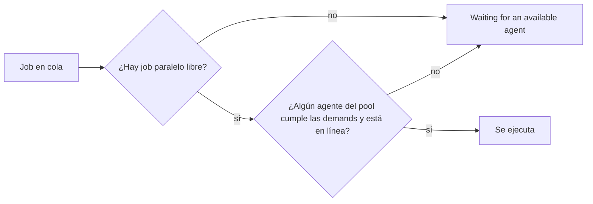

# Azure Pipelines - agentes

Parte de: [[07-Azure/09 Azure DevOps/_Índice Azure DevOps|Azure DevOps]]

> [!info] Cómo avanzar
> `progreso`: **pendiente** → **viendo** (estudiando) → **visto** (contestaste la autoevaluación sin abrir las respuestas) → **dominado** (hiciste el laboratorio o lo aplicaste de verdad).

## Contenido

### Qué es
Un **agente** es la máquina (con el software *Azure Pipelines Agent*) que ejecuta los jobs de tu pipeline: clona el repo, corre `dotnet build`, publica artefactos, despliega. Los agentes se agrupan en **pools**, y cada job pide un pool (`pool: vmImage: ubuntu-24.04` o `pool: name: MiPool`). Hay dos grandes familias: **hospedados por Microsoft** y **autohospedados**. El contexto general del servicio está en [[Azure Pipelines]].

### Cómo funciona
**Hospedados por Microsoft (Microsoft-hosted):**
- Cada job recibe una **VM nueva y limpia** que se descarta al terminar; no hay estado entre ejecuciones (salvo lo que guardes con la tarea `Cache@2`).
- Microsoft mantiene las imágenes con software preinstalado (.NET SDKs, Node, Docker, Azure CLI…). Verificado en Microsoft Learn: `windows-latest` apunta hoy a Windows Server 2025 y se está moviendo a la variante con Visual Studio 2026 (`windows-2025-vs2026` disponible para probar); hay imágenes Ubuntu (`ubuntu-24.04`, `ubuntu-latest`) y macOS. Fijar la versión (`ubuntu-24.04`) evita sorpresas cuando cambia el "latest".
- No llegan a tu red privada (salen desde IPs públicas de Azure) y tienen límites de tiempo por job.

**Autohospedados (self-hosted):**
- Instalas el agente en tu VM, servidor o contenedor y lo registras en un pool. **Tú** lo mantienes: parches, SDKs, espacio en disco, seguridad.
- **Persiste estado**: el repo ya clonado, paquetes NuGet y capas de Docker en caché → builds más rápidos.
- Puede llegar a **recursos privados**: un IIS interno, una base con private endpoint, una VNet.
- Alternativa intermedia: **Managed DevOps Pools**, agentes en Azure administrados por Microsoft pero con tus tamaños de VM, imágenes y red.

**Paralelismo y costo** (verificado en la página de precios y en Microsoft Learn, noviembre 2026). Cada job que corre al mismo tiempo consume un **job paralelo**. Gratis por organización: **1 job paralelo hospedado por Microsoft con 1,800 minutos al mes** (máximo 60 minutos por job en el nivel gratuito) y **1 job paralelo autohospedado con minutos ilimitados**. Para más, compras jobs paralelos adicionales. En organizaciones nuevas la concesión gratuita hospedada puede no estar activa de inicio; la documentación actual indica vincular la organización a una suscripción de Azure para habilitarla (antes se pedía con un formulario) (Pendiente de confirmar el procedimiento vigente al crear la organización).

**Demands y capabilities.** Cada agente autohospedado anuncia *capabilities* (sistema operativo, software instalado, variables que tú agregas). Un job puede exigir *demands* (`demands: - docker`); solo corre en agentes que las cumplen.



**«Waiting for an available agent»: causas típicas.**
1. No hay **paralelismo** disponible (organización nueva sin la concesión gratuita activa, o minutos del mes agotados).
2. Todos los jobs paralelos están **ocupados** por otros pipelines.
3. En pools autohospedados, **ningún agente en línea** cumple las *demands*, o el agente está desconectado o deshabilitado.
4. El pipeline no tiene **permiso** para usar ese pool (hay que autorizarlo la primera vez).

### Ejemplo
Un pipeline que compila en un agente hospedado y despliega a un servidor IIS interno con un agente autohospedado de Windows:

```yaml
stages:
  - stage: Build
    jobs:
      - job: Compilar
        pool:
          vmImage: ubuntu-24.04          # hospedado por Microsoft
        steps:
          - task: UseDotNet@2
            inputs: { version: 10.0.x }
          - script: dotnet publish src/Dionisio.Api -c Release -o $(Build.ArtifactStagingDirectory)/api
          - publish: $(Build.ArtifactStagingDirectory)/api
            artifact: api

  - stage: DeployInterno
    dependsOn: Build
    jobs:
      - job: IIS
        pool:
          name: OnPrem-Windows           # autohospedado en la red de la empresa
          demands:
            - Agent.OS -equals Windows_NT
            - iis
        steps:
          - download: current
            artifact: api
          - pwsh: ./deploy/publicar-iis.ps1 -Origen "$(Pipeline.Workspace)/api"
```

Instalar un agente autohospedado (en una VM de laboratorio): descargas el paquete desde *Organization settings → Agent pools → New agent*, ejecutas `config.cmd` (Windows) o `./config.sh` (Linux) con la URL de la organización y un token de acceso, y lo instalas como servicio. Sobre la VM, revisa que no tenga puertos de administración abiertos: el agente solo necesita salida HTTPS hacia Azure DevOps.

### Cuándo usarlo y cuándo no
- **Hospedado por Microsoft**: la opción por defecto. Cero mantenimiento, entorno limpio y reproducible, ideal para CI de .NET y React.
- **Autohospedado**: cuando despliegas a servidores en tu red privada, necesitas herramientas con licencia instalada, builds pesados que se benefician de caché local, hardware especial, o si no tienes paralelismo hospedado disponible. Recuerda que una VM encendida 24/7 cuesta; apágala o usa Managed DevOps Pools o escalado de VM.

### Errores comunes
- **Usar `*-latest`** y que el pipeline se rompa el día que cambia la imagen. Fija versiones y actualiza a propósito.
- **Agentes autohospedados compartidos entre proyectos sensibles**: un pipeline malicioso puede leer lo que dejó otro. Separa pools y limpia el workspace (`workspace: clean: all`).
- **Guardar secretos en el disco del agente**: usa variable groups con Key Vault o service connections.
- **Agente como administrador local sin necesidad**: corre el servicio con una cuenta de mínimo privilegio.
- **Ignorar el límite de 60 minutos** del nivel gratuito: builds largos se cancelan; optimiza o compra paralelismo.

### Para profundizar
- [Agentes de Azure Pipelines](https://learn.microsoft.com/azure/devops/pipelines/agents/agents)
- [Agentes hospedados por Microsoft](https://learn.microsoft.com/azure/devops/pipelines/agents/hosted)
- [Jobs paralelos y concesión gratuita](https://learn.microsoft.com/azure/devops/pipelines/licensing/concurrent-jobs)

## Autoevaluación

Contesta primero en voz alta o en papel; luego despliega la respuesta.

> [!question]- Agentes hospedados por Microsoft vs autohospedados.
> **Microsoft-hosted**: VM nueva y limpia por job, mantenida por Microsoft, con imágenes fijas. **Self-hosted**: tu máquina o VM con el agente instalado; persiste estado y caché, puede llegar a tu red privada, y tú la mantienes.

> [!question]- Tu pipeline se queda en cola «waiting for an available agent». ¿Causas?
> Sin **paralelismo** disponible (organizaciones nuevas pueden requerir solicitar la concesión gratuita de jobs hospedados (verificar en la página oficial)), todos los jobs paralelos ocupados, o ningún agente del pool cumple las *demands*.

> [!question]- ¿Cuándo usarías un agente autohospedado?
> Para desplegar a servidores en tu red (p. ej. un IIS interno), herramientas con licencia instalada, builds pesados que aprovechan caché, o si no tienes paralelismo hospedado.

## Práctica

- [[Lab 5 - Pipeline YAML con stages y aprobaciones]]

