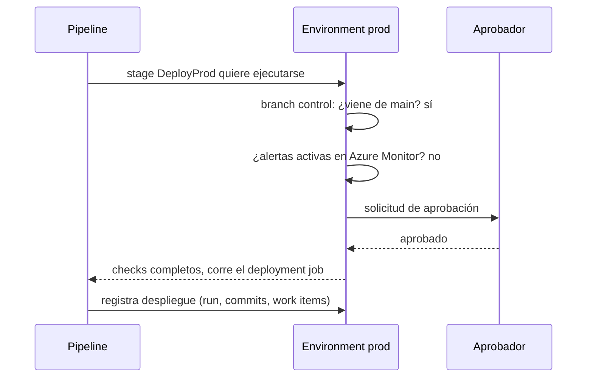

# Azure Pipelines - environments y aprobaciones

Parte de: [[07-Azure/09 Azure DevOps/_Índice Azure DevOps|Azure DevOps]]

> [!info] Cómo avanzar
> `progreso`: **pendiente** → **viendo** (estudiando) → **visto** (contestaste la autoevaluación sin abrir las respuestas) → **dominado** (hiciste el laboratorio o lo aplicaste de verdad).

## Contenido

### Qué es
Un **environment** en Azure Pipelines es un **destino lógico de despliegue** (`dev`, `qa`, `prod`) al que apuntan los *deployment jobs*. Sirve para tres cosas: llevar el **historial** de qué versión (qué run, qué commits, qué work items) se desplegó y cuándo; agrupar **recursos** (VMs o namespaces de Kubernetes); y, sobre todo, proteger el destino con **aprobaciones y checks** que se evalúan antes de que el stage pueda ejecutarse.

### Cómo funciona
El YAML solo **declara** el environment en un deployment job. La protección **no vive en el YAML**: se configura en la interfaz, en *Pipelines → Environments → prod → Approvals and checks*. Esto es intencional: si las aprobaciones estuvieran en el YAML, cualquier desarrollador con permiso de escribir en el repo podría quitárselas en un commit. Así, quien administra el environment decide las reglas y todos los pipelines que usan `prod` las respetan.

**Checks disponibles:**
- **Approvals**: una o varias personas o grupos deben aprobar; puedes impedir que quien lanzó el run se apruebe a sí mismo y definir tiempo de espera.
- **Branch control**: solo se puede desplegar desde ramas permitidas (`refs/heads/main`, `refs/heads/release/*`).
- **Business hours**: solo dentro de un horario.
- **Invoke REST API** e **Invoke Azure Function**: preguntar a un sistema externo si se puede desplegar (por ejemplo, ¿hay un cambio aprobado en la herramienta de gestión de cambios?).
- **Query Azure Monitor alerts**: no desplegar si hay alertas activas en producción.
- **Required template**: el pipeline debe extender una plantilla aprobada (ver [[Azure Pipelines - plantillas]]).
- **Exclusive lock**: solo un run a la vez puede desplegar a ese environment; los demás esperan.

Los mismos checks se pueden poner en otros **recursos protegidos**: service connections, variable groups, pools de agentes y repositorios.

**Deployment job y estrategias.** Un `deployment` es un job especial que registra el despliegue en el environment y soporta estrategias: `runOnce` (la más común), `rolling` (por lotes, para VMs) y `canary` (porcentajes crecientes). Cada estrategia tiene *lifecycle hooks*: `preDeploy`, `deploy`, `routeTraffic`, `postRouteTraffic`, y `on: failure / success` para reaccionar. Para estrategias con slots de App Service, ver [[Estrategias de despliegue (blue-green y canary)]].



### Ejemplo
Pipeline de Itzamna.Dionisio con despliegue a `dev` automático y a `prod` protegido:

```yaml
stages:
  - stage: DeployDev
    dependsOn: Build
    jobs:
      - deployment: DeployDev
        environment: dev
        pool:
          vmImage: ubuntu-24.04
        strategy:
          runOnce:
            deploy:
              steps:
                - task: AzureWebApp@1
                  inputs:
                    azureSubscription: sc-dionisio-dev
                    appType: webAppLinux
                    appName: app-dionisio-dev
                    package: $(Pipeline.Workspace)/api/**/*.zip

  - stage: DeployProd
    dependsOn: DeployDev
    condition: and(succeeded(), eq(variables['Build.SourceBranch'], 'refs/heads/main'))
    jobs:
      - deployment: DeployProd
        environment: prod            # las aprobaciones viven en el environment, no aquí
        pool:
          vmImage: ubuntu-24.04
        strategy:
          runOnce:
            deploy:
              steps:
                - task: AzureWebApp@1
                  inputs:
                    azureSubscription: sc-dionisio-prod
                    appType: webAppLinux
                    appName: app-dionisio-prod
                    deployToSlotOrASE: true
                    resourceGroupName: rg-dionisio-prod
                    slotName: staging
                    package: $(Pipeline.Workspace)/api/**/*.zip
                - task: AzureAppServiceManage@0
                  inputs:
                    azureSubscription: sc-dionisio-prod
                    Action: Swap Slots
                    WebAppName: app-dionisio-prod
                    ResourceGroupName: rg-dionisio-prod
                    SourceSlot: staging
```

En un deployment job los artefactos del run actual se descargan solos a `$(Pipeline.Workspace)`. En *Environments → prod → Approvals and checks* agregas: aprobación del grupo "Líderes Dionisio", branch control para `main` y exclusive lock. La práctica completa está en [[Lab 5 - Pipeline YAML con stages y aprobaciones]].

### Cuándo usarlo y cuándo no
Usa environments para **todo** destino real de despliegue, aunque al inicio no tenga checks: ganas historial y trazabilidad. Pon aprobaciones manuales en producción y en ambientes compartidos sensibles; en `dev` normalmente basta con branch control o nada, para no frenar al equipo. Si una aprobación se vuelve un clic automático sin revisar nada, reemplázala por checks objetivos (alertas, ventana horaria, pruebas que pasan).

### Errores comunes
- **Buscar las aprobaciones en el YAML**: no existen ahí; se configuran en el environment.
- **Usar un `job` normal en lugar de `deployment`**: no se registra el despliegue ni se evalúan los checks del environment.
- **Aprobadores que se aprueban a sí mismos**: desactívalo en la configuración del check.
- **Proteger el environment pero no la service connection de producción**: otro pipeline puede usar la conexión sin pasar por el environment.
- **Timeouts de aprobación muy largos**: runs viejos se aprueban días después con código desactualizado.

### Para profundizar
- [Crear y usar environments](https://learn.microsoft.com/azure/devops/pipelines/process/environments)
- [Aprobaciones y checks](https://learn.microsoft.com/azure/devops/pipelines/process/approvals)
- [Deployment jobs y estrategias](https://learn.microsoft.com/azure/devops/pipelines/process/deployment-jobs)

## Autoevaluación

Contesta primero en voz alta o en papel; luego despliega la respuesta.

> [!question]- ¿Qué es un environment en Azure Pipelines?
> Un destino lógico (`dev`, `prod`) al que apuntan los **deployment jobs**. Da historial de qué versión se desplegó y cuándo, y permite agregar **checks**.

> [!question]- ¿Dónde se configuran las aprobaciones? ¿En el YAML?
> No: en el **environment** (Approvals and checks) desde la interfaz. El YAML solo declara `environment: prod`; así un desarrollador no puede quitarse la aprobación editando el YAML.

> [!question]- ¿Qué otros checks existen además de la aprobación manual?
> Control de rama (solo desde `main`), horario hábil, invocar REST API o Azure Function, consultar alertas de Azure Monitor, plantilla requerida y *exclusive lock*.

> [!question]- Escribe el esqueleto de un deployment job que usa el environment `prod`.
> ```yaml
> - deployment: DeployProd
>   environment: prod
>   pool:
>     vmImage: ubuntu-24.04
>   strategy:
>     runOnce:
>       deploy:
>         steps:
>           - script: echo desplegando
> ```

## Práctica

- [[Lab 5 - Pipeline YAML con stages y aprobaciones]]

