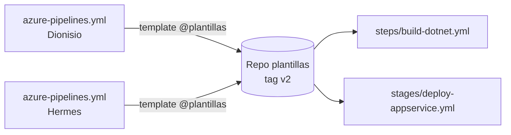

# Azure Pipelines - plantillas

Parte de: [[07-Azure/09 Azure DevOps/_Índice Azure DevOps|Azure DevOps]]

> [!info] Cómo avanzar
> `progreso`: **pendiente** → **viendo** (estudiando) → **visto** (contestaste la autoevaluación sin abrir las respuestas) → **dominado** (hiciste el laboratorio o lo aplicaste de verdad).

## Contenido

### Qué es
Las **plantillas YAML** permiten reutilizar partes de un pipeline: defines una vez cómo se compila una API .NET o cómo se despliega a App Service, con **parámetros**, y la insertas en muchos pipelines. Además de evitar copiar y pegar, sirven para **seguridad y gobierno**: una plantilla `extends` puede imponer la estructura obligatoria de todo pipeline que despliega a producción.

### Cómo funciona
**Tipos de plantilla:**
- **De steps**: una lista de pasos (`steps:`).
- **De jobs**: uno o varios jobs completos.
- **De stages**: stages completos (build, deploy).
- **De variables**: un bloque de variables reutilizable.
Se insertan con `- template: ruta.yml` en el lugar correspondiente, pasando `parameters:`.
- **`extends`**: el pipeline no define su estructura, sino que **extiende** una plantilla que decide qué stages existen y dónde se pueden inyectar los pasos del usuario. Combinado con el check **Required template** en un environment o service connection, garantiza que solo pipelines basados en la plantilla aprobada puedan desplegar.

**Parámetros** tienen tipo (`string`, `number`, `boolean`, `object`, `step`, `stepList`, `job`, `jobList`, `stage`, `stageList`), valor por defecto y lista de valores permitidos. A diferencia de las variables, se resuelven **al compilar** el YAML.

**Las tres sintaxis de expresión, y cuándo se evalúa cada una:**

| Sintaxis | Nombre | Cuándo se evalúa | Uso típico |
|---|---|---|---|
| `${{ }}` | Expresión de plantilla | Al **compilar** el YAML, antes de ejecutar | Parámetros, `if`, `each`, insertar o quitar steps |
| `$( )` | Macro | En **tiempo de ejecución**, justo antes de correr cada tarea | Usar variables en inputs y scripts |
| `$[ ]` | Expresión de runtime | En **tiempo de ejecución**, al evaluar variables o condiciones | Variables de salida de otros jobs, `counter()` |

Consecuencia práctica: con `${{ }}` no puedes leer valores que solo existen al ejecutar (como una variable de salida de un job anterior), y con `$( )` no puedes decidir si un step existe o no.

**Plantillas en otro repositorio.** Declaras el repo en `resources.repositories` y referencias `template: archivo.yml@alias`. Conviene **fijar** una rama de versión o un tag (`ref: refs/tags/v2`) para que un cambio en las plantillas no rompa todos los pipelines a la vez.



### Ejemplo
Plantilla de steps para compilar y probar un proyecto .NET, con parámetros y un `each`:

```yaml
# plantillas/steps/build-dotnet.yml (repo Itzamna.Plantillas)
parameters:
  - name: proyecto
    type: string
  - name: proyectosPrueba
    type: object
    default: []
  - name: configuracion
    type: string
    default: Release
    values: [ Debug, Release ]

steps:
  - task: UseDotNet@2
    inputs:
      version: 10.0.x
  - script: dotnet build ${{ parameters.proyecto }} -c ${{ parameters.configuracion }}
    displayName: Compilar ${{ parameters.proyecto }}
  - ${{ each p in parameters.proyectosPrueba }}:
      - script: dotnet test ${{ p }} -c ${{ parameters.configuracion }} --logger trx
        displayName: Probar ${{ p }}
  - task: PublishTestResults@2
    condition: succeededOrFailed()
    inputs:
      testResultsFormat: VSTest
      testResultsFiles: '**/*.trx'
```

Uso desde el repo de Itzamna.Dionisio, con las plantillas en otro repositorio fijadas a un tag:

```yaml
# azure-pipelines.yml
resources:
  repositories:
    - repository: plantillas
      type: git
      name: Itzamna/Itzamna.Plantillas
      ref: refs/tags/v2

trigger:
  branches:
    include: [ main ]

pool:
  vmImage: ubuntu-24.04

steps:
  - template: steps/build-dotnet.yml@plantillas
    parameters:
      proyecto: src/Dionisio.Api/Dionisio.Api.csproj
      proyectosPrueba:
        - tests/Dionisio.Tests/Dionisio.Tests.csproj
```

Y un ejemplo de por qué importa la sintaxis: `${{ if eq(parameters.configuracion, 'Release') }}:` puede agregar un paso de firma solo en Release (se decide al compilar), mientras que `$(Build.BuildNumber)` dentro de un script se sustituye al ejecutar.

### Cuándo usarlo y cuándo no
Úsalas cuando dos o más pipelines repiten los mismos pasos, cuando quieres un estándar de equipo (cómo se compila, cómo se escanea, cómo se despliega) o cuando seguridad exige que los despliegues a producción sigan una estructura aprobada (`extends` + required template). Para un solo pipeline sencillo, una plantilla agrega indirección sin beneficio. No conviertas todo en parámetros: una plantilla con 25 parámetros es más difícil de entender que dos plantillas simples.

### Errores comunes
- **Usar `$(variable)` donde se necesita `${{ }}`** (o al revés) y obtener el texto literal o un valor vacío.
- **Referenciar la rama `main` del repo de plantillas**: un cambio rompe todos los pipelines. Fija tags.
- **Parámetros sin tipo ni valores permitidos**: errores que solo aparecen al ejecutar.
- **Indentación incorrecta en `each` o `if`**: el YAML compila con una estructura distinta a la esperada; revisa el YAML expandido en la vista "Download full YAML".
- **Lógica de negocio compleja en expresiones de plantilla**: muévela a scripts versionados y probados.

### Para profundizar
- [Uso de plantillas](https://learn.microsoft.com/azure/devops/pipelines/process/templates)
- [Expresiones](https://learn.microsoft.com/azure/devops/pipelines/process/expressions)
- [Seguridad con plantillas (extends)](https://learn.microsoft.com/azure/devops/pipelines/security/templates)

## Autoevaluación

Contesta primero en voz alta o en papel; luego despliega la respuesta.

> [!question]- ¿Qué tipos de plantilla YAML existen?
> De **steps**, **jobs**, **stages** y **variables** (se insertan con `template:`), y plantillas **extends** que definen la estructura obligatoria del pipeline (útil para seguridad).

> [!question]- Diferencia entre `${{ }}`, `$( )` y `$[ ]`.
> `${{ }}`: expresión de **plantilla**, se evalúa al compilar el YAML (parámetros, `if`, `each`). `$( )`: macro de variable, se sustituye en **tiempo de ejecución** antes de correr la tarea. `$[ ]`: expresión de **runtime** (p. ej. leer variables de salida de otros jobs).

> [!question]- Escribe una plantilla de steps con un parámetro `proyecto` y cómo usarla.
> ```yaml
> # templates/build-dotnet.yml
> parameters:
>   - name: proyecto
>     type: string
> steps:
>   - script: dotnet build ${{ parameters.proyecto }} -c Release
> ```
> ```yaml
> # azure-pipelines.yml
> steps:
>   - template: templates/build-dotnet.yml
>     parameters:
>       proyecto: src/Api/Api.csproj
> ```

> [!question]- ¿Cómo reutilizas plantillas de otro repositorio?
> Declarándolo en `resources.repositories` y referenciando `template: build.yml@plantillas`. Fija una rama o tag para no romper pipelines con cambios.

