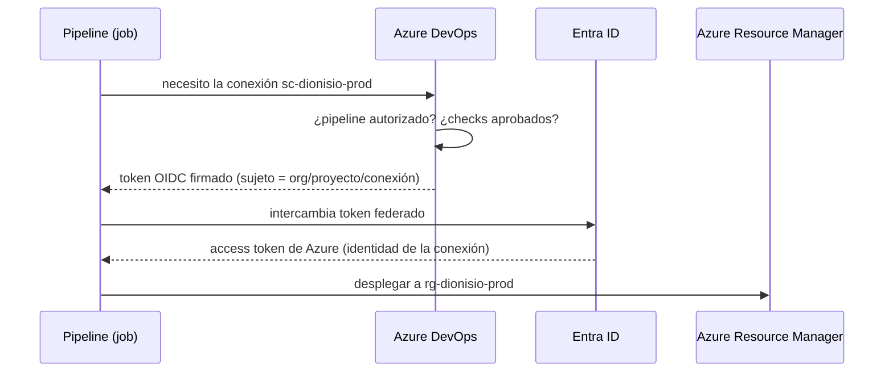

# Azure Pipelines - service connections

Parte de: [[07-Azure/09 Azure DevOps/_Índice Azure DevOps|Azure DevOps]]

> [!info] Cómo avanzar
> `progreso`: **pendiente** → **viendo** (estudiando) → **visto** (contestaste la autoevaluación sin abrir las respuestas) → **dominado** (hiciste el laboratorio o lo aplicaste de verdad).

## Contenido

### Qué es
Una **service connection** es una credencial que se guarda en el proyecto de Azure DevOps para que los pipelines se conecten a un servicio externo sin poner secretos en el YAML: una suscripción de Azure (Azure Resource Manager), un registro de contenedores, GitHub, un clúster de Kubernetes, un servidor por SSH, un feed de NuGet externo. En el YAML solo se menciona su **nombre** (`azureSubscription: sc-dionisio-prod`).

### Cómo funciona
La conexión vive en *Project settings → Service connections*. Tiene una identidad (en Azure, un *app registration* o una *managed identity*), un **alcance** (suscripción o grupo de recursos), **permisos de pipeline** (qué pipelines pueden usarla) y, como recurso protegido, **aprobaciones y checks** propios.

**Autenticación para Azure Resource Manager** (verificado en Microsoft Learn). Lo recomendado es **workload identity federation (WIF)**, basado en OIDC: no hay secreto guardado ni que caduque. Cuando el pipeline corre, Azure DevOps emite un token firmado que identifica a ese pipeline y conexión; Entra ID confía en él gracias a una **credencial federada** configurada en el app registration o en la managed identity, y lo intercambia por un token de Azure. Opciones:
- **App registration (automática)**: Azure DevOps crea la app y la credencial federada; requiere que tengas rol Owner en la suscripción.
- **Managed identity existente (user-assigned)**: útil cuando no tienes permiso para crear app registrations.
- **Manual**: cuando lo automático no aplica.
Las conexiones con **secreto** de service principal se consideran heredadas: el secreto expira, se puede filtrar y alguien tiene que rotarlo. Las existentes pueden **convertirse** a WIF desde la interfaz. Otros datos a tener en cuenta: Azure DevOps cambiará el emisor de los tokens federados al emisor de Entra el **1 de julio de 2027**, y las conexiones sin uso durante **100 días** pueden deshabilitarse automáticamente.



**Limitar el uso de la conexión a producción:**
1. **No** marcar *Grant access permission to all pipelines*; autoriza explícitamente solo los pipelines de despliegue de esa app.
2. Agregar **checks** a la conexión: aprobación, *branch control* (solo `main`), *required template*.
3. **Mínimo privilegio en Azure**: la identidad de la conexión de prod solo con *Contributor* (o un rol más acotado como *Website Contributor*) sobre `rg-dionisio-prod`, no sobre toda la suscripción. Una conexión por ambiente (`sc-dionisio-dev`, `sc-dionisio-prod`).
4. Restringir quién puede administrar o usar la conexión con los roles de seguridad del recurso (User, Administrator).

### Ejemplo
Uso en YAML con Azure CLI. La tarea `AzureCLI@2` usa la conexión y, con WIF, no hay ningún secreto en juego:

```yaml
- task: AzureCLI@2
  displayName: Desplegar infraestructura con Bicep
  inputs:
    azureSubscription: sc-dionisio-prod     # nombre de la service connection
    scriptType: bash
    scriptLocation: inlineScript
    inlineScript: |
      az deployment group create \
        -g rg-dionisio-prod \
        -f infra/main.bicep \
        -p infra/prod.bicepparam
```

Dar permisos mínimos a la identidad de la conexión (el id del principal aparece en la conexión, en "Manage service connection roles" o en el app registration):

```bash
az role assignment create \
  --assignee <appId-o-objectId-de-la-conexion> \
  --role Contributor \
  --scope /subscriptions/<sub-id>/resourceGroups/rg-dionisio-prod
```

Si un script necesita asignar roles (por ejemplo crear la asignación de Key Vault en el Bicep), Contributor no alcanza: necesitas *Role Based Access Control Administrator* acotado a ese grupo de recursos, idealmente con condiciones que limiten qué roles puede asignar.

### Cuándo usarlo y cuándo no
Usa service connections para todo acceso de pipelines a sistemas externos. Para Azure, siempre WIF en conexiones nuevas, y convierte las de secreto. Para leer secretos de aplicación en el pipeline, la service connection sirve para autenticarse, pero los valores vienen de Key Vault mediante un variable group vinculado (ver [[Azure Pipelines - variable groups]]). Nunca pongas un service principal con secreto como variable del pipeline "porque es más rápido".

### Errores comunes
- **"Grant access to all pipelines"** en la conexión de producción: cualquier pipeline nuevo, incluso de una rama experimental, puede desplegar a prod.
- **Contributor sobre toda la suscripción**: un error de script puede borrar recursos de otros sistemas.
- **Una sola conexión para todos los ambientes**: no puedes proteger prod sin estorbar a dev.
- **Secretos que expiran en silencio**: el despliegue falla el día que vence el secreto. WIF lo evita.
- **Conexiones huérfanas**: conexiones viejas con permisos amplios que nadie usa; revísalas y bórralas.

### Para profundizar
- [Conectarse a Azure con una service connection de ARM](https://learn.microsoft.com/azure/devops/pipelines/library/connect-to-azure)
- [Administrar service connections](https://learn.microsoft.com/azure/devops/pipelines/library/service-endpoints)
- [Convertir conexiones existentes a workload identity federation](https://learn.microsoft.com/azure/devops/pipelines/release/convert-service-connections)

## Autoevaluación

Contesta primero en voz alta o en papel; luego despliega la respuesta.

> [!question]- ¿Qué es una service connection?
> Credencial guardada en el proyecto para que el pipeline se conecte a un servicio externo (Azure Resource Manager, ACR, GitHub, un servidor SSH) sin poner secretos en el YAML.

> [!question]- ¿Qué tipo de autenticación recomiendas para Azure Resource Manager?
> **Workload identity federation** (OIDC): no hay secreto guardado ni que caduque; Azure confía en el token que emite Azure DevOps para ese pipeline.

> [!question]- ¿Cómo limitas qué pipelines usan una conexión a producción?
> No marcar «Grant access to all pipelines», autorizar pipelines específicos y agregar **checks** a la conexión (aprobaciones, control de rama). Dale a su identidad solo el rol necesario sobre el grupo de recursos de prod.

