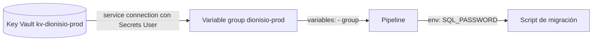

# Azure Pipelines - variable groups

Parte de: [[07-Azure/09 Azure DevOps/_Índice Azure DevOps|Azure DevOps]]

> [!info] Cómo avanzar
> `progreso`: **pendiente** → **viendo** (estudiando) → **visto** (contestaste la autoevaluación sin abrir las respuestas) → **dominado** (hiciste el laboratorio o lo aplicaste de verdad).

## Contenido

### Qué es
Un **variable group** es un conjunto de variables con nombre que se guarda en **Pipelines → Library** del proyecto y se comparte entre varios pipelines. Evita repetir los mismos valores (nombres de recursos, URLs, configuraciones por ambiente) en cada YAML y permite guardar **secretos** fuera del repositorio, ya sea dentro del propio grupo (marcados como secretos) o **vinculando el grupo a un Azure Key Vault**.

### Cómo funciona
Se referencia en el YAML con `variables: - group: nombre` y sus variables quedan disponibles como cualquier otra (`$(NombreVariable)`). Se puede usar a nivel pipeline, stage o job, y combinar con variables propias:

```yaml
variables:
  - group: dionisio-prod
  - name: dotnetVersion
    value: 10.0.x
```

**Variables secretas.** Las marcadas como secretas (candado en Library, o todas las de un grupo vinculado a Key Vault) se cifran, se enmascaran con `***` en los logs y tienen una regla importante: **no se mapean automáticamente a variables de entorno** de los scripts. Las variables normales sí aparecen como variables de entorno (en mayúsculas y con `_` en lugar de `.`), pero una secreta no; si un script hace `echo $SQLPASSWORD`, sale vacío. Hay que pasarla explícitamente con `env:`. Tampoco se pasan solas a pipelines de forks ni a plantillas de otros repos sin declararlas.

**Grupo vinculado a Key Vault.** Al crear el grupo eliges *Link secrets from an Azure key vault as variables*, una service connection con acceso al vault y qué secretos traer. En cada run, el pipeline **lee el valor actual** de Key Vault. Ventajas frente a copiar secretos en Library:
- **Una sola fuente de verdad**: rotas el secreto en Key Vault y el siguiente run usa el nuevo, sin tocar Azure DevOps.
- **Auditoría**: los accesos quedan registrados en los logs de Key Vault.
- **Menos copias**: el secreto no queda duplicado en otro sistema.
La identidad de la service connection necesita permiso de lectura de secretos (*Key Vault Secrets User* con RBAC). Los nombres de secretos en Key Vault no admiten `_` ni `.`, así que se usan guiones (`Sql-Password`).

**Seguridad del grupo.** El variable group es un **recurso protegido**: tiene permisos (quién lo administra, qué pipelines lo usan) y puede tener **aprobaciones y checks**, igual que un environment. Así, el grupo `dionisio-prod` solo se usa en el pipeline de despliegue y desde `main`.



### Ejemplo
Pipeline que aplica migraciones de base de datos con un script de PowerShell. `SqlPassword` viene del grupo vinculado a Key Vault (secreto `SqlPassword` en el vault):

```yaml
variables:
  - group: dionisio-prod          # vinculado a kv-dionisio-prod

steps:
  # MAL: la secreta no llega como variable de entorno; $env:SQLPASSWORD está vacío
  - pwsh: ./db/migrar.ps1

  # BIEN: se mapea explícitamente
  - pwsh: ./db/migrar.ps1 -Servidor "$(SqlServer)" -Base "$(SqlDatabase)"
    displayName: Aplicar migraciones
    env:
      SQL_PASSWORD: $(SqlPassword)
```

```powershell
# db/migrar.ps1
param([string]$Servidor, [string]$Base)
$password = $env:SQL_PASSWORD
if (-not $password) { throw "SQL_PASSWORD no está definido" }
# ... ejecutar los .sql de db/migraciones en orden ...
```

Mejor aún, si la base admite autenticación de Entra, ni siquiera necesitas contraseña: el script usa la identidad de la service connection con `AzureCLI@2` o `AzurePowerShell@5` y obtiene un token para SQL.

Crear un grupo simple con la CLI (las variables no secretas):

```bash
az pipelines variable-group create --project Itzamna --name dionisio-dev \
  --variables SqlServer=sql-dionisio-dev.database.windows.net SqlDatabase=dionisio \
  --authorize false
```

### Cuándo usarlo y cuándo no
Úsalos para valores que comparten varios pipelines o que cambian por ambiente (`dionisio-dev`, `dionisio-prod`) y para secretos que el pipeline realmente necesita. Para valores propios de un solo pipeline, variables en el YAML son más visibles y quedan versionadas. Para secretos de la **aplicación** en tiempo de ejecución, no los pases por el pipeline: la app debe leerlos de Key Vault con su Managed Identity (ver [[Key Vault]]).

### Errores comunes
- **Esperar que la secreta aparezca como variable de entorno**: siempre `env:`.
- **Imprimir secretos transformados** (en Base64 o partidos): el enmascarado solo reconoce el valor exacto.
- **Autorizar el grupo de prod para todos los pipelines**: cualquiera puede leer los secretos con un `echo` creativo. Autoriza pipelines concretos y agrega checks.
- **Copiar secretos a mano en Library** y luego rotarlos solo en Key Vault: el pipeline falla con credenciales viejas.
- **Nombres con guion bajo en Key Vault**: no se permiten; usa guiones y ajusta los nombres en el YAML.

### Para profundizar
- [Variable groups](https://learn.microsoft.com/azure/devops/pipelines/library/variable-groups)
- [Variables secretas](https://learn.microsoft.com/azure/devops/pipelines/process/set-secret-variables)
- [Vincular variable groups a Key Vault](https://learn.microsoft.com/azure/devops/pipelines/library/link-variable-groups-to-key-vaults)

## Autoevaluación

Contesta primero en voz alta o en papel; luego despliega la respuesta.

> [!question]- ¿Qué es un variable group?
> Conjunto de variables en **Library** compartido entre pipelines (`variables: - group: mi-grupo`). Puede tener secretos o **vincularse a Key Vault**.

> [!question]- Un script no ve la variable secreta `SqlPassword`. ¿Por qué?
> Las variables secretas **no se mapean** solas a variables de entorno. Hay que pasarlas explícitamente:
> ```yaml
> - pwsh: ./migrar.ps1
>   env:
>     SQL_PASSWORD: $(SqlPassword)
> ```

> [!question]- ¿Por qué usar un grupo vinculado a Key Vault en lugar de copiar los secretos en Library?
> Una sola fuente de verdad: rotas el secreto en Key Vault y el pipeline toma el nuevo valor; además queda auditado.

