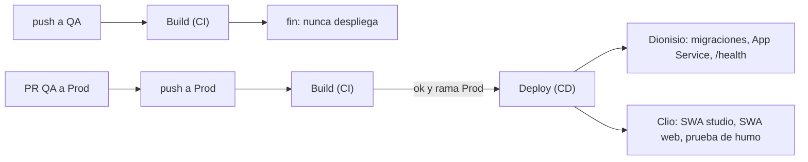

# Azure Pipelines

> Servicio de CI/CD de Azure DevOps que se define en YAML dentro del repo; [[Itzamna.Dionisio]] y [[Itzamna.Clio]] tienen cada uno su `azure-pipelines.yml` con dos etapas: **Build** (CI en `QA` y `Prod`) y **Deploy** (CD solo en `Prod`).

## Qué es y qué problema resuelve
Compilar, probar y desplegar a mano es lento y propenso a errores ("en mi máquina sí jala"). Un pipeline lo hace igual cada vez, en una máquina limpia, y bloquea el despliegue si algo falla.

## Cómo funciona por dentro
- **Trigger**: ramas/rutas que disparan el pipeline (`trigger.branches`, `paths.exclude`).
- **Stages → jobs → steps**. Cada job corre en un **agente** (`pool.vmImage`: `ubuntu-24.04`, `windows-2025`).
- **Steps**: `script`/`bash`/`pwsh` o **tasks** (`UseDotNet@2`, `PublishPipelineArtifact@1`, `AzureWebApp@1`…).
- **Artefactos**: lo que produce el CI y consume el CD (en un job `deployment` se descargan solos en `$(Pipeline.Workspace)/<nombre>`).
- **Condiciones**: `condition: and(succeeded(), eq(variables['Build.SourceBranch'], 'refs/heads/Prod'), ...)`.
- **Deployment jobs + environments**: historial de despliegues y posibles aprobaciones (`environment: itzamna-prod`).
- **Secretos**: grupos de variables (`group: itzamna-prod-secrets`) y conexiones de servicio (`sc-azure-itzamna-prod`, con federación de identidad).



## Cuándo usarla y cuándo no
### Ventajas
- YAML versionado junto al código.
- Integración nativa con Azure (conexiones de servicio, tareas de App Service, SQL, Static Web Apps).
- Environments con historial y aprobaciones.
### Desventajas
- Sintaxis y tareas propias de Azure DevOps (no portables).
- Algunas tareas exigen SO concreto (Azure SQL → Windows; Static Web Apps → Linux/Docker).
- Depurar YAML requiere ejecutar el pipeline.

## Alternativas
| Alternativa | En qué se diferencia |
|---|---|
| GitHub Actions | YAML similar, ecosistema de *actions*; natural si el repo está en GitHub. |
| GitLab CI | Integrado con GitLab. |
| Despliegue desde Visual Studio / `az` CLI | Manual; sin pruebas ni historial. |

## Cómo se usó en Itzamna
Ramas (comentario común a ambos YAML): **`QA`** = trabajo, "Solo CI. NUNCA despliega"; **`Prod`** = producción, "Solo recibe cambios por Pull Request desde QA". `pr: none` porque "Azure Repos ignora esta sección; los PR se validan con las políticas de rama". Se excluyen `README.md` y `.ai/*` del trigger. Ningún YAML contiene secretos.

**[[Itzamna.Dionisio]]** (`Itzamna.Dionisio/azure-pipelines.yml`)
| Etapa | Pasos |
|---|---|
| Build (`ubuntu-24.04`) | `UseDotNet@2` (10.0.x) → restore → build Release → `dotnet test` (trx) → `PublishTestResults@2` → publish API → zip → `dotnet ef migrations script --idempotent` → artefactos `api` y `migrations` |
| Deploy (`windows-2025`) | `SqlAzureDacpacDeployment@1` aplica `migrations.sql` → `AzureWebApp@1` (`webAppLinux`, `DOTNETCORE\|10.0`) → `pwsh` que reintenta `GET /health` hasta 20 veces cada 15 s |

Migraciones primero, código después:
```yaml
- task: SqlAzureDacpacDeployment@1
  displayName: 'Aplicar migraciones a $(sqlDatabase)'
  inputs:
    azureSubscription: '$(azureServiceConnection)'
    AuthenticationType: 'server'
    ServerName: '$(sqlServer)'
    DatabaseName: '$(sqlDatabase)'
    SqlUsername: '$(SqlAdminUser)'
    SqlPassword: '$(SqlAdminPassword)'
    deployType: 'SqlTask'
    SqlFile: '$(Pipeline.Workspace)/migrations/migrations.sql'
    SqlAdditionalArguments: '-ConnectionTimeout 120 -QueryTimeout 600'
```
Ver [[Entity Framework Core]] y [[SQL Server]].

**[[Itzamna.Clio]]** (`Itzamna.Clio/azure-pipelines.yml`)
| Etapa | Pasos |
|---|---|
| Build (`ubuntu-24.04`) | `UseNode@1` (22.x) → `npm i -g pnpm@10.12.1` → `pnpm install --frozen-lockfile` → `pnpm typecheck` → build `@clio/studio` y `@clio/web` con variables `VITE_*` → artefactos `studio-dist` y `web-dist` |
| Deploy (`ubuntu-24.04`) | `AzureStaticWebApp@0` ×2 (`skip_app_build: true`) → prueba de humo: ambos sitios 200 y el portfolio con CSP `frame-ancestors` del Studio |

- Variables `VITE_*` en el YAML a la vista: "quedan dentro del JavaScript que descarga cualquier visitante… Nunca pongas contraseñas, claves ni tokens en una variable VITE_*". Studio: `VITE_AUTH_MODE: 'access'`, `VITE_MAX_IMAGE_MB: '15'`, `VITE_MAX_VIDEO_MB: '50'` ("Igual que MediaLimits:MaxVideoBytes de producción").
- "Hoy es la única validación: el repo aún no tiene ESLint ni pruebas unitarias" (sobre `pnpm typecheck`).
- Despliegue: [[Azure Static Web Apps]]. Ver también [[pnpm workspaces]], [[Vite]], [[Content Security Policy]].

> [!note] Pendiente de confirmar
> No se ve en el repo si el environment `itzamna-prod` tiene aprobación manual. Los comentarios mencionan plan "F1" de App Service (arranque en frío lento). La base de datos se llama `dbSeshatProd` (ver [[SQL Server]]). Ambos pipelines usan el mismo grupo de secretos `itzamna-prod-secrets`.

> [!tip] Reutilizable
> El esqueleto "QA solo CI / Prod CI+CD por PR, artefacto de migraciones idempotente, migrar antes de desplegar y health check con reintentos" sirve para cualquier API .NET en Azure; el de Clio para cualquier SPA en Static Web Apps.

## Errores comunes y buenas prácticas
- `vmImage: ubuntu-latest`: cambia solo; aquí se fija `ubuntu-24.04` ("no cambia sola cuando Microsoft mueve ubuntu-latest").
- Migrar desde la app al arrancar en producción: aquí lo hace el pipeline con script idempotente.
- Health check que toca la base: despierta Azure SQL serverless; `/health` no la consulta.
- `pnpm install` sin `--frozen-lockfile`: el CI "arregla" el lockfile en silencio.
- Secretos en variables `VITE_*` o en el YAML.

## Qué estudiar después
- [[Azure Static Web Apps]], [[Entity Framework Core]] (migraciones), [[xUnit]]
- Environments con aprobaciones, plantillas YAML reutilizables, slots de App Service.

## Documentación oficial
- https://learn.microsoft.com/azure/devops/pipelines/yaml-schema/
- https://learn.microsoft.com/azure/devops/pipelines/process/deployment-jobs
- https://learn.microsoft.com/azure/devops/pipelines/library/variable-groups

## Autoevaluación

Contesta primero en voz alta o en papel; luego despliega la respuesta.

> [!question]- ¿Cuál es la jerarquía de un pipeline YAML?
> **stages** → **jobs** → **steps** (`script`, `pwsh` o `task`). Cada job corre en un agente; los stages pueden depender entre sí (`dependsOn`) y tener condiciones.

> [!question]- ¿Por qué separar CI (Build) y CD (Deploy) con un artefacto entre ellos?
> Se despliega **exactamente** lo que se probó: el mismo binario pasa por todos los ambientes, y un rollback es volver a desplegar un artefacto anterior sin recompilar.

> [!question]- ¿Qué hace este condition? `and(succeeded(), eq(variables['Build.SourceBranch'], 'refs/heads/Prod'))`
> El stage corre solo si los anteriores terminaron bien **y** el pipeline se disparó desde la rama `Prod`.

> [!question]- ¿Por qué fijar `vmImage: ubuntu-24.04` en lugar de `ubuntu-latest`?
> `latest` cambia cuando Microsoft mueve la etiqueta y puede romper el build sin que cambies nada. Fijar la versión hace el build reproducible; actualizas a propósito.

## Práctica

- [[Lab 5 - Pipeline YAML con stages y aprobaciones]]

