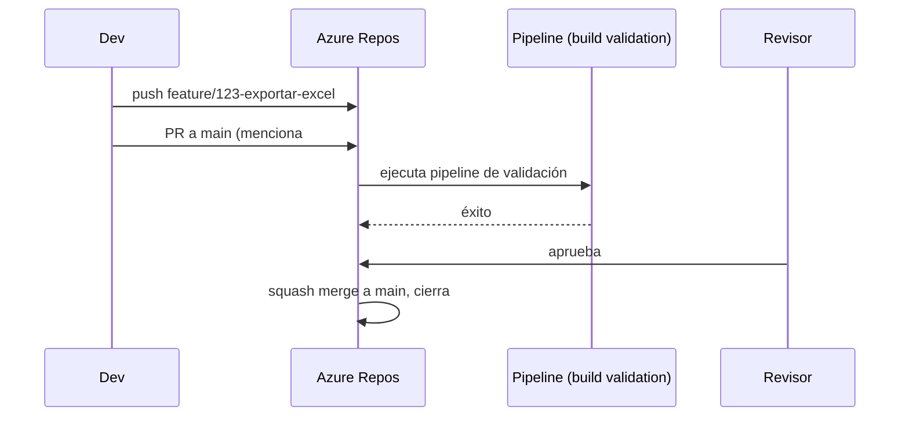

# Azure Repos

Parte de: [[07-Azure/09 Azure DevOps/_Índice Azure DevOps|Azure DevOps]]

> [!info] Cómo avanzar
> `progreso`: **pendiente** → **viendo** (estudiando) → **visto** (contestaste la autoevaluación sin abrir las respuestas) → **dominado** (hiciste el laboratorio o lo aplicaste de verdad).

## Contenido

### Qué es
Azure Repos es el servicio de **repositorios Git privados** de Azure DevOps (también soporta TFVC, el control de versiones centralizado heredado). Ofrece pull requests con revisión, **políticas de rama** para proteger ramas importantes, integración con Boards para vincular trabajo y con Pipelines para validar cada cambio antes de fusionarlo.

### Cómo funciona
**Políticas de rama.** Se configuran por rama (o por patrón de ramas) en *Project settings → Repositories → Policies*. Al activar cualquiera, **ya no se puede hacer push directo** a esa rama: todo cambio entra por PR. Las más útiles para `main`:
- **Número mínimo de revisores** (por ejemplo 1 o 2), opcionalmente prohibiendo que el autor se apruebe solo y reiniciando votos cuando hay nuevos commits.
- **Build validation**: un pipeline debe terminar con éxito para poder completar el PR. Puede marcar el resultado como vencido tras unas horas o cuando cambia `main`.
- **Check for linked work items**: el PR debe estar vinculado a un work item.
- **Check for comment resolution**: todos los comentarios resueltos.
- **Limit merge types**: permitir solo *squash merge*, por ejemplo, para tener un historial lineal.
- **Automatically included reviewers**: agrega revisores obligatorios cuando cambian ciertas rutas (`/db/**` → el DBA).

**Por qué `pr:` en el YAML no hace nada en Azure Repos.** La sección `pr:` del YAML solo aplica a repos de **GitHub y Bitbucket Cloud**. En Azure Repos, la ejecución de un pipeline en cada PR se configura con la política **Build validation** de la rama destino. El `trigger:` (CI al hacer push) sí funciona.

**Vincular commits y PRs con work items.** En Azure Repos basta con mencionar **`#123`** en el mensaje del commit o en el título o descripción del PR; también puedes vincular desde el panel "Work items" del PR, y configurar que al completar el PR el work item cambie de estado. Si tu código está en **GitHub** conectado a Boards, la sintaxis es **`AB#123`**.



### Ejemplo
Proteger `main` de Itzamna.Dionisio con la CLI (`azure-devops`):

```bash
REPO_ID=$(az repos show --repository Itzamna.Dionisio --project Itzamna --query id -o tsv)

# Mínimo un revisor, sin autoaprobación, votos reiniciados con nuevos cambios
az repos policy approver-count create --project Itzamna --repository-id "$REPO_ID" \
  --branch main --blocking true --enabled true \
  --minimum-approver-count 1 --creator-vote-counts false \
  --allow-downvotes false --reset-on-source-push true

# El pipeline "Dionisio-CI" debe pasar
PIPE_ID=$(az pipelines show --name Dionisio-CI --project Itzamna --query id -o tsv)
az repos policy build create --project Itzamna --repository-id "$REPO_ID" \
  --branch main --blocking true --enabled true \
  --build-definition-id "$PIPE_ID" --display-name "CI Dionisio" \
  --queue-on-source-update-only true --manual-queue-only false --valid-duration 720

# Work item vinculado obligatorio
az repos policy work-item-linking create --project Itzamna --repository-id "$REPO_ID" \
  --branch main --blocking true --enabled true
```

Y un commit típico:

```bash
git checkout -b feature/123-exportar-excel
git commit -m "Agrega exportación de ventas a Excel con ClosedXML #123"
git push -u origin feature/123-exportar-excel
az repos pr create --source-branch feature/123-exportar-excel --target-branch main \
  --title "Exportar ventas a Excel" --work-items 123 --auto-complete true --squash true
```

### Cuándo usarlo y cuándo no
Úsalo si tu organización ya está en Azure DevOps y quieres todo integrado (políticas, Boards, Pipelines, permisos de Entra). GitHub ofrece funciones equivalentes (branch protection, rulesets, Actions) y un ecosistema más grande; puedes tener el código en GitHub y seguir usando Boards y Pipelines. Para monorepos muy grandes evalúa el rendimiento y usa *sparse checkout*.

### Errores comunes
- **Esperar que `pr:` dispare validaciones** en Azure Repos: configura Build validation.
- **Permitir que el autor se apruebe solo**: la política de revisores pierde sentido.
- **Build validation sin vencimiento** y `main` avanzando: fusionas algo validado contra un `main` viejo. Usa *valid duration* o "requerir rama actualizada".
- **Dar a todos el permiso "Bypass policies"**: anula la protección. Resérvalo para emergencias y audítalo.
- **Commits sin referencia a work items**: pierdes la trazabilidad de qué se desplegó para qué.

### Para profundizar
- [Políticas de rama](https://learn.microsoft.com/azure/devops/repos/git/branch-policies)
- [Vincular work items a commits y PRs](https://learn.microsoft.com/azure/devops/boards/backlogs/add-link)
- [Disparadores de PR en Azure Repos](https://learn.microsoft.com/azure/devops/pipelines/repos/azure-repos-git#pr-triggers)

## Autoevaluación

Contesta primero en voz alta o en papel; luego despliega la respuesta.

> [!question]- ¿Qué son las políticas de rama y cuáles usarías en `main`?
> Reglas que se aplican a PR hacia una rama: mínimo de revisores, **validación de build** (pipeline debe pasar), work items vinculados, comentarios resueltos y tipos de merge permitidos. Impiden el push directo.

> [!question]- ¿Por qué `pr:` en el YAML no hace nada en Azure Repos?
> Esa sección es para repos de GitHub/Bitbucket. En Azure Repos la validación de PR se configura con la política **Build validation** de la rama.

> [!question]- ¿Cómo vinculas un commit a un work item?
> Mencionando `#123` en el mensaje del commit o del PR (en Azure Repos), o desde el PR con «Work items». En GitHub conectado a Boards se usa `AB#123`.

## Práctica

- [[Lab 5 - Pipeline YAML con stages y aprobaciones]]

