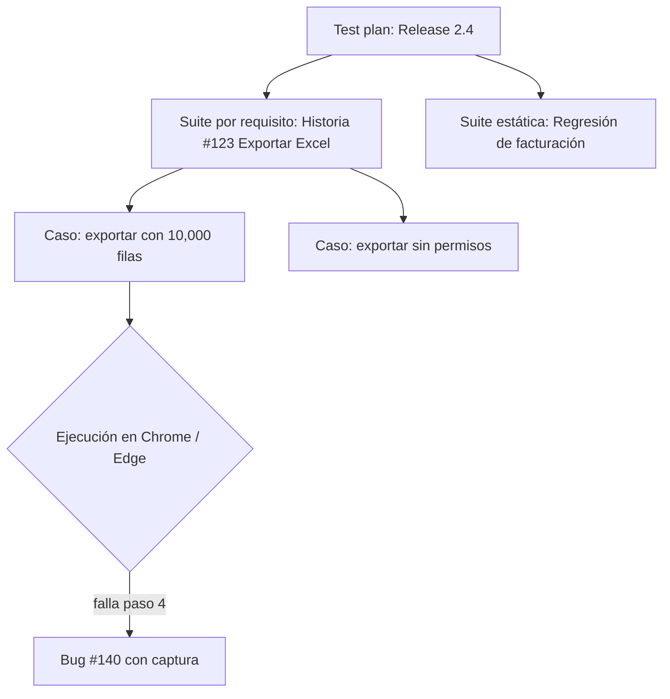

# Azure Test Plans

Parte de: [[07-Azure/09 Azure DevOps/_Índice Azure DevOps|Azure DevOps]]

> [!info] Cómo avanzar
> `progreso`: **pendiente** → **viendo** (estudiando) → **visto** (contestaste la autoevaluación sin abrir las respuestas) → **dominado** (hiciste el laboratorio o lo aplicaste de verdad).

## Contenido

### Qué es
Azure Test Plans es el servicio de Azure DevOps para **gestionar pruebas manuales y exploratorias**: organizas planes y suites de prueba, escribes casos con pasos y resultados esperados, los ejecutas registrando qué pasó en cada paso y creas bugs vinculados con evidencia. También muestra resultados de pruebas automatizadas del pipeline junto a las manuales, para tener un panorama de calidad por versión.

### Cómo funciona
**Estructura:**
- **Test plan**: agrupa las pruebas de un ciclo (un sprint, un release: "Release 2.4").
- **Test suites** dentro del plan: **estáticas** (agrupas casos a mano), **basadas en requisitos** (una suite por historia de usuario, lo que da trazabilidad historia → casos → resultados) o **basadas en consultas** (los casos que cumplan una consulta).
- **Test case**: un work item con pasos, datos de prueba (parámetros) y resultados esperados. Se pueden compartir pasos entre casos.
- **Configuraciones**: combinaciones de entorno (Chrome en Windows, Safari en iPhone 15 Pro) para ejecutar el mismo caso en cada una.
- **Ejecución**: el *Test Runner* guía paso a paso; marcas cada uno como pasado o fallado, adjuntas capturas y, si falla, creas un bug con todo el contexto.

**Pruebas exploratorias.** Con la extensión **Test & Feedback** del navegador, un tester (o un stakeholder) navega la app libremente, toma capturas, notas y grabaciones, y crea bugs o tareas directamente; útil para descubrir problemas que ningún caso escrito anticipa.

**Licencias** (verificado en Microsoft Learn y en la página de precios):
- **Stakeholder**: puede dar retroalimentación con la extensión Test & Feedback, pero no entra al portal de Test Plans.
- **Basic**: puede **ejecutar** pruebas, marcar resultados y ver reportes.
- **Basic + Test Plans** (52 USD por usuario al mes, o incluido en Visual Studio Enterprise o Test Professional): necesario para **crear y administrar** planes, suites, casos, configuraciones y pruebas de aceptación de usuario.
- Además de la licencia, cuentan los **permisos** del proyecto (por ejemplo "Manage test plans" en el área correspondiente).

### Ejemplo
Para la historia #123 de Wee.Reporteria ("Exportar reporte de ventas a Excel"), creas una suite basada en requisitos con estos casos:

| Caso | Pasos clave | Resultado esperado |
|---|---|---|
| Exportación normal | Filtrar mayo 2026 → Exportar | Archivo `.xlsx` con encabezados, totales y formato de moneda MXN |
| Volumen alto | Rango de un año (≈ 50,000 filas) | Descarga en menos de 30 s, sin error 500 |
| Sin permisos | Usuario con rol Consulta | Botón deshabilitado; la API responde 403 con ProblemDetails `codigo` |
| Caracteres especiales | Cliente "Ñandú & Cía" | El nombre se ve correcto en Excel |

Los dos primeros también se automatizan: una prueba de integración con xUnit valida el archivo generado y una prueba de carga mide el tiempo (ver [[Pruebas de carga (k6 y NBomber)]]). Los resultados del pipeline (tarea `PublishTestResults` o `dotnet test` con logger TRX) aparecen en la pestaña Tests y puedes asociar pruebas automatizadas a casos de prueba. Los dos últimos casos, que dependen de ver la UI, quedan como manuales para la validación de aceptación con el usuario de negocio.

### Cuándo usarlo y cuándo no
Úsalo cuando tienes un equipo de QA, pruebas de aceptación formales con usuarios de negocio, requisitos de auditoría que piden evidencia de qué se probó en cada versión, o mucha prueba manual en dispositivos y navegadores. **No reemplaza a las pruebas automatizadas**: todo lo repetible (unitarias, integración, API, regresión) debe correr en el pipeline en cada cambio; Test Plans cubre lo exploratorio, lo visual y la aceptación. Para un desarrollador solo o un equipo pequeño sin QA, el costo de la licencia rara vez se justifica; una lista de verificación en la descripción del PR o un work item puede bastar.

### Errores comunes
- **Usarlo como sustituto de automatización**: cientos de casos manuales de regresión que nadie ejecuta completos.
- **Casos de prueba vagos** ("verificar que funcione"): sin pasos ni resultado esperado no son reproducibles.
- **Comprar Basic + Test Plans para todos**: los que solo ejecutan pruebas pueden ser Basic.
- **No vincular casos a requisitos**: se pierde la trazabilidad que justifica la herramienta.
- **Bugs sin evidencia**: aprovecha capturas y datos del Test Runner al crear el bug.

### Para profundizar
- [¿Qué es Azure Test Plans?](https://learn.microsoft.com/azure/devops/test/overview)
- [Acceso y permisos para pruebas manuales](https://learn.microsoft.com/azure/devops/test/manual-test-permissions)
- [Pruebas exploratorias con la extensión Test & Feedback](https://learn.microsoft.com/azure/devops/test/perform-exploratory-tests)

## Autoevaluación

Contesta primero en voz alta o en papel; luego despliega la respuesta.

> [!question]- ¿Para qué sirve Azure Test Plans?
> Gestionar **pruebas manuales y exploratorias**: planes, suites y casos de prueba con pasos, ejecución con registro de resultados y bugs vinculados a work items.

> [!question]- ¿Qué licencia requiere?
> Crear y gestionar planes requiere el nivel de acceso Basic + Test Plans (u otra licencia equivalente); algunas funciones de ejecución son más amplias (verificar en la página oficial).

> [!question]- ¿Reemplaza a las pruebas automatizadas?
> No. Complementa: lo repetible se automatiza en el pipeline; Test Plans cubre lo exploratorio y la validación de aceptación.

