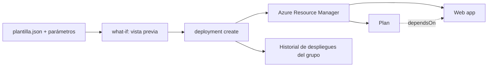

# ARM templates

Parte de: [[07-Azure/10 Infraestructura como código/_Índice Infraestructura como código|Infraestructura como código]]

> [!info] Cómo avanzar
> `progreso`: **pendiente** → **viendo** (estudiando) → **visto** (contestaste la autoevaluación sin abrir las respuestas) → **dominado** (hiciste el laboratorio o lo aplicaste de verdad).

## Contenido

### Qué es
Una **plantilla ARM** (*Azure Resource Manager template*) es un archivo **JSON declarativo** que describe los recursos de Azure que quieres (una web app, su plan, una cuenta de Storage) y su configuración. Se la entregas a Resource Manager y él se encarga de crearlos o actualizarlos hasta que coincidan con lo declarado, en el orden correcto y en paralelo cuando puede. Es el formato nativo de despliegue de Azure: el portal, la CLI y [[Bicep]] terminan generando o enviando ARM por debajo (ver [[Azure - Resource Manager]]).

### Cómo funciona
**Secciones de una plantilla:**
- `$schema`: versión del esquema (dice qué ámbito: grupo de recursos, suscripción, grupo de administración o tenant).
- `contentVersion`: versión de tu plantilla (texto libre, como `1.0.0.0`).
- `parameters`: valores que cambian por despliegue (nombre, ambiente, SKU), con tipo, valores permitidos y `secureString` para secretos.
- `variables`: valores calculados que reutilizas.
- `functions` (opcional): funciones definidas por el usuario.
- `resources`: el arreglo de recursos, cada uno con `type`, `apiVersion`, `name`, `location`, `properties` y `dependsOn`.
- `outputs`: valores que devuelve el despliegue (una URL, un id).

Las **expresiones** van entre corchetes: `[parameters('nombre')]`, `[resourceGroup().location]`, `[concat('app-', parameters('ambiente'))]`, `[resourceId('Microsoft.Web/serverfarms', variables('plan'))]`.

**Modos de despliegue a nivel grupo de recursos:**
- **Incremental** (predeterminado): crea lo que falta y actualiza lo declarado; **no toca** recursos del grupo que no estén en la plantilla. Ojo: un recurso declarado se configura con las propiedades de la plantilla, así que propiedades omitidas pueden volver a sus valores predeterminados.
- **Complete**: además **borra** del grupo todo recurso que no esté en la plantilla. Útil para que el grupo refleje exactamente el código, peligrosísimo si alguien creó algo a mano o si despliegas una plantilla parcial. Microsoft recomienda considerar **deployment stacks** para administrar el ciclo de vida de recursos en lugar de complete mode.

**`what-if`** muestra **antes** de aplicar qué se crearía (`+`), modificaría (`~`), borraría (`-`) o quedaría igual, propiedad por propiedad. Es tu `terraform plan`.



### Ejemplo
Plantilla mínima para el plan y la web app de un ambiente de Itzamna.Dionisio:

```json
{
  "$schema": "https://schema.management.azure.com/schemas/2019-04-01/deploymentTemplate.json#",
  "contentVersion": "1.0.0.0",
  "parameters": {
    "ambiente": { "type": "string", "allowedValues": [ "dev", "prod" ] },
    "location": { "type": "string", "defaultValue": "[resourceGroup().location]" }
  },
  "variables": {
    "planName": "[format('plan-dionisio-{0}', parameters('ambiente'))]",
    "appName": "[format('app-dionisio-{0}', parameters('ambiente'))]"
  },
  "resources": [
    {
      "type": "Microsoft.Web/serverfarms",
      "apiVersion": "2024-04-01",
      "name": "[variables('planName')]",
      "location": "[parameters('location')]",
      "sku": { "name": "B1" },
      "kind": "linux",
      "properties": { "reserved": true }
    },
    {
      "type": "Microsoft.Web/sites",
      "apiVersion": "2024-04-01",
      "name": "[variables('appName')]",
      "location": "[parameters('location')]",
      "identity": { "type": "SystemAssigned" },
      "dependsOn": [ "[resourceId('Microsoft.Web/serverfarms', variables('planName'))]" ],
      "properties": {
        "serverFarmId": "[resourceId('Microsoft.Web/serverfarms', variables('planName'))]",
        "httpsOnly": true,
        "siteConfig": { "linuxFxVersion": "DOTNETCORE|10.0" }
      }
    }
  ],
  "outputs": {
    "url": { "type": "string", "value": "[format('https://{0}', reference(variables('appName')).defaultHostName)]" }
  }
}
```

```bash
az deployment group what-if -g rg-dionisio-dev -f main.json -p ambiente=dev
az deployment group create  -g rg-dionisio-dev -f main.json -p ambiente=dev
```

Verifica que la cadena `DOTNETCORE|10.0` esté disponible en tu región con `az webapp list-runtimes --os linux`.

### Cuándo usarlo y cuándo no
Hoy casi nadie escribe ARM JSON a mano: para lo nuevo, **Bicep** ofrece lo mismo con mucha menos sintaxis. Aun así necesitas leer ARM porque: el portal exporta plantillas ARM (*Export template*), muchos ejemplos y soluciones del Marketplace vienen en ARM, Bicep compila a ARM y los errores de despliegue se refieren a él, y el historial de despliegues guarda el JSON. Si tu equipo trabaja con varias nubes, mira [[Terraform]].

### Errores comunes
- **Usar `--mode Complete` sin entenderlo**: borra recursos que no estaban en la plantilla.
- **No correr `what-if`** antes de producción.
- **`dependsOn` faltante o circular**: errores de "recurso no encontrado" o despliegues que no terminan.
- **Secretos como `string`** en lugar de `secureString`: quedan en el historial de despliegues.
- **`apiVersion` muy vieja** copiada de un ejemplo: faltan propiedades nuevas o hay comportamientos obsoletos.

### Para profundizar
- [¿Qué son las plantillas ARM?](https://learn.microsoft.com/azure/azure-resource-manager/templates/overview)
- [Estructura y sintaxis de plantillas](https://learn.microsoft.com/azure/azure-resource-manager/templates/syntax)
- [Modos de despliegue](https://learn.microsoft.com/azure/azure-resource-manager/templates/deployment-modes)
- [Operación what-if](https://learn.microsoft.com/azure/azure-resource-manager/templates/deploy-what-if)

## Autoevaluación

Contesta primero en voz alta o en papel; luego despliega la respuesta.

> [!question]- ¿Cuáles son las secciones de una plantilla ARM?
> `$schema`, `contentVersion`, `parameters`, `variables`, `resources` (y opcional `functions`), `outputs`. Todo en JSON.

> [!question]- Diferencia entre modo *incremental* y *complete*.
> **Incremental** (predeterminado): crea o actualiza lo declarado y deja intacto lo demás del grupo. **Complete**: **borra** del grupo lo que no esté en la plantilla. Úsalo con mucho cuidado.

> [!question]- ¿Para qué sirve `what-if`?
> Muestra qué se crearía, modificaría o borraría **antes** de aplicar: `az deployment group what-if -g rg -f main.json`.

## Práctica

- [[Lab 6 - Bicep básico]]

