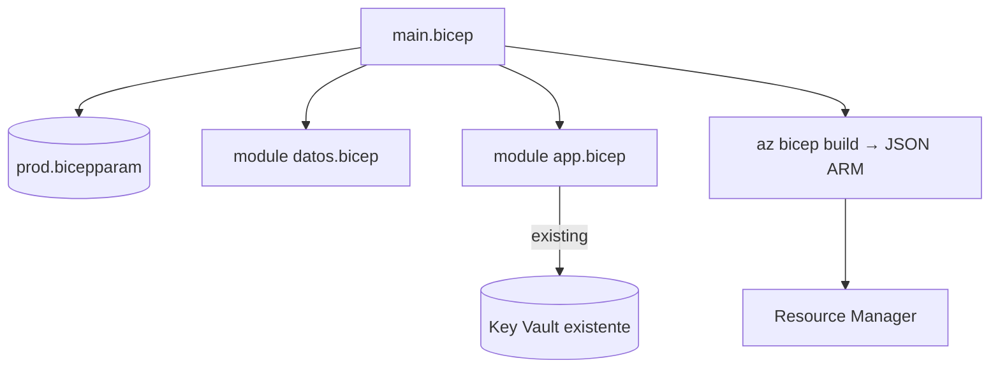

# Bicep

Parte de: [[07-Azure/10 Infraestructura como código/_Índice Infraestructura como código|Infraestructura como código]]

> [!info] Cómo avanzar
> `progreso`: **pendiente** → **viendo** (estudiando) → **visto** (contestaste la autoevaluación sin abrir las respuestas) → **dominado** (hiciste el laboratorio o lo aplicaste de verdad).

## Contenido

### Qué es
**Bicep** es un lenguaje declarativo de Microsoft para definir infraestructura de Azure. Es una capa más legible sobre [[ARM templates]]: escribes `.bicep` y se **compila a JSON de ARM** (`az bicep build`), que es lo que recibe Resource Manager. Por eso tiene **soporte inmediato** de cualquier tipo de recurso y versión de API nuevos, y **no tiene archivo de estado**: el estado es Azure mismo. Es la opción recomendada por Microsoft para IaC solo en Azure.

### Cómo funciona
Elementos principales:
- `param`: entradas, con tipo y **decoradores**: `@allowed([...])`, `@minLength()`, `@description()` y `@secure()`.
- `var`: valores calculados.
- `resource`: un recurso con su tipo y versión de API (`'Microsoft.Web/sites@2024-04-01'`). Las referencias entre recursos (`plan.id`) generan las dependencias **automáticamente**; casi nunca necesitas `dependsOn`.
- `output`: valores de salida.
- `module`: otro archivo Bicep (o un módulo de un registro) con sus propios parámetros y salidas.
- Archivos **`.bicepparam`** para los valores por ambiente.

**`@secure()`** marca un parámetro `string` u `object` como secreto: no se registra en el historial de despliegues ni se muestra en salidas o logs. No conviertas un secreto en `output`: el linter te lo advierte porque las salidas sí quedan visibles.

**`existing`** declara una referencia a un recurso que **ya existe** sin crearlo ni modificarlo: lees sus propiedades (`kv.properties.vaultUri`), lo usas como `scope` de una asignación de rol o como `parent` de un recurso hijo. Típico con un Key Vault o una red creados por otro equipo o en otro despliegue. Puede estar en otro grupo de recursos con `scope: resourceGroup('rg-red')`.

**Módulos.** Un archivo `.bicep` cualquiera es un módulo. Lo llamas con `module nombre 'ruta.bicep' = { name: ..., params: {...} }` y lees `nombre.outputs.x`. Permiten dividir la infraestructura (red, datos, app) y reutilizar piezas. También puedes consumir módulos publicados en registros, como el registro público de **Azure Verified Modules** (`br/public:avm/...`), mantenidos por Microsoft con buenas prácticas incluidas (revisa la versión vigente de cada módulo antes de fijarla).



### Ejemplo
`main.bicep` para Itzamna.Dionisio: plan, web app con identidad y lectura de un Key Vault existente.

```bicep
@allowed([ 'dev', 'prod' ])
param ambiente string
param location string = resourceGroup().location
param nombreKeyVault string

@secure()
@description('Llave de la API del proveedor de timbrado')
param llaveTimbrado string

var sufijo = 'dionisio-${ambiente}'

resource kv 'Microsoft.KeyVault/vaults@2023-07-01' existing = {
  name: nombreKeyVault
}

resource secretoTimbrado 'Microsoft.KeyVault/vaults/secrets@2023-07-01' = {
  parent: kv
  name: 'Timbrado-ApiKey'
  properties: { value: llaveTimbrado }
}

resource plan 'Microsoft.Web/serverfarms@2024-04-01' = {
  name: 'plan-${sufijo}'
  location: location
  sku: { name: ambiente == 'prod' ? 'P0v3' : 'B1' }
  kind: 'linux'
  properties: { reserved: true }
}

resource app 'Microsoft.Web/sites@2024-04-01' = {
  name: 'app-${sufijo}'
  location: location
  identity: { type: 'SystemAssigned' }
  properties: {
    serverFarmId: plan.id            // dependencia implícita
    httpsOnly: true
    siteConfig: {
      linuxFxVersion: 'DOTNETCORE|10.0'
      appSettings: [
        { name: 'Timbrado__ApiKey', value: '@Microsoft.KeyVault(SecretUri=${secretoTimbrado.properties.secretUri})' }
      ]
    }
  }
}

module rolKv 'modulos/rol-kv-secrets-user.bicep' = {
  name: 'rol-kv-${sufijo}'
  params: {
    nombreKeyVault: kv.name
    principalId: app.identity.principalId
  }
}

output url string = 'https://${app.properties.defaultHostName}'
```

```bicep
// modulos/rol-kv-secrets-user.bicep
param nombreKeyVault string
param principalId string

resource kv 'Microsoft.KeyVault/vaults@2023-07-01' existing = {
  name: nombreKeyVault
}

var secretsUser = subscriptionResourceId('Microsoft.Authorization/roleDefinitions', '4633458b-17de-408a-b874-0445c86b69e6')

resource asignacion 'Microsoft.Authorization/roleAssignments@2022-04-01' = {
  name: guid(kv.id, principalId, secretsUser)
  scope: kv
  properties: {
    principalId: principalId
    principalType: 'ServicePrincipal'
    roleDefinitionId: secretsUser
  }
}
```

```bicep
// prod.bicepparam
using './main.bicep'
param ambiente = 'prod'
param nombreKeyVault = 'kv-dionisio-prod'
param llaveTimbrado = readEnvironmentVariable('LLAVE_TIMBRADO')
```

```bash
az bicep build -f main.bicep                       # opcional: ver el JSON generado
az deployment group what-if -g rg-dionisio-prod -p prod.bicepparam
az deployment group create  -g rg-dionisio-prod -p prod.bicepparam
```

En el pipeline, `LLAVE_TIMBRADO` llega con `env:` desde un variable group vinculado a Key Vault (ver [[Azure Pipelines - variable groups]]). La práctica guiada está en [[Lab 6 - Bicep básico]]. Los SKUs como `P0v3` dependen de la región; verifica disponibilidad.

### Cuándo usarlo y cuándo no
Úsalo cuando toda tu infraestructura está en Azure y quieres la vía con menos fricción: sin estado que proteger, soporte día uno, `what-if` integrado y buena experiencia en VS Code con la extensión de Bicep. Si necesitas administrar también GitHub, Cloudflare, Datadog u otra nube con la misma herramienta, [[Terraform]] encaja mejor. Para tareas puntuales e imperativas (rotar algo, limpiar recursos) usa la CLI o [[PowerShell para Azure]].

### Errores comunes
- **Exponer secretos en `output`** o pasarlos como `string` normal.
- **`dependsOn` manual innecesario**: usa referencias simbólicas y deja que Bicep calcule el orden.
- **Nombres globales repetidos** (Storage, Key Vault, web apps): usa `uniqueString(resourceGroup().id)` como sufijo cuando aplique.
- **Asignaciones de rol con `name` aleatorio**: usa `guid(scope, principal, rol)` para que el nombre sea determinista y el despliegue sea idempotente.
- **Saltarse `what-if`**: en producción, revisa siempre el plan antes de aplicar.

### Para profundizar
- [¿Qué es Bicep?](https://learn.microsoft.com/azure/azure-resource-manager/bicep/overview)
- [Parámetros y decoradores](https://learn.microsoft.com/azure/azure-resource-manager/bicep/parameters)
- [Recursos existentes](https://learn.microsoft.com/azure/azure-resource-manager/bicep/existing-resource)
- [Módulos de Bicep](https://learn.microsoft.com/azure/azure-resource-manager/bicep/modules)

## Autoevaluación

Contesta primero en voz alta o en papel; luego despliega la respuesta.

> [!question]- ¿Qué es Bicep y cómo se relaciona con ARM?
> Un lenguaje declarativo más legible que **se compila a JSON de ARM** (`az bicep build`). Mismas capacidades que ARM desde el día uno, sin estado que administrar: el estado es Azure.

> [!question]- ¿Qué hace el decorador `@secure()`?
> Marca un parámetro como secreto: no se registra en el historial de despliegues ni se muestra en salidas.

> [!question]- ¿Para qué sirve `existing`?
> Referenciar un recurso que ya existe (sin crearlo) para leer propiedades o usarlo como `parent`/`scope`, p. ej. un Key Vault creado por otro equipo.

> [!question]- ¿Qué son los módulos?
> Archivos Bicep reutilizables con parámetros y salidas (`module st 'storage.bicep' = { name: 'st', params: {...} }`). También se pueden consumir del registro público de *Azure Verified Modules*.

## Práctica

- [[Lab 6 - Bicep básico]]

